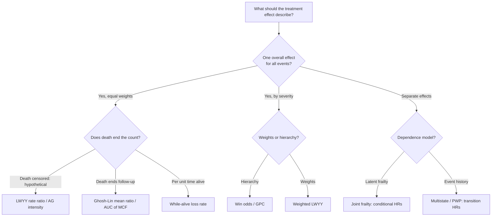

# Statistical review: Duoerkongjiang et al. 2026 on recurrent, competing and terminal events

Reviewed 2026-10-04 with `/review-article-stats`. Sources: PMC full text (PMC13571326); Appendix 1, a 30-page methods PDF; and Appendix 2, a 43-page PDF of R code with printed output. All three were read in full. Every effect estimate quoted below comes from the authors' printed R output in Appendix 2 or from Appendix 1 Table A1, not from reading the figures.

## Article summary and verified citation

**What it is.** A practice-oriented synthesis, not a new method. It sets out a "decision-guided framework" that maps about 25 analysis methods for multiple time-to-event endpoints to the question each one answers. It then fits all of them to one randomized trial and supplies the R code. The authors say plainly that methods in different branches target **different estimands**: marginal rates, conditional intensities, latent-frailty parameters, prioritized pairwise contrasts and transition hazards. The choice should therefore start from the scientific question, not the model.

**Design and data.** EAST-AFNET 4 is an open, blinded-outcome RCT of early rhythm control (n = 1395) versus usual care (n = 1394). It randomized 2789 patients at 135 sites, with median follow-up 5.1 years. The composite counts every event, not just the first: 521 heart-failure (WHF) hospitalizations, 161 cardiovascular (CV) deaths, 140 acute coronary syndromes (ACS) and 112 strokes, for 934 events in all. There were also 141 non-CV deaths, treated as a competing event. The analyses are deliberately unadjusted, with a two-arm comparison only.

**Your framing is accurate.** "Choose the survival question before the model" is the paper's thesis. The worked example is cardiovascular. The paper does not adopt the ICH E9(R1) attribute structure (population, treatment, variable, intercurrent-event strategy, summary measure). Each method gets a one-paragraph "target estimand" description, and intercurrent events other than death are not discussed.

| Field | Value |
|---|---|
| Title | Methods for analyzing recurrent and terminal events considering composite and competing endpoints in clinical trials: a practical overview |
| Authors | Alidan Duoerkongjiang, Antonia Zapf, Paulus Kirchhof, Ann-Kathrin Ozga (UKE Hamburg) |
| Journal | BMC Medical Research Methodology |
| Year / Volume / Article | 2026 / 26 / 206 |
| Dates | Received 2026-06-05; accepted 2026-09-07; published 2026-09-12 |
| DOI | 10.1186/s12874-026-03008-7 |
| PMID / PMCID | 42732052 / PMC13571326 (PubMed ID conversion, 2026-10-04) |
| Publisher / Licence | BioMed Central (Springer Nature) / CC BY 4.0 |
| BibTeX | [duoerkongjiang-2026-recurrent-terminal-events.bib](duoerkongjiang-2026-recurrent-terminal-events.bib), which also holds EAST-AFNET 4 (PMID 32865375) |
| Retraction / correction | None found. The record is too new for any to be expected; the PubMed metadata endpoint returned an API error, but the ID conversion and title search both resolved. |
| Data / code | Trial data not public (available on request). Code is in Appendix 2 PDF; the WHR, Wei–Lachin and Bakal helper functions are called but **not listed**. |

## Extracted statistical methods

All values are treatment vs control from the authors' printed output. "MB" means model-based SE.

| Family | Method (R call in Appendix 2) | Estimand as the authors describe it | Estimate (95% CI) |
|---|---|---|---|
| Reference | Cox, time to first event | first-event cause-specific hazard | 0.78 (0.66–0.92) in text; "0.79" in the summary |
| Composite, unweighted | Andersen–Gill: `coxph(Surv(start, stop, ev) ~ arm)` | intensity among those under observation | 0.759 (0.667–0.864), MB |
| | LWYY: AG + `cluster(id)` | marginal rate ratio | 0.759 (0.623–0.925), robust SE 1.53× MB |
| | Weibull AFT, all events (`flexsurvreg`) | acceleration factor | AF 1.35 (1.17–1.56) |
| | "Stratified" Weibull AFT | event-order AF | AF 1.26 (1.06–1.51); see D6 |
| | PWP: `+ strata(enum)` | conditional HR within event order | 0.850 (0.745–0.971), MB, no `cluster()` |
| | WLW: `+ strata(enum)` on 41 835 rows | marginal event-order HR | 0.748 (0.657–0.851), MB, no `cluster()`; see D2 |
| | Negative binomial: `glm.nb(n ~ arm + offset(log fu))` | incidence-rate ratio | 0.710 (0.561–0.898); θ = 0.128 |
| Composite, weighted | Weighted LWYY: `Wcompo::CompoML`, weights 1/0.8/0.5/0.5 | weighted mean ratio | 0.760 (0.630–0.915) |
| | Weighted all-cause HR (WHR): parametric / stratified / non-parametric (own code) | weighted cause-specific hazard ratio | 0.805 (0.610–1.081) / 0.664 (0.023–11.9, not converged) / 0.710 (0.420–1.031), bootstrap CIs |
| | Wei–Lachin / stratified Wei–Lachin (own code) | weighted log cause-specific HR | 0.755 (0.584–0.926) / 0.815 (0.644–0.987); see D5 |
| | Bakal weighted KM / log-rank (own code) | none defined | p = 0.0021 |
| Ordered | `WINS::win.stat`, 7 tiers | win ratio / win odds / net benefit | WR 1.31 (1.11–1.55); WO 1.10 (1.04–1.17); NB 0.048 (0.018–0.077), p = 0.0015 |
| | `BuyseTest`, same 7 tiers, Peron scoring | net treatment benefit | Δ 0.067 (−0.064 to 0.196), p = 0.31; see D4 |
| Several effects | Joint frailty, semi-parametric (`frailtyPenal`, composite + non-CV death) | conditional HRs | recurrent 0.743, plotted 0.64–0.87; terminal 1.00; θ 1.06, α 1.21 |
| | Joint frailty, non-fatal events + CV death | conditional HRs | 0.747 / CV death 0.697; α 2.10 |
| | Joint frailty, parametric (Weibull) | conditional HRs | 0.742 (0.636–0.866); α 0.05 (p = 0.68); the log-normal variant did not converge |
| | Ghosh–Lin (`reReg`, `model = "cox.GL"`, B = 200), non-fatal events, CV death terminal | marginal mean ratio | 0.768 (0.622–0.948); CV death HR 0.722 (0.527–0.987) |
| | Multistate model, 20 transitions, `coxph(... + strata(trans))` | transition HRs | global LR p = 0.10; start → non-CV death 1.13 (0.75–1.71) |
| Event burden | AUC under the mean cumulative count (`MCC::CompareAUCs`) | ratio of areas at τ = 3132 days | 0.773 (0.623–0.96); difference −184 days (−340 to −28) |
| | While-alive (`WA::LRfit`, τ = maximum observed time) | loss rate per unit time alive | 0.79 (0.53–1.19); see D3 |
| Descriptive | Nelson–Aalen (`mvna`), Aalen–Johansen (`etm`), state occupation | group-specific curves | no effect estimate |

The paper names, but does not fit, a group of further approaches: Bayesian models, pseudo-observations, additive models, and the Fine–Gray model, which it discusses only to say it answers a different question.

## Independent verification

Script: [duoerkongjiang-2026-recurrent-terminal-checks.R](duoerkongjiang-2026-recurrent-terminal-checks.R). It ran clean on 2026-10-04 with R 4.6, survival 3.8.12, reReg 1.4.7, WA 1.0 and frailtypack 3.8.1, and every `stopifnot` passed. It uses public R datasets only.

1. **The reported arithmetic is internally consistent.**
   - The win proportions (20.18% vs 15.38%) reproduce WR 1.31, WO 1.10 and 1/WO 0.91, which implies **64.4% tied pairs**.
   - The severity weights 1/0.5/0.5/0.8 reproduce the Wei–Lachin weights 0.36/0.18/0.18/0.29.
   - 140 + 161 + 112 + 521 = 934 composite events.
   - Against the published primary analysis: EAST-AFNET 4 (NEJM 2020;383:1305, verified in PubMed) reported **HR 0.79, 96% CI 0.66–0.94**. The article gives "0.78 (95% CI 0.66–0.92)" in the Data section and "0.79" in its summary.
2. **The while-alive estimator matches `WA::LRfit` once its convention is known.**
   - On `frailtypack::readmission` (403 colorectal-cancer patients, 458 readmissions, 109 deaths), a hand-coded Mao (2023) estimator reproduces `WA::LRfit` exactly: ratio 0.64104 for both, at τ = 1500.
   - The textbook form gives 0.63703. The difference is that WA multiplies by S(t), not S(t−), and integrates RMST with a right-endpoint sum on the event grid.
   - Any ClinicoPath oracle test must either use WA's convention or allow a tolerance of about 1%.
3. **The same randomized trial gives different answers under different estimands.** This uses `survival::bladder1`, a VA superficial bladder-cancer RCT of thiotepa vs placebo: 85 patients, 132 recurrences, 21 deaths.

   | Estimand / method | Thiotepa vs placebo |
   |---|---|
   | Time to first recurrence or death (Cox HR) | 0.77 (0.45–1.31) |
   | Andersen–Gill HR, model-based SE | **0.66 (0.46–0.95)** |
   | LWYY rate ratio, robust SE | 0.66 (0.37–1.18) |
   | PWP counting-process HR, robust SE | 0.81 (0.54–1.22) |
   | Negative binomial IRR | 0.74 (0.42–1.32) |
   | Ghosh–Lin mean ratio (death terminal) | 0.67 (point estimate) |
   | While-alive loss-rate ratio, τ = 50 months | 0.71 (0.39–1.31) |

   The only "significant" result, Andersen–Gill with model-based variance, vanishes when within-patient dependence is respected. That is the article's AG-vs-LWYY point, made with a pathology dataset. In this dataset, 9 patients' final record is a recurrence, and reReg refuses those patients until a closing censoring record is added. That is the same practical limit the article reports for Ghosh–Lin ("this process has to end with censoring").

## Discrepancies between the text, the code and the appendices

| # | Finding | Evidence | Consequence |
|---|---|---|---|
| D1 | Reference time-to-first-event HR is quoted two ways | Data section 0.78 (0.66–0.92); Results summary 0.79; published 0.79 (96% CI 0.66–0.94) | Minor. State which is the re-fit and why the CI level differs. |
| D2 | **WLW variance ignores clustering** | `coxph(Surv(stop, ev) ~ arm + strata(enum), data = dataWLW)`: 41 835 rows from 2789 patients, no `cluster()` | The 0.66–0.85 interval is invalid. WLW requires the robust sandwich because every patient contributes to every stratum. The text's own simulation remark ("higher standard deviations") is the opposite of what the figure shows. |
| D3 | **While-alive and AUC code disagree with the main text** | Text: "only non-CV death restricts the time being alive (CV death is part of the composite)", and the ratio is called "the rate of the composite events". Code: in `data_sel`, subject 3 (a CV death at day 1420 in every other data structure) has `status = 2`, which WA/MCC read as death. `LRfit` runs with the default `Dweight = 0`. Appendix 1 Table A1 calls the result "recurrent **non-fatal** event burden". | As coded, CV death ends the time alive and adds zero loss. The 0.79 is a non-fatal-event-only while-alive rate, not the composite rate the text describes. Only six rows of `data_sel` are printed, so the coding of non-CV death cannot be confirmed. |
| D4 | **WINS and BuyseTest disagree on the same hierarchy** | WINS NB 0.048 (0.018–0.077), p = 0.0015; BuyseTest Δ 0.067 (−0.064 to 0.196), p = 0.31; the CI is about 4× wider | Unreconciled. The two differ in how they score censored pairs (WINS uses Pocock-type rules, BuyseTest uses Peron's probabilistic scoring with 81% uninformative pairs at tier 1). The text calls this "a small group difference", which hides that the two contradict each other. |
| D5 | Wei–Lachin CIs are on the ratio scale | Both intervals are exactly symmetric about the estimate (midpoints 0.7553 and 0.8152) | Wald on the HR scale rather than log(HR); poor coverage for small HRs. Helper code not provided. |
| D6 | The "stratified" parametric model is not stratified | `flexsurvreg(... ~ arm + enum, anc = list(shape = ~enum))` | Event number enters as a linear trend on log-scale and shape. That is not a separate baseline per event order as in PWP. |
| D7 | Joint frailty CIs use a different SE from the package's own test | Plotted CI from `varH` (SE 0.0789 → 0.64–0.87). frailtypack's printed z = −2.695 = coef / SE(HIH) 0.1103 → 0.60–0.92 | The figure and Table A1 understate uncertainty for the semi-parametric joint frailty model. |
| D8 | Joint frailty association differs by an order of magnitude | Semi-parametric α 1.21 (p < 1e−11) vs parametric α 0.05 (p = 0.68) | The text says "the HRs coincide". True for the recurrent HR, but the latent dependence structure is not robust to the baseline specification. |
| D9 | PWP has no robust variance | `strata(enum)` without `cluster(id)` | Minor. Robust SE is the usual recommendation (Kelly & Lim 2000). |
| D10 | Win-ratio hierarchy uses "time to *last* event" tiers, and the Table A1 wording leaves out the CV-death tier | Tiers 3, 5 and 7; Table A1 describes wins as "fewer composite events, … a later last event" | An unusual tie-break with no stated rationale. |

## Critical evaluation

**Overall rating: 🟡, a sound conceptual guide with a worked example whose code should not be copied as-is.**

The decision framework is the paper's real contribution, and it is correct. It keeps the following kinds of contrast apart: conditional vs marginal, intensity vs rate vs mean, latent-variable vs population-average, and pairwise vs model-based. It warns against Bakal and against the win ratio when ties are heavy, and it tells readers to prespecify one primary analysis.

The weaknesses are in two places:
- **Implicit estimand choices.** Non-CV death is treated as independent censoring almost everywhere. That is a hypothetical strategy for every marginal-rate method, and it is never named as one.
- **The application code.** WLW variance, joint frailty and Wei–Lachin intervals, and the while-alive coding (D2–D7) all have errors. A reader who copies them inherits incorrect intervals.

**Methodological point the paper underplays.** Treating a competing death as independent censoring is legitimate for **hazard** models: AG and PWP then estimate cause-specific intensities. For **marginal rate or mean** methods (LWYY, weighted LWYY, AUC/MCF), censoring at death silently changes the estimand to "the event rate in a world where nobody dies of other causes". If death is associated with recurrence, the implied mean count is biased for the observable world.

The paper's justification (Troendle) concerns Cox versus Fine–Gray for a single event, not marginal rate models. Its own cited evidence points the same way as this critique: Liu found that LWYY did not control type I error when mortality differed. Ghosh–Lin and while-alive exist precisely to give death its proper role, but in the application even Ghosh–Lin uses only CV death as terminal. The paper does not name an ICH E9(R1) strategy for non-CV death (hypothetical, composite or while-alive) for each method. It also does not discuss treatment discontinuation or crossover after a first event, which Claggett et al. showed governs the power gain from recurrent-event methods.

| Aspect | Assessment | Evidence | Recommendation |
|---|:-:|---|---|
| Design–method alignment | 🟢 | Framework (Methods, Fig. 2); "different estimands" stated explicitly | Add a per-method ICH E9(R1) attribute table. |
| Assumptions & diagnostics | 🟡 | Schoenfeld and Markov checks recommended in the Discussion; none reported for EAST-AFNET 4; the AG-vs-PWP difference (0.76 vs 0.85) is read as "event dependence" without a test | Report a PH test per model, and a Markov check (prior-event count as covariate). |
| Sample size & power | 🟡 | Not applicable to a tutorial; power literature cited (Claggett, Gregson, Fritsch) | Note that recurrent-event power gains depend on heterogeneity and post-event discontinuation. |
| Multiplicity | 🟡 | About 20 analyses of one trial; "all point the same way" offered as confirmation | They are not independent replications. Prespecify one primary analysis. |
| Model specification & competing death | 🟡 | Non-CV death censored for marginal methods; D2, D6 | Name the strategy; use all-cause death as terminal for Ghosh–Lin and while-alive. |
| Censoring / missing data | 🟡 | Independent censoring assumed throughout; τ for while-alive = last observed time | Choose τ where a meaningful risk set remains, and prespecify it. |
| Effect sizes & CIs | 🟡 | Estimates and CIs given for every method, but D2, D5 and D7 intervals are mis-computed and D4 is unreconciled | Robust WLW variance, HIH-based joint frailty CIs, log-scale Wei–Lachin CIs. |
| Validation & calibration | N/A | Not a prediction paper | — |
| Reproducibility | 🟡 | Full `sessionInfo()` and code PDF are good; data not public; WHR, Wei–Lachin and Bakal functions missing; `MCC` 0.7.1 is not on CRAN | Release a code repository with the helper functions and a synthetic dataset. |

| Aspect | Score (0–2) | Badge |
|---|:-:|:-:|
| Design–method alignment | 2 | 🟢 |
| Assumptions & diagnostics | 1 | 🟡 |
| Sample size & power | 1 | 🟡 |
| Multiplicity | 1 | 🟡 |
| Model specification & confounding | 1 | 🟡 |
| Missing data / censoring | 1 | 🟡 |
| Effect sizes & CIs | 1 | 🟡 |
| Validation & calibration | N/A | — |
| Reproducibility | 1 | 🟡 |
| **Total** | **9/16** (validation excluded) | 🟡 Moderate |

**Red flags present:** model-based variance where a clustered variance is required (WLW); a win ratio with 64% ties (the authors correctly prefer win odds); a parametric WHR and a joint frailty model that did not converge, kept in the presentation; and ratio intervals computed on the linear scale.

**Should you read it in full?** Yes, if you analyze recurrence. Read Fig. 2 and Table 1 for the decision map, Appendix 1 for the per-method assumptions, and Appendix 2 as a catalogue of R calls, keeping D2–D7 in mind. For an oncology endpoint the takeaways are these:
- Time to first recurrence (DFS-type endpoints) discards later recurrences.
- A single Cox model cannot answer "how much recurrence burden does a patient carry while alive".
- The estimand must say what death does to the count.

## ClinicoPath coverage matrix

**Status first.** Of the analyses that hold any recurrent-event code, every one is a parked draft (`D`/`T` suffix). **No shipped analysis fits a recurrent-event model.** In production, `multisurvival` (`Survival`) covers time to first event, Fine–Gray, and the Aalen–Johansen CIF. `survival` (currently routed `SurvivalT`) adds a cumulative-incidence table and RMST.

| Article method | ClinicoPath analysis (menuGroup) | Coverage | Notes |
|---|---|:-:|---|
| Cox, time to first event | `survival` (SurvivalT), `multisurvival` (Survival) | ✅ | |
| Aalen–Johansen CIF / Fine–Gray (Discussion) | `multisurvival` ✅; `competingsurvival`, `finegray` (SurvivalD) | ✅ | Production path is `multisurvival`. |
| Andersen–Gill | `recurrentsurvival` (OncoPathD) | ❌ | Fits `Surv(event_time, status)` from time 0 on every row (`R/recurrentsurvival.b.R:364`). The (start, stop] columns it builds are never used, so the risk set is wrong. |
| LWYY (AG + robust SE) | `recurrentsurvival` (`robust_variance`) | ❌ | Same wrong risk set. A correct fit is one line: `coxph(Surv(start, stop, ev) ~ x + cluster(id))`. |
| PWP-CP / PWP-GT | `recurrentsurvival` `model_type` | ❌ | Stub that only prints a note (`b.R:414-452`). |
| WLW | none | ❌ | |
| Parametric AFT on all events | none (`flexparametric` handles single events) | ❌ | Low priority. |
| Negative binomial IRR | none (`hierarchicalpathology` uses glmmTMB NB for a different purpose) | ❌ | |
| Weighted LWYY / WHR / Wei–Lachin / Bakal | none | ❌ | Bakal deliberately excluded (not recommended). |
| Win ratio / win odds | `winratio` (SurvivalD) | 🟡 | Hand-coded Pocock comparison with time-to-event and continuous tiers, plus WO and net benefit. It has no event-count tier, so it cannot express the article's hierarchy. |
| Generalized pairwise comparisons (BuyseTest) | `winratio` | 🟡 | No Peron scoring and no thresholds. |
| Joint frailty (recurrent + terminal) | `jointfrailty` (SurvivalD) | ❌ | Calls `frailtypack::jointfrailty()`, which does not exist in frailtypack 3.8.1. The fallback passes arguments that `frailtyPenal` does not accept (`b.R:291-314`). |
| Ghosh–Lin marginal mean | `recurrentsurvival` (`use_reReg`, `cox_GL`) | ❌ | Passes `terminal=` to `reReg::reSurv`, which has no such argument; also uses invalid SE names and the invalid models `am.LWYY` and `sc.XCYH` (`b.R:684-712`). |
| reReg joint model | `marginalrecurrent` (SurvivalD) | 🟡→❌ | Fits, but the coefficients table is **always empty** (see M1). Labelled "marginal", it fits `cox|cox`, a joint model and not the Ghosh–Lin mean. On `readmission` that gives recurrent RR 0.81, against cox.GL 0.64. |
| Multistate (transition HRs, Aalen–Johansen) | `illnessdeath`, `flexmultistate` (SurvivalDT); `multistatesurvival`, `markovmultistate` (SurvivalD) | 🟡 | `illnessdeath` gives Aalen–Johansen occupation and per-transition Cox with `cluster(id)`; its reversible structure allows repeated illness. `markovmultistate` returns mock results; `multistatesurvival` calls undefined helpers. |
| Nelson–Aalen (multi-transition) | none | ❌ | |
| AUC under the mean cumulative count | none | ❌ | Computable from the Ghosh–Lin mean with no new dependency. |
| While-alive loss rate | none (zero hits) | ❌ | |
| RMST (the while-alive denominator) | `rmst`, `rmstregression` (ClinicoPathD); `survival` `rmst_analysis` | ✅ | |

Mapping caveat: on a generous reading, `recurrentsurvival` and `marginalrecurrent` count as 🟡 because the options exist. On a conservative reading, which this review uses, nothing that cannot produce a correct number counts as covered.

### Module defects found while mapping (all in parked drafts; none shipped)

- **M1. `marginalrecurrent` never shows coefficients.**
  - Where: `R/marginalrecurrent.b.R` `.populateCoefficients()` reads `summary(fit)$coef` and the columns `"SE"`, `"z"`, `"Pr(>|z|)"`.
  - What reReg actually returns: reReg 1.4.7 gives `coefficients.rec` / `coefficients.haz` with columns `StdErr`, `z.value`, `p.value`.
  - With a terminal event, `$coef` partially matches both names and returns `NULL`, so the table is silently empty.
  - Without one, the column subscript errors inside `tryCatch` and an all-NA row is shown.
  - Also: `se = "sand"` gives `NA` SEs under `cox|cox`, so only the bootstrap produces intervals.
  - Verified by executing the analysis under `devtools::load_all()` on `readmission` (0 coefficient rows) and by section 4 of the checks script.
- **M2. `recurrentsurvival`'s Andersen–Gill fit uses the wrong time scale.** The other `model_type`s are stubs, the reReg path cannot run, and all 8 image renderers return `FALSE`.
- **M3. `jointfrailty` cannot fit.** It calls a non-existent function, and its fallback ignores the terminal event.
- **M4. Mock or simulated results.** `markovmultistate` (mock results) and `marginalrecurrent` (`rnorm` residual plot) would trip `check_fabricated_stats` on promotion.

## Gap analysis

| Gap | Where the article uses it | Pathology relevance | Closest analysis | Missing pieces |
|---|---|---|---|---|
| Correct AG / LWYY / PWP on (start, stop] data | Table 1, Fig. 4 | Bladder (NMIBC), colorectal adenoma and skin-cancer recurrence; readmissions | `recurrentsurvival` | Counting-process `Surv(start, stop, ev)`, `cluster(id)`, `strata(enum)`, gap-time option |
| Ghosh–Lin mean count with death terminal, plus the mean cumulative count plot | GL section; the AUC method builds on it | "Expected number of recurrences per patient by 5 years", accounting for death | `recurrentsurvival` / `marginalrecurrent` | A working `reReg cox.GL` call with all-cause death terminal; closing-record handling |
| While-alive loss rate | WA section | Recurrence burden per year alive, when one arm lives longer | none | Estimator, τ, death weight |
| Negative binomial IRR | Table 1 | Simple and widely reported (adenoma counts, readmissions) | none | `MASS::glm.nb` with a log follow-up offset |
| Joint frailty | JF section | Recurrence with informative death | `jointfrailty` | Rewrite to `frailtyPenal(... + terminal(d), formula.terminalEvent =)`, report HIH SEs |
| Win ratio with count tiers | WR/WO section | Hierarchical composites (death, then number of recurrences) | `winratio` | A count tier, WO-first reporting, a tie fraction |

## Roadmap

The recommendation is **one working recurrent-event analysis, not seven new ones**. Repair `recurrentsurvival` (OncoPathD, oncology-facing) around a question-first selector, delete its stubs, and route the other drafts to it. This follows the article's own thesis. Everything below except `WA` uses packages already in `Imports`: survival, MASS, reReg, frailtypack.

### P0: Make the core estimands correct in `recurrentsurvival`

**`.a.yaml`**: replace `model_type`/`time_scale` with an estimand-first list, and require the death indicator explicitly.

```yaml
    - name: estimand
      title: Question (estimand)
      type: List
      options:
        - name: ttfe
          title: Time to first event (Cox HR)
        - name: ag
          title: Event intensity among those under observation (Andersen-Gill)
        - name: lwyy
          title: Marginal event rate, death censored (LWYY)
        - name: pwp
          title: Next-event hazard given event history (PWP)
        - name: ghoshlin
          title: Mean number of events, death ends follow-up (Ghosh-Lin)
        - name: whilealive
          title: Events per unit time alive (while-alive)
        - name: negbin
          title: Event count per follow-up time (negative binomial)
      default: lwyy
    - name: tau
      title: Time horizon (while-alive)
      type: Number
      min: 0
      default: 0          # 0 = 90th percentile of follow-up, stated in a note
```

**`.b.R`** (sketch). One fit per estimand, and each table row carries how death is handled.

```r
f <- jmvcore::asFormula(paste("survival::Surv(start, stop, ev) ~", rhs))
fit <- switch(self$options$estimand,
  ag   = survival::coxph(f, data = d),                                  # MB variance by design
  lwyy = survival::coxph(update(f, . ~ . + cluster(id)), data = d),
  pwp  = survival::coxph(update(f, . ~ . + strata(enum) + cluster(id)), data = d),
  negbin = MASS::glm.nb(n ~ trt + offset(log(fu)), data = perSubject),
  ghoshlin = reReg::reReg(reReg::Recur(stop, id, ev, death) ~ trt,     # all-cause death terminal
                          data = closeRecords(d), model = "cox.GL", B = self$options$B),
  whilealive = WA::LRfit(d$id, d$stop, status3, d$trt))                 # status: 0/1 rec/2 death
deathNote <- c(ag = "death = censoring (cause-specific intensity)",
               lwyy = "death = censoring (hypothetical: no deaths)",
               ghoshlin = "death ends the count (observable world)",
               whilealive = "rate per unit time alive up to tau")
```

`closeRecords()` appends a censoring record at the last time, plus a small epsilon, for subjects whose final row is an event. That is the reReg constraint in check 3; reuse its logic.

**`.r.yaml`**: one `estimates` table with columns `estimand`, `method`, `deathHandling`, `estimate`, `lower`, `upper`, `p` (`format: zto,pvalue`). Add an MCF image (`requiresData: false`; its state is the step-function data frame).

**`.u.yaml`**: a variable box for `start`, `stop`, `event` and the death indicator, with `estimand` as a ComboBox under "Question".

Also delete the stub branches (PWP via note, frailty, msm), the unused options and the 8 `FALSE` renderers. Set `marginalrecurrent` aside, or fix M1 and relabel its `cox|cox` fit as "joint recurrent/terminal model". No `menuGroup` change: promotion is a release decision (review guide §24).

### P1: Fix the `marginalrecurrent` extraction (M1), a small change

```r
s <- summary(fit)
co <- s$coefficients.rec                         # exact name: no partial matching
se <- co[, "StdErr"]; z <- co[, "z.value"]; p <- co[, "p.value"]
# plus, when terminal: s$coefficients.haz into a second table
```

Gate the sandwich SE under `cox|cox`: when SE is `NA`, require bootstrap and say so in `setNote()`.

### P2: `jointfrailty` rewrite

```r
frailtypack::frailtyPenal(Surv(start, stop, ev) ~ trt + cluster(id) + terminal(death),
                          formula.terminalEvent = ~ trt, data = d, recurrentAG = TRUE,
                          hazard = "Weibull")          # splines: n.knots, kappa required
# Report SE(HIH) for penalised fits (fit$varHIH); flag non-convergence
```

### P3: Count tier in `winratio`, and AUC under the mean cumulative count

Add a "fewer events" count tier type, report the tie fraction, and lead with win odds when ties exceed 50%. The AUC is the integral of the Ghosh–Lin step function up to τ, which needs no `MCC` dependency (MCC is not on CRAN).

## Test plan

- **Oracles, using public data only:**
  - LWYY: `coxph` on `bladder1` must give 0.66 (0.37–1.18).
  - While-alive: `WA::LRfit` ratio at 1e−5 tolerance (WA convention).
  - Ghosh–Lin: `reReg cox.GL` point estimate 0.67 on `bladder1`.
  - Negative binomial: `MASS::glm.nb` 0.74.
- **Regression test for M1:** the coefficients table has ≥ 1 row with a finite estimate when `terminal_event` is supplied.
- **Edge cases:**
  - a subject whose last record is an event (closing-record path)
  - zero-length intervals
  - a single event per subject (all methods should reduce to the Cox model or its variants)
  - one arm with no deaths
  - τ beyond the last follow-up time
- **Death-handling sentence:** each estimand's `deathHandling` cell is non-empty and differs between `lwyy` and `ghoshlin`.

## Dependencies

| Package | Status | Use |
|---|---|---|
| survival, MASS, reReg, frailtypack | already in Imports | AG/LWYY/PWP, NB, Ghosh–Lin, joint frailty |
| WA 1.0 | **new**; CRAN, no imports, one exported fitter | While-alive point estimate and influence-function SE. A hand-coded alternative (in the checks script) gives the point estimate but not the variance. |
| BuyseTest, WINS, Wcompo | not proposed | Defer until a count tier or weighted composites are actually requested. |

## Prioritization

1. **P1, M1 fix in `marginalrecurrent`** (high impact, about 10 lines): turns an always-empty table into real output.
2. **P0, estimand-first rewrite of `recurrentsurvival`** (high impact, medium effort): delivers the article's framework, three verified oracles already exist, and the oncology use cases are direct.
3. **P2, `jointfrailty` rewrite** (medium impact, medium effort).
4. **P3, win-ratio count tier and the AUC** (medium impact, low effort).
5. Weighted composites (WHR, Wei–Lachin, weighted LWYY): low priority. Weights are hard to justify in pathology endpoints, and there is no CRAN implementation for most of them.

## Diagram: the question decides the method



## Reproducibility, sources and limits

- Sources read in full: PMC full text, Appendix 1 (30 pages) and Appendix 2 (43 pages), both downloaded from Springer static content. The PMC supplementary links returned HTML. The NEJM primary-result abstract was verified through PubMed.
- Not reproducible here: the EAST-AFNET 4 analyses, since the data are not public. The checks script reproduces the article's arithmetic and verifies the estimators on public datasets.
- `readmission` is observational, so its chemotherapy contrasts show the estimand mechanics only and have no causal reading. `bladder1` is randomized, but small (85 patients), and the comparison is thiotepa vs placebo only.
- D3 rests on 6 printed rows of `data_sel`. The coding of non-CV death in the full data is not shown.
- An earlier figure-readout pass gave wrong numbers (for example, "WHR 0.77") and was discarded. All figures here come from printed R output or Table A1.

## Skills and agents invoked

| Skill / agent | Phase | Purpose |
|---|---|---|
| `review-article-stats` | all | Canonical workflow |
| PubMed MCP (pubmed-database role) | Citation | DOI → PMID/PMCID, full text, EAST-AFNET 4 primary result |
| `pdf` role, via `pdftools` | Ingestion | Appendix 1 and 2 extraction |
| `statistical-analysis` / `scikit-survival` roles | Evaluation | Done directly in R (survival, reReg, WA, MASS); the R reference implementations were authoritative |
| Explore agent (catalog) | Catalog | 23 analyses catalogued. Its key claims were spot-checked against the code (`recurrentsurvival:364`, `reSurv` formals, the `jointfrailty` existence check) and M1 was found by executing the analysis. |

No skill was invoked through the Skill tool beyond `review-article-stats`. Citation, PDF and statistical work was done directly with the tools above.
