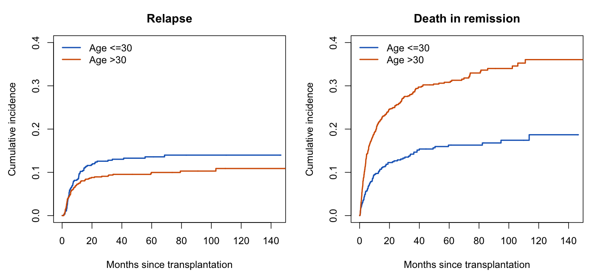

# Statistical review: Putter and Andersen on cure models

**Review completed:** 4 October 2026; source records checked 3 October 2026. **Overall assessment:** 🟡 The observed-time competing-risk recommendation is well supported; the stronger identification and testing arguments require material qualifications. Your summary is a fair description of the practical message, provided “cure” is defined by endpoint and modeling framework.

This review combines full-text and appendix reading, inspection of the authors’ code and PDF supplements, independent calculations on their public AML example, an independent mathematical check, and source inspection of the ClinicoPath repository at review time. The review itself did not change production code. Subsequent authorized implementation is recorded in the [implementation guide](putter-andersen-2026-implementation.md); the source findings and line numbers below describe the pre-implementation state.

## Article summary and verified citation

This is a methodological argument illustrated with transplantation data and simulations, rather than a treatment-effect study or systematic review. Its central concerns are competing death, limited tail information, and dependence of latent cure inference on assumptions. It also discusses hybrid illness-death cure models and explicitly distinguishes statistical cure relative to population mortality. [Published article, Sections 1–5](https://link.springer.com/article/10.1007/s10985-026-09729-7).

| Field | Verified value |
|---|---|
| Title | *No cure for cure models: killed by competing risks* |
| Authors | Hein Putter; Per Kragh Andersen |
| Journal | *Lifetime Data Analysis* |
| Publication | 10 September 2026; volume 32, issue 4, article 51 |
| Pages | Article number 51; 18 pages in the institutional record, not a verified page range |
| DOI | [10.1007/s10985-026-09729-7](https://doi.org/10.1007/s10985-026-09729-7) |
| PMID / PMCID | [42722803](https://pubmed.ncbi.nlm.nih.gov/42722803/) / PMC13562180 |
| Publisher | Springer Science and Business Media LLC / Springer Nature |
| ISSN | 1380-7870; electronic 1572-9249 |
| License | CC BY 4.0, as stated by the publisher |
| BibTeX | [Verified bibliography entry](putter-andersen-2026-cure-models.bib), generated from Crossref metadata |
| Correction/retraction check | No notice was displayed on the publisher or PubMed records checked on 3 October 2026; Crossref supplied no update-to relationship. This is a record check, not exhaustive correction surveillance. |
| MeSH | No assigned MeSH headings found in the retrieved record; TODO if indexing is later updated. Author keywords are not MeSH terms. |

Metadata agree across the [publisher](https://link.springer.com/article/10.1007/s10985-026-09729-7), [PubMed](https://pubmed.ncbi.nlm.nih.gov/42722803/), [Crossref record](https://api.crossref.org/works/10.1007/s10985-026-09729-7), and [author’s institutional record](https://researchprofiles.ku.dk/en/publications/no-cure-for-cure-models-killed-by-competing-risks/).

## Methods and the questions they answer

The source locations below distinguish methods actually used from approaches discussed as context. The authors’ [analysis repository](https://github.com/survival-lumc/CureModels/tree/d289028c90b45bf7c1278c272f86a7e9dbc65a07) supplies the computational details.

| Method | Role and source | Assumptions or interpretation to check |
|---|---|---|
| Kaplan–Meier for relapse with death censored | Deliberate comparison in Section 2 and `BMT-cure-short.R` | Its complement is not observed-world recurrence CIF. Censoring death in a cause-specific hazard fit is a different, legitimate operation. |
| Aalen–Johansen / cumulative incidence | Main descriptive alternative, Section 2 | Preserve each competing event and event time; require appropriate independent administrative/loss-to-follow-up censoring, possibly conditional on covariates. |
| Cause-specific Cox models for relapse and death in remission | Covariate illustration, Section 2 | Age is dichotomized; HR is a rate contrast among those still event-free. CIF prediction requires all relevant cause-specific hazards. |
| Logistic-incidence, PH-latency mixture cure model | Sections 2–4; `intsurv`, comparison with `smcure` | Check whether coefficients parameterize susceptible or cured probability, susceptible-tail properness, latent conditional PH, and tail completion. |
| KM and reverse KM; changing censoring horizons | Follow-up illustration, `Cure_fup.qmd` | Reverse KM estimates follow-up support; it does not establish lifetime cure. |
| Simulated reference distributions for tail and follow-up statistics | Appendix 1; `Cure_fup.qmd` | Calibration must belong to the stated null and have the intended rejection tail. |
| PH/non-PH latent-mixture equivalence and simulation | Section 4, Appendix 2; `Cure_model_simulation.R` | Distinguish a designated latent class weight from total probability mass at infinity. |
| Promotion-time, frailty, hybrid illness-death, and relative-survival cure models | Conceptual context, Sections 1 and 5 | Different estimands; they cannot be rejected or validated by a single-event example alone. |
| Interval-censored progression | Discussion in Section 3 | Scheduled assessments supply intervals, not necessarily exact progression times. |

Fine–Gray regression is a relevant software alternative below; it is **not** the regression fitted in the authors’ AML comparison.

## Independent numerical verification

The [public data](https://multi-state-book.github.io/companion/data/bmt.csv) and the [authors’ preparation code](https://github.com/survival-lumc/CureModels/blob/d289028c90b45bf7c1278c272f86a7e9dbc65a07/BMT-cure-short.R) reproduce 1,406 AML patients: 570 aged ≤30 and 836 aged >30; 154 relapses and 343 deaths before relapse. There are no missing values in the reconstructed time, event, and age-group fields. This does not establish complete ascertainment or noninformative loss to follow-up.

I implemented the Aalen–Johansen recursion directly and checked both cause-specific CIF curves against `cmprsk::cuminc()` to tolerance `1e-12`. The event-free probability plus both CIFs also sums to one within that tolerance. These are new calculations, not copied article results.

| At 120 months | Age ≤30 | Age >30 |
|---|---:|---:|
| Recurrence CIF | 13.9825% | 10.8825% |
| Death-in-remission CIF | 18.6894% | 36.0612% |
| Alive without either event | 67.3281% | 53.0563% |
| Number still at risk just before 120 months | 34 | 42 |
| Naive 1 − relapse KM | 15.2898% | 13.3745% |

The CIF estimates remain unchanged to each group’s last observed time; that persistence is not additional evidence about unobserved lifetime outcomes. [Aggregate results](putter-andersen-2026-observed-risk-checks.csv).



*Original review figure calculated from the public example data. Curves show point estimates over the displayed observed horizon; no confidence bands are implied. Late risk sets are small.*

Cause-specific Cox models, older versus younger, reproduce:

| Event | HR | 95% Wald CI | Log-HR SE | Two-sided p |
|---|---:|---:|---:|---:|
| Relapse | 0.8164 | 0.5950–1.1201 | 0.1614 | 0.2087 |
| Death in remission | 2.1686 | 1.7002–2.7659 | 0.1241 | 4.50 × 10⁻¹⁰ |

The additional `cox.zph()` checks gave p=0.248 and p=0.794, respectively. These checks were performed for this review; lack of detected non-PH does not prove PH, and marginal Cox diagnostics cannot test PH conditional on latent susceptible membership. [Cox results](putter-andersen-2026-cox-checks.csv).

### Reporting discrepancies requiring correction

1. **Reversed age labels for the final recurrence CIFs.** Section 2.1 assigns 10.9% to younger and 14.0% to older patients; the independently calculated order is the reverse, consistent with the qualitative description of the curves.
2. **Relapse standard error.** The main text gives 0.116. The independent fit gives 0.1614068, and the authors’ [PDF supplement, page 7](https://github.com/survival-lumc/CureModels/blob/d289028c90b45bf7c1278c272f86a7e9dbc65a07/BMT-cure-short.pdf) prints 0.1614. This is strong evidence of a transcription error, not simply a package-version difference.
3. **Reversed simulation comparison.** Appendix 1 describes the reference plateau estimates as exceeding the observed ones. The [Quarto source](https://github.com/survival-lumc/CureModels/blob/d289028c90b45bf7c1278c272f86a7e9dbc65a07/Cure_fup.qmd) calculates the proportion exceeding the observations, while its rendered PDF, page 4, reports zero in both groups. The printed comparison is therefore reversed.

These discrepancies do not overturn the main competing-risk argument, but the numerical summaries should be corrected before teaching from them.

## Critical evaluation

### The estimand distinction is essential

For recurrence, let event 1 be recurrence and event 2 be death before recurrence. Then

\[
F_1(t)=\int_0^t S_{\mathrm{all}}(u-)\,d\Lambda_1(u),
\]

where event-free survival incorporates **both** hazards. In contrast, the complement of KM after censoring competing deaths estimates a transform of the recurrence cause-specific hazard. Calling that transform a causal risk “if death were eliminated” needs additional assumptions. Neither the CIF nor its plateau identifies biological immunity to recurrence.

Coding the other event as censored is appropriate for fitting a **cause-specific Cox hazard**, provided its occurrence time remains in the risk-set calculation. It is inappropriate to convert the resulting single-cause survival curve directly into observed-world recurrence probability. The [survival reference manual](https://therneau.r-universe.dev/survival/doc/manual.html) describes the Aalen–Johansen framework used for state probabilities.

A positive lifetime survival asymptote for literal all-cause death would imply immortality. Statistical cure in relative/excess survival instead concerns disappearance of excess mortality while background mortality continues. Those statements are compatible. [Maintainer documentation for relative-survival cure models](https://stat.ethz.ch/CRAN/web/packages/flexsurvcure/refman/flexsurvcure.html).

### Appendix 2 changes latent allocation, not the total cure probability

**Independent derivation, also checked by a separate statistical reviewer:** for the non-PH susceptible hazard specified in Appendix 2,

\[
h_u(t)=\frac{2}{1+e^{2t}},\quad
H_u(t)=\log\frac{2}{1+e^{-2t}},\quad
S_u(t)=\frac{1+e^{-2t}}2.
\]

Consequently, \(S_u(\infty)=1/2\): the nominally susceptible component is itself improper. Combining it with the stated mixing weight gives

\[
S(t)=\frac13+\frac23 S_u(t)
=\frac23+\frac13e^{-2t},\qquad S(\infty)=\frac23.
\]

The comparison PH model has exactly that same survival curve. With the other covariate group’s asymptote equal to 1/2, the odds ratio for **actually never experiencing the event is 2 in both representations**. The reversed OR of 1/2 describes the designated latent-class allocation, not total event immunity. Conditioning the non-PH component on eventual failure recovers the ordinary exponential susceptible distribution of the PH representation.

Thus the example establishes nonuniqueness when an additional mass at infinity is allowed inside the susceptible component. It does not establish different lifetime cure probabilities for two proper-susceptible models with identical survival at every time: taking limits rules that out. The paper recognizes the proper-tail requirement and the extra-mass formula in its Discussion; the concern is the interpretation of its example despite that qualification. [Article, Section 4, Appendix 2, and Discussion](https://link.springer.com/article/10.1007/s10985-026-09729-7).

For the authors’ simulation family, every positive value of the sensitivity parameter yields finite susceptible integrated hazard. Independent integration shows that the total no-event probability changes with that parameter even though the designated latent weight stays fixed. Therefore the simulation should report both quantities and should not describe their difference solely as bias in a constant lifetime cure probability. [Simulation source](https://github.com/survival-lumc/CureModels/blob/d289028c90b45bf7c1278c272f86a7e9dbc65a07/Cure_model_simulation.R); [independent calculations](putter-andersen-2026-latent-weight-checks.csv).

Finite-follow-up nonidentifiability remains a separate and valid concern: two hazards can agree throughout observation and differ afterwards. Good observed fit, large sample size, and optimization convergence cannot determine an unobserved tail.

### Appendix 1 needs a corrected testing interpretation

Three independent checks matter:

- An upper-tail rule using the **5th** null percentile ordinarily rejects about 95% of a continuous null distribution. A conventional 5% upper-tail rule uses the 95th percentile. Atoms require appropriate quantile handling but do not repair the stated direction.
- Exponential event times with finite censoring horizon 3 have positive survival at 3. For the reference rates used in the code, this survival is approximately 0.464 and 0.440. Such distributions do not satisfy the stated null \(F(3)=1\). This is a null-calibration mismatch, beyond ordinary uncertainty about choosing an exponential shape.
- For the separate insufficient-follow-up null, exponentials do have event support exceeding censoring support. However, one fitted parametric reference distribution does not establish test size across that composite null. The resulting example illustrates dependence on calibration assumptions; it does not by itself refute every correctly calibrated follow-up test.

These are checks of the article’s application and code, **not** a verification or rejection of the original Maller–Zhou procedures. Their original book was not reviewed. The supporting [Quarto script](https://github.com/survival-lumc/CureModels/blob/d289028c90b45bf7c1278c272f86a7e9dbc65a07/Cure_fup.qmd) also retains `runif(n, 2, 3)` in the later blocks labeled for follow-up on (6,7), so those blocks require repair before using them to validate that later scenario. Zero exceedances in 1,000 Monte Carlo draws should be reported with finite Monte Carlo resolution/uncertainty, not as an exact zero probability.

### Checklist and contextual scoring

Scores are editorial judgments for a methodological paper, not a validated quality scale or certainty-of-evidence grade. Clinical-trial power calculations, multiplicity adjustments for a prespecified treatment family, and prediction calibration are not universal requirements for analytic counterexamples.

| Aspect | Score / 2 | Assessment and action |
|---|:---:|---|
| Design–method alignment | 2 | The data example addresses the chosen recurrence estimand; keep age contrasts illustrative rather than causal. |
| Assumptions and diagnostics | 0 | Correct Appendix 1 calibration and distinguish proper susceptible distributions from mixtures containing additional infinite event times. |
| Sample size and power | 2 | Analytic counterexamples need no clinical power calculation; report late risk sets and Monte Carlo uncertainty for empirical demonstrations. |
| Multiplicity control | 2 | No primary confirmatory treatment-testing family is claimed. Label exploratory comparisons and simulation diagnostics accordingly. |
| Model specification and confounding | 1 | Latent allocation and actual cure probability need separation. Binary age is illustrative and should not support clinical causal conclusions. |
| Missing data and censoring | 1 | Selected fields are complete in the downloaded data; completeness does not verify independent censoring. Clarify loss-to-follow-up and assessment schedules. |
| Effect sizes and CIs | 1 | Correct the CIF labels and SE; show intervals and supported horizons alongside estimates. |
| Validation and calibration | 1 | Independent CIF/Cox checks support the central example. Tail-test validation and the full simulation interpretation need revision; prediction calibration is not the paper’s purpose. |
| Reproducibility and transparency | 2 | Public code, example data, seeds, and rendered outputs materially help. Pin the final manuscript version and repair differences between source and prose. |

**Total: 12/18 — 🟡 Moderate, with material technical qualifications.** The central descriptive recommendation is stronger than the broader conclusions one might draw from the testing and latent-label demonstrations.

## ClinicoPath coverage matrix

The catalog scanned the 390 analysis-schema/backend names, parsed the `.a.yaml`, `.r.yaml`, and `.u.yaml` files for 12 relevant analyses, and inspected their backend paths. “Covered” denotes an implemented source pathway, not an installed-module or jamovi-GUI certification. Draft/pending routing does not count as production availability.

| Article-related need | Current functions | Coverage | Evidence and limitation |
|---|---|:---:|---|
| KM, numbers at risk, reverse-KM follow-up | `singlearm`, `survival` | ✅ | Production `Survival` routing; [shared follow-up helper](../R/utils-followup.R:45), [singlearm](../R/singlearm.b.R:3301). |
| Aalen–Johansen / competing-risk CIF | `singlearm`, `survival` | ✅ method; 🟡 integrated reporting | Real [cuminc](../R/singlearm.b.R:1836) and [factor-state survfit](../R/singlearm.b.R:2395). Both event curves exist, but all-cause fixed-horizon tables and CIF risk tables need integration; [CIF plotting](../R/singlearm.b.R:3423). |
| Cause-specific Cox | `multisurvival`, `survival`; draft `causespecifichazards` | 🟡 workflow | Production Cox can use separately coded target events at the original first-event time. Joint modeled CIF prediction is not a certified integrated pathway. [Cox backend](../R/multisurvival.b.R:2233). |
| Fine–Gray regression, adjacent alternative | `multisurvival`; draft `finegray` | ✅ supported production designs | [finegray expansion and weighted Cox](../R/multisurvival.b.R:2189); avoid confusing sHR with cause-specific HR. |
| Mixture and non-mixture cure models | `curemodels` | 🟡 draft, requires repair | Real package fits, but `OncoPathD` routing and probability/interpretation issues below; [schema](../jamovi/curemodels.a.yaml:4), [fit call](../R/curemodels.b.R:426). |
| Cure-model sensitivity to tail/latency assumptions | `curemodels`, flexible-model drafts | 🟡 | Current sensitivity section describes threshold counts rather than a full set of comparative refits; [backend](../R/curemodels.b.R:1443). |
| Validated full illness-death state probabilities | `illnessdeath`, `flexmultistate` drafts | ❌ reliable coverage | [Hardcoded probabilities and intervals](../R/illnessdeath.b.R:429) prevent counting the advertised output as an implementation. |
| Validated interval-censored recurrence likelihood | `intervalsurvival` draft | ❌ reliable coverage | [Crude proportions labeled Turnbull](../R/intervalsurvival.b.R:329) are not a genuine NPMLE. Joint interval-censoring plus competing death is a further gap. |
| Flexible non-PH survival sensitivity | Production parametric/PH diagnostics; `flexparametric`, `flexrstpm2` drafts | 🟡 | Ordinary PH diagnostics exist. Draft synthetic validation paths require replacement; [flexrstpm2](../R/flexrstpm2.b.R:2310). They do not certify latent conditional PH. |
| Relative/excess mortality cure | `curemodels` draft | 🟡 | Advertised background-mortality branches require separate estimand and life-table verification. Literal all-cause cure and zero excess hazard must have different labels. |

### Separate implementation finding: default-logit cure probability is reversed

In [R/curemodels.b.R:816](../R/curemodels.b.R:816), `plogis(model$b[1])` is labeled cure fraction; the output later calls it “Overall.” Installed `smcure` 2.2 defines that logistic quantity as **uncured/susceptible probability**, and its prediction code combines it as `p_uncured * S_uncured + (1 - p_uncured)`. The authors’ intsurv code similarly complements the logistic probability; the [intsurv maintainer example](https://wwenjie.org/intsurv/reference/cox_cure) explicitly constructs susceptibility before cure.

Under the proper susceptible-tail convention, the module should report the complement, transform interval endpoints in reverse order, and invert the incidence-effect interpretation. With covariates, an intercept is a reference-profile estimate, not automatically the cohort average. This is a **static implementation finding**, not a newly executed validation of the full module. Alternative exposed links also require package-level verification before being offered.

The current [follow-up heuristic](../R/curemodels.b.R:129) and [zero-late-event interpretation](../R/curemodels.b.R:1466) should also be revised: an empty or tiny late risk set cannot substantiate cure.

## Practical workflow with current production analyses

1. Define the time origin, recurrence, death before recurrence, and last contact. Construct mutually exclusive first-event codes without discarding the competing event. Death after recurrence belongs to a later transition if that question is studied.
2. Use `singlearm` or grouped `survival` in competing-risk mode to report recurrence and competing-death curves within supported follow-up. Use identical analysis populations and horizons for both causes. If separate numeric tables require rerunning with the target cause reversed, preserve both terminal events and the original censoring definition.
3. Report risk counts, event counts, censoring, and reverse-KM follow-up. Do not treat the last horizontal segment as a lifetime guarantee.
4. For covariate associations, choose cause-specific Cox or Fine–Gray according to the estimand. Joint probability predictions from cause-specific models require combining all relevant hazards.
5. Consider cure modeling only with an explicit scientific estimand and assumptions, supported diagnostics, and sensitivity to tail and latency choices. Interpret estimates conditionally on those choices; relative-survival cure needs a suitable background-mortality model.

## Prioritized implementation roadmap

All changes below are proposals. Generated `.h.R` files must be regenerated from source schemas, never edited directly. The draft analyses should remain drafts until independently validated.

### P0 — Repair cure semantics and endpoint interpretation

**Target:** `curemodels`; high impact, small-to-medium effort.

- **`.a.yaml`:** add `endpoint_type` with choices `recurrence`, `all_cause_death`, `excess_mortality`; add explicit event/censor/competing-event level controls where applicable. Rename the existing threshold title to “Late follow-up assessment time,” with a description that it does not classify patients as cured. Do not give `Level` options schema defaults; generated R calls must supply them explicitly.
- **`.b.R`:** verify supported incidence links; correct susceptibility-to-cure transformation, prediction profile, coefficient interpretation, and CI ordering. Reject literal positive-asymptote all-cause interpretation; route excess-mortality requests only through a verified background-hazard model. Report late at-risk counts and events without a rule asserting cure.
- **`.r.yaml`:** add `estimand`, `prediction_profile`, `model_assumptions`, and `followup_support`; separate observed event-free proportion from model asymptote. Suppress unsupported quantities.
- **`.u.yaml`:** put endpoint/coding controls before model selection; expose a clearly named prediction profile and follow-up-support panel.

Core default-logit calculation after verifying the fitted design matrix:

```r
p_uncured <- stats::plogis(drop(Z %*% fit$b))
p_cured <- 1 - p_uncured
# A specified profile uses its own row of Z.
# Cohort standardization averages predictions, not coefficients.
p_cured_standardized <- mean(p_cured)
# If [eta_lo, eta_hi] is a valid interval on the susceptibility logit:
p_cured_ci <- c(1 - plogis(eta_hi), 1 - plogis(eta_lo))
```

The cohort-average CI needs uncertainty for the standardized average, not an intercept-only interval. Validate baseline profiles, covariate contrasts, interval complement/order, and rejection of unsupported links.

### P1 — Integrate CIFs for every event with observed-time support

**Targets:** `singlearm` and `survival`; high impact, medium effort; reuse existing estimators.

Suggested additions to each `.a.yaml`:

```yaml
- name: cif_all_causes
  title: Report all event types
  type: Bool
  default: true
- name: show_followup_support
  title: Show follow-up support
  type: Bool
  default: true
```

In `.b.R`, use one analysis population and a factor-coded multi-state outcome, retain all relevant `pstate` columns, and extract right-continuous values at supported cutpoints. Preserve event-free probability and distinguish pooled competing causes from individually coded causes. For example, the relevant R estimation path is:

```r
analysis_data$state <- factor(
  analysis_data$status, levels = c(0, 1, 2),
  labels = c("censored", "recurrence", "death_before_recurrence")
)
aj_fit <- survival::survfit(survival::Surv(time, state) ~ group, data = analysis_data)
```

The `.r.yaml` all-event table should contain `group`, `time`, `cause`, `estimate`, `lower`, `upper`, `n_risk`, `n_events`, and `n_censored`, with explicit cumulative/interval count definitions and the event-free probability. In `.u.yaml`, add `CheckBox` controls for the two new names and enable a genuine CIF risk table once implemented. Do not extend estimates beyond group-specific support merely to fill a common table.

### P2 — Replace descriptive threshold summaries with actual sensitivity refits

**Target:** `curemodels`; high impact, medium-to-high effort.

- **`.a.yaml`:** `analysis_horizons` as a validated time list, separate incidence and latency predictors, prespecified distribution/latency choices, and bootstrap seed/count.
- **`.b.R`:** administratively truncate at each chosen horizon, recoding later events as censored at that horizon; refit each supported model. Record convergence, successful bootstrap fits, susceptibility convention, and tail completion. Require proper susceptible distributions when labeling the mixing weight as lifetime cure. Compare the same data and prediction profiles.
- **`.r.yaml`:** model/horizon/N/events/late-at-risk/asymptote/CI/convergence table and curves distinguishing observed support from extrapolation.
- **`.u.yaml`:** separate “Model assumption sensitivity” from “Follow-up support”; explain that favorable AIC or stable optimization does not prove cure identification.

Use existing `smcure`/`flexsurvcure`/`cuRe`/`npcure` only after verifying their semantics and supported designs. `intsurv` is an optional reference engine; its tail-completion options are documented by its [maintainer](https://wwenjie.org/intsurv/reference/cox_cure).

### P3 — Repair interval and multistate drafts before counting them as coverage

**Targets:** `illnessdeath`, `flexmultistate`, `intervalsurvival`; specialized, high effort.

For illness-death, `.a/.u` must make subject ID, entry/exit times, transition coding, and clock-forward versus clock-reset explicit. Replace simplified preparation and hardcoded/random outputs in `.b.R` with valid at-risk expansion, transition fits, and AJ/product-integral state probabilities. `.r.yaml` must show genuine state-probability uncertainty or unavailable values. Use `survival`/`mstate` as independently checked reference implementations.

For interval-censoring, `.a/.u` must preserve left/right/interval censoring semantics and expose only implemented model choices. `.b.R` must retain infinite censoring bounds and fit the actual interval likelihood, rather than substitute midpoint events or crude proportions. `.r.yaml` must identify NPMLE/PH/AFT method and convergence. Evaluate existing `survival` interval support for nonparametric estimates and `icenReg` for additional regression after checking its current API. Joint competing-risk interval censoring requires a separate design; fixing single-event Turnbull estimation alone does not fill that gap.

### P4 — Validate flexible and relative-survival extensions

**Targets:** `flexparametric`, `flexrstpm2`, `curemodels`; medium impact, high effort.

In `.a/.u`, gate non-PH and background-mortality choices by supported endpoints and required inputs. In `.b.R`, replace synthetic bootstrap/validation outputs with actual refits and correctly matched life-table hazards; compare common populations and profiles. In `.r.yaml`, report computed uncertainty, failures, and background-versus-excess hazards separately. Do not present marginal `cox.zph()` as a test of latent conditional PH.

## Validation plan and dependencies

| Priority | Meaningful verification |
|---|---|
| P0 | Known susceptibility logits and covariate profiles; correctly complemented estimates/CIs; baseline versus standardized predictions; empty late risk sets; endpoint and competing-event guards. |
| P1 | Manual tiny AJ examples, ties, absent causes, all censoring, no censoring, sparse late support; agreement with `survfit`/`cuminc`; probabilities in [0,1] summing to one; no extrapolated table entries. |
| P2 | Proper cure and long-tail no-cure mechanisms; indistinguishable finite-horizon observations; genuine truncation/refits; deterministic seeds; failure counts and Monte Carlo error; separate latent weights from mass at infinity. |
| P3 | Exact/right/left/interval-censored examples; compare genuine likelihood fits. For multistate models, test direct death, recurrence then death, delayed entry, absorbing states, and subject-level resampling. |
| P4 | Background-mortality predictions continue to decline despite zero excess hazard; valid non-PH curves and real bootstrap dispersion; invalid life-table mappings rejected. |

Use existing `survival`, `cmprsk`, and `prodlim` for observed-risk references; verify `smcure` and existing cure engines before adding alternatives. `mstate`, `icenReg`, and `intsurv` should be added only for a concrete verified implementation, not for a nominal UI option. Check memory and runtime for 50,000-row descriptive analyses; benchmark expensive cure/bootstrap fits separately and report failed fits. GUI persistence, generated schemas, and clean installed-module namespaces require separate release checks.

## Reproducibility, sources, and limits

- [Independent R checks](putter-andersen-2026-cure-models-checks.R): direct AJ recursion, package cross-check, cohort counts, cause-specific Cox/CI/diagnostics, and analytic/numerical mixture-tail checks. Run from the repository root with the downloaded public CSV path as its argument.
- [Observed risks](putter-andersen-2026-observed-risk-checks.csv), [Cox estimates](putter-andersen-2026-cox-checks.csv), [latent-weight calculations](putter-andersen-2026-latent-weight-checks.csv), and [figure](putter-andersen-2026-observed-cif.png).
- Environment for independent calculations: R 4.6.0; `survival` 3.8.12; `cmprsk` 2.2.12. `smcure` 2.2 was inspected for source semantics. No patient-level dataset was added to the repository.
- Authors’ repository revision: `d289028c90b45bf7c1278c272f86a7e9dbc65a07`. Downloaded BMT CSV SHA-256: `fa18048afdb321fbef29ddddf234d1b69f5e87e612587be7b28cbefdbc33624b`.
- Full `intsurv` refits and the large authors’ simulation were **not executed**; `intsurv` and `simsurv` were unavailable locally. Their R/Quarto source and both rendered PDF supplements were read. The review’s mathematical results and AML competing-risk calculations were executed independently.
- No source was ultimately unreadable. Initial Python HTTPS/PDF-library access failed; native curl and R `pdftools` supplied the readable sources. Crossref and PubMed verification used their records directly; the specifically named `pubmed-database` skill was unavailable.
- No causal age effect, clinical follow-up recommendation for an individual patient, overall cure-model prohibition, or full release-readiness claim follows from these checks.
- The article and its criticism must be taught together with the distinction between observed recurrence probability, designated latent susceptibility, and excess-mortality statistical cure.

## Skills and agents invoked

| Skill or agent | Purpose |
|---|---|
| `review-article-stats` | Canonical article review, catalog, coverage, and roadmap workflow. |
| `citation-management` | DOI/PMID/Crossref metadata verification and BibTeX generation. |
| `statistical-analysis` | Estimand, assumptions, effect-size, uncertainty, and reporting assessment. |
| `scikit-survival` | Survival/competing-risk framework; R primary references and computations controlled the implementation details. Generic skill examples were not treated as authoritative statistical evidence. |
| `pdf` | Read the authors’ rendered numerical and follow-up supplements using `pdftools`. |
| `cure_catalog` agent | Read-only schema/backend catalog, routing distinctions, and concrete implementation gaps. |
| `cure_math_check` agent | Independent derivation of the PH/non-PH mixture example and Appendix 1 calibration assessment. |

The focused catalog and source findings were synthesized and checked against the relevant local backend sections. The independent mathematical review agreed with the executed derivation. Proposed implementation changes are separate from findings about the paper.
