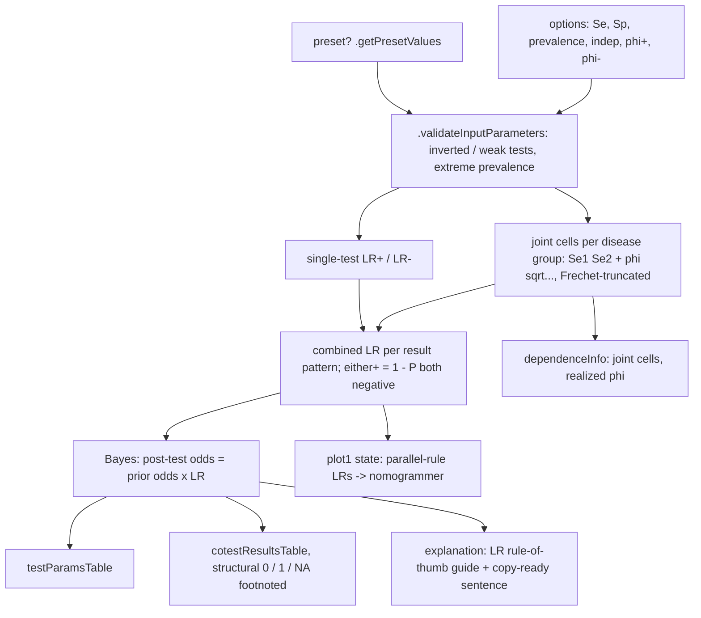

# Co-Testing Analysis - Developer Documentation

## 1. Overview

- **Function**: `cotest`
- **Title**: Co-Testing Analysis
- **Module**: `meddecide`
- **Files**:
  - `jamovi/cotest.u.yaml` - User Interface Definition
  - `jamovi/cotest.a.yaml` - Options & Schema Definition
  - `jamovi/cotest.r.yaml` - Results Layout & Tables
  - `R/cotest.b.R` - Backend Implementation
- **Summary**: Analyses two diagnostic tests applied in parallel: both are performed on the same subject at the same time, before either result is known, and the two results are then combined. Reports the post-test probability of disease for every result combination (either test positive, test 1 only, test 2 only, both positive, both negative), optionally allowing the two tests to be conditionally dependent. For tests performed one after another, where the second is ordered only after a particular first result, use Sequential Test Analysis instead. Note that Sequential Test Analysis also offers a parallel strategy, but its combined figures assume conditional independence; this analysis is the one that models conditional dependence numerically.

## 1a. Changelog

- **Date**: 2026-08-29
- **Summary**: Comprehensive documentation suite created & verified against active schemas and backend implementation.
- **Date**: 2026-10-05
- **Summary**: Sections 4-6 rewritten for what `cotest` is: a calculator with no data input. The previous
  text (variables, missing values, formula parsing, ggstatsplot) was a generic template.

## 2. Options Reference (`.a.yaml`)

| Option | Type | Default | Description |
| :--- | :--- | :--- | :--- |
| `test1_name` | `String` | `` | Name of test 1 |
| `test2_name` | `String` | `` | Name of test 2 |
| `test1_sens` | `Number` | `0.8` | Test 1 sensitivity |
| `test1_spec` | `Number` | `0.9` | Test 1 specificity |
| `test2_sens` | `Number` | `0.75` | Test 2 sensitivity |
| `test2_spec` | `Number` | `0.95` | Test 2 specificity |
| `indep` | `Bool` | `FALSE` | Assume conditional independence |
| `cond_dep_pos` | `Number` | `0.05` | Correlation (phi) among subjects with disease |
| `cond_dep_neg` | `Number` | `0.05` | Correlation (phi) among subjects without disease |
| `prevalence` | `Number` | `0.1` | Disease prevalence |
| `showGuidance` | `Bool` | `TRUE` | Guidance and explanations |
| `fnote` | `Bool` | `FALSE` | Footnotes |
| `fagan` | `Bool` | `FALSE` | Fagan nomogram |
| `preset` | `List` | `custom` | Worked example |

## 3. Results Definition (`.r.yaml`)

| Output ID | Type | Title | Description |
| :--- | :--- | :--- | :--- |
| `instructions` | `Html` | `Instructions` |  |
| `notices` | `Html` | `Validation Notices` |  |
| `testParamsTable` | `Table` | `Test Parameters` |  |
| `cotestResultsTable` | `Table` | `Co-Testing Results` |  |
| `dependenceInfo` | `Html` | `Test Dependence` |  |
| `dependenceExplanation` | `Html` | `Understanding Test Dependence` |  |
| `explanation` | `Html` | `Explanation` |  |
| `plot1` | `Image` | `Fagan nomogram - parallel rule (positive if either test is positive)` |  |

## 4. Architecture & Data Flow

`cotest` takes no dataset. Every input is a number typed into an option, or supplied by a worked
example (`preset`), which overrides the typed values.

## 5. Execution Sequence

1. `.init()` adds the fixed table rows and the instructions.
2. `.run()` resolves the test names and applies a worked example, with override notices.
3. It then validates the inputs and computes LRs, joint cells and posteriors.
4. It fills both tables, the Test Dependence panel, the explanation and the essay.
5. If `fagan = TRUE`, it stores the nomogram state.
6. It writes the collected notices.

`.plot1()` draws only from `image$state` (`requiresData: false`).

## 6. Change Impact & Safety Guidelines

- **Presets live in two places.** `.getPresetValues()` and `jamovi/js/cotest.events.js` must agree
  field for field; `tests/testthat/test-cotest.R` checks this.
- **Every sentence is checked against the numbers.** Run a text change through:
  - a negative dependence truncated at its floor;
  - a structural 0%, 100% or NA row;
  - LR = 1 (both tests on the chance diagonal);
  - a test below the chance diagonal;
  - prevalence at 0.001 and 0.999.

  `development-scripts/validate_cotest.R` and `development-scripts/audit_cotest.R` cover these.
- **Interpretive text is a guide, not a verdict.** Magnitude words come from the combined
  likelihood ratio on the conventional bands (Jaeschke et al. 1994), and they are labelled as a
  rule of thumb.
- **The dependence parameter is a phi correlation.** A covariance or a kappa entered as-is gives a
  different model, so keep the conversion note next to any change to these options.
- **Test names reach three kinds of sink:**
  - table cells and footnotes, via `.cellText()`, which breaks a tag-opening `<`;
  - HTML, via `.escapeHtml()`;
  - notices, escaped on display.

  Never escape a name at its source.
- **i18n.** After rewording a `.()` string, run `jmvtools::i18nUpdate()`. Then check that no Turkish
  translation was lost; a reworded msgid arrives with an empty msgstr.
