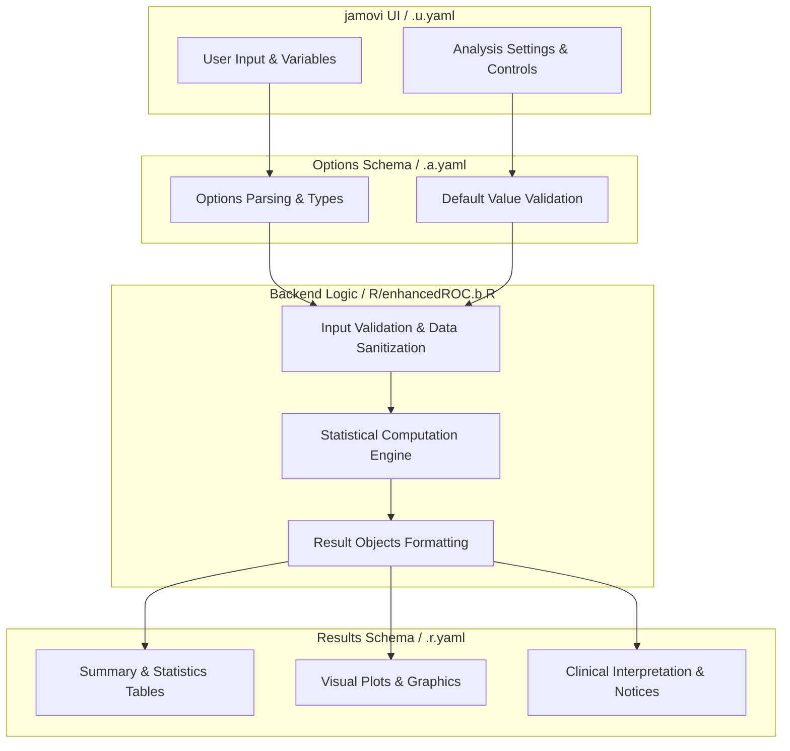
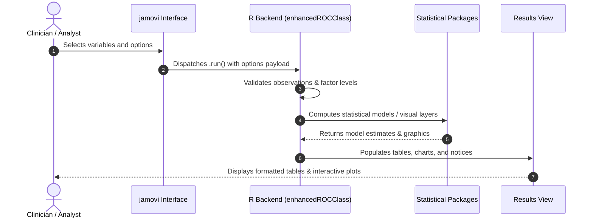

# Clinical ROC Analysis - Developer Documentation

## 1. Overview

- **Function**: `enhancedROC`
- **Title**: Clinical ROC Analysis
- **Module**: `meddecide`
- **Files**:
  - `jamovi/enhancedROC.u.yaml` - User Interface Definition
  - `jamovi/enhancedROC.a.yaml` - Options & Schema Definition
  - `jamovi/enhancedROC.r.yaml` - Results Layout & Tables
  - `R/enhancedROC.b.R` - Backend Implementation
- **Summary**: Clinical ROC analysis toolkit for comprehensive diagnostic performance  evaluation. Includes ROC curve analysis, Youden Index optimization,  sensitivity/specificity analysis, optimal cutoff determination, and  comparative ROC analysis. Essential for biomarker validation, diagnostic test evaluation, and clinical decision support in medical research.

## 1a. Changelog

- **Date**: 2026-10-11, analysis version 1.0.84
- **Summary**: AUC table notes, methods, and copy-ready reports identify the actual
  interval method per marker, including bootstrap failures followed by DeLong and
  BCa downgrades to percentile. DeLong fallback rows show their matching standard
  errors. Distinct marker and class labels have distinct internal keys, including
  punctuation and Unicode. Ordinary ROC analyses require 20 complete observations
  across the outcome and all selected predictors. This minimum is an analysis
  policy, not a mathematical requirement or an assurance of adequate precision.
  Adding missing rows cannot bypass it. Frozen-model validation uses its separate
  eligibility checks. Statistical defaults are unchanged. Plots save their own
  coordinates and summaries, without cleaned input rows or model objects.
  Resizing/exporting reuses those coordinates, including seeded confidence bands.
  Recalculate older saved plot states when prompted. ROC curves and ribbons follow
  the global jamovi palette. Citation metadata now survives document serialization.

- **Date**: 2026-08-29
- **Summary**: Comprehensive documentation suite created & verified against active schemas and backend implementation.

- **Date**: 2026-09-22
- **Summary**: Removed 14 options that were never implemented and are now commented out of
  `jamovi/enhancedROC.a.yaml` / `.u.yaml`. They are not options, not UI controls and not
  wrapper arguments - passing one to `ClinicoPath::enhancedROC()` is an "unused argument"
  error. Do not re-add them from an older copy of this table: `harrellCIndex`, `unoCStatistic`, `namDagostino`, `greenwoodNam`, `calibrationBelt`, `optimismCorrection`, `externalValidation`, `transportability`, `bootstrapCutoffCI`, `modelUpdating`, `netBenefitRegression`, `incidentDynamic`, `cumulativeDynamic`, `competingRisksConcordance`.
  Optimism-corrected performance is available through `internalValidation` with
  `validationMethod = "bootstrap"`.

- **Date**: 2026-10-09
- **Summary**: Fixes from the 2026-10-09 validation (`development-ideas/enhancedROC-validation-2026-10-09.md`).
  `positiveClass` now has `allowNone`: the box starts empty and the positive class is never taken from
  level order. Only a numeric outcome coded 0/1 defaults (1 = positive); any other outcome waits for a
  choice, and the new **Outcome coding** table (`results$outcomeCoding`) lists every level with its
  N, its role and notes saying what sensitivity, PPV and the AUC refer to. `tiedScoreHandling` is
  retired (ties always count one half; an automatic note under the AUC table gives the bounds), and
  passing it is an "unused argument" error. `predictionScale` now also decides what calibration, the
  Brier score, E/O, Hosmer-Lemeshow and the decision and clinical impact curves read: Score (default)
  fits a logistic model of the marker; values between 0 and 1 are no longer assumed to be probabilities.

## 2. Options Reference (`.a.yaml`)

| Option | Type | Default | Description |
| :--- | :--- | :--- | :--- |
| `data` | `Data` | `NULL` |  |
| `outcome` | `Variable` | `NULL` | Outcome Variable |
| `positiveClass` | `Level` | `NULL` (allowNone) | Positive class; never inferred from level order (numeric 0/1 outcome: 1) |
| `predictors` | `Variables` | `NULL` | Predictor Variables |
| `analysisType` | `List` | `single` | Analysis Type |
| `direction` | `List` | `higher` | Direction |
| `youdenOptimization` | `Bool` | `TRUE` | Youden index optimization |
| `customCutoffs` | `String` | `` | Custom Cutoffs |
| `sensitivityThreshold` | `Number` | `0` | Minimum sensitivity |
| `specificityThreshold` | `Number` | `0` | Minimum specificity |
| `confidenceLevel` | `Number` | `95` | Confidence Level |
| `bootstrapSamples` | `Integer` | `1000` | Bootstrap Samples |
| `useBootstrap` | `Bool` | `FALSE` | Use bootstrap |
| `bootstrapMethod` | `List` | `bca` | Bootstrap Method |
| `bootstrapPartialAUC` | `Bool` | `FALSE` | Bootstrap CI for partial AUC |
| `stratifiedBootstrap` | `Bool` | `FALSE` | Stratified bootstrap |
| `seed` | `Integer` | `0` | Random Seed |
| `pairwiseComparisons` | `Bool` | `FALSE` | Pairwise comparisons |
| `comparisonMethod` | `List` | `delong` | Comparison Method |
| `rocCurve` | `Bool` | `TRUE` | ROC curve plot |
| `aucTable` | `Bool` | `TRUE` | AUC summary table |
| `cutoffTable` | `Bool` | `FALSE` | Cutoff analysis table |
| `optimalCutoffs` | `Bool` | `TRUE` | Optimal cutoffs summary |
| `diagnosticMetrics` | `Bool` | `TRUE` | Diagnostic metrics |
| `clinicalMetrics` | `Bool` | `FALSE` | Clinical metrics |
| `smoothMethod` | `List` | `none` | ROC Curve Smoothing |
| `partialAuc` | `Bool` | `FALSE` | Partial AUC analysis |
| `partialAucType` | `List` | `specificity` | Partial AUC Type |
| `partialAucFrom` / `partialAucTo` | `Number` | `0.8` / `1` | Partial AUC Range |
| `crocAnalysis` | `Bool` | `FALSE` | CROC analysis |
| `crocAlpha` | `Number` | `7` | CROC Alpha Parameter |
| `convexHull` | `Bool` | `FALSE` | ROC convex hull |
| `detectImbalance` | `Bool` | `FALSE` | Detect class imbalance |
| `imbalanceThreshold` | `Number` | `3` | Imbalance Threshold |
| `showImbalanceWarning` | `Bool` | `FALSE` | Imbalance warning |
| `recommendPRC` | `Bool` | `FALSE` | Recommend PRC for imbalanced data |
| `prevalence` | `Number` | `0.1` | Disease prevalence |
| `useObservedPrevalence` | `Bool` | `TRUE` | Use observed prevalence |
| `clinicalContext` | `List` | `general` | Clinical Context |
| `clinicalPresets` | `List` | `custom` | Clinical Presets |
| `comprehensive_output` | `Bool` | `FALSE` | Comprehensive statistical output |
| `clinical_interpretation` | `Bool` | `FALSE` | Clinical interpretation |
| `plotTheme` | `List` | `clinical` | Plot Theme |
| `plotWidth` | `Integer` | `600` | Plot Width |
| `plotHeight` | `Integer` | `600` | Plot Height |
| `showCutoffPoints` | `Bool` | `FALSE` | Cutoff points |
| `showConfidenceBands` | `Bool` | `FALSE` | Confidence bands |
| `showMetricsDiff` | `Bool` | `FALSE` | Metrics differences |
| `statisticalComparison` | `Bool` | `FALSE` | Statistical model comparison |
| `calibrationAnalysis` | `Bool` | `FALSE` | Calibration analysis |
| `predictionScale` | `List` | `score` | Prediction scale (score or probability of the positive class) |
| `calibrationPlot` | `Bool` | `FALSE` | Calibration plot |
| `hosmerLemeshow` | `Bool` | `FALSE` | Hosmer-Lemeshow test |
| `hlGroups` | `Integer` | `10` | Risk groups |
| `brierScore` | `Bool` | `FALSE` | Brier score |
| `calibrationMetrics` | `Bool` | `FALSE` | Calibration metrics |
| `splineCalibration` | `Bool` | `FALSE` | Spline calibration curves |
| `splineKnots` | `Integer` | `4` | Number of Knots |
| `eoRatio` | `Bool` | `FALSE` | E/O ratio |
| `calibrationDensity` | `Bool` | `FALSE` | Calibration density plot |
| `multiClassROC` | `Bool` | `FALSE` | Multi-class ROC analysis |
| `multiClassStrategy` | `List` | `ovr` | Multi-Class Strategy |
| `multiClassAveraging` | `List` | `macro` | Multi-Class AUC Averaging |
| `clinicalImpact` | `Bool` | `FALSE` | Clinical impact analysis |
| `nntCalculation` | `Bool` | `FALSE` | Number needed to test/Treat |
| `clinicalUtilityCurve` | `Bool` | `FALSE` | Clinical utility curve |
| `decisionImpactTable` | `Bool` | `FALSE` | Decision impact table |
| `internalValidation` | `Bool` | `FALSE` | Internal validation |
| `validationMethod` | `List` | `bootstrap` | Validation Method |
| `decisionImpactCurves` | `Bool` | `FALSE` | Decision impact curves |

## 3. Results Definition (`.r.yaml`)

| Output ID | Type | Title | Description |
| :--- | :--- | :--- | :--- |
| `results` | `Group` | `Analysis Results` |  |

## 4. Architecture & Data Flow Diagram

## 5. Execution Sequence

## 6. Change Impact & Safety Guidelines

- **Data Filtering**: Ensure observations with missing values are handled gracefully according to analysis options.
- **Formula Conflicts**: Use isolated environment calls or base formula methods when interacting with `ggstatsplot` or formula parsers.
- **Safe Deparsing**: Use `deparse(val)` in syntax generation (`asSource()`) to escape column names with spaces or special symbols.
