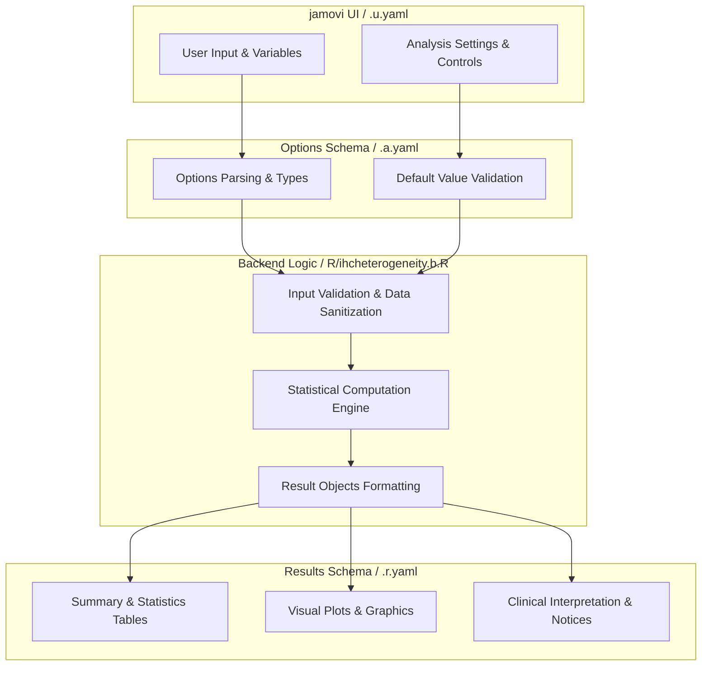
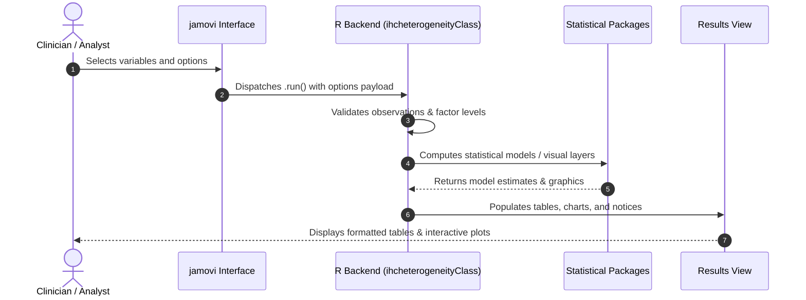

# IHC Heterogeneity Analysis - Developer Documentation

## 1. Overview

- **Function**: `ihcheterogeneity`
- **Title**: IHC Heterogeneity Analysis
- **Module**: `OncoPath` (`menuGroup: OncoPath`, `menuSubgroup: IHC Analysis`, `version: 1.1.3`)
- **Files**:
  - `jamovi/ihcheterogeneity.u.yaml` - User Interface Definition
  - `jamovi/ihcheterogeneity.a.yaml` - Options & Schema Definition
  - `jamovi/ihcheterogeneity.r.yaml` - Results Layout & Tables
  - `R/ihcheterogeneity.b.R` - Backend Implementation
- **Summary**: Evaluates regional sampling agreement and spatial heterogeneity of immunohistochemical (IHC) biomarkers across tumor regions and biopsy cores relative to whole-section reference measurements (or pairwise across regions). Computes ICC(2,1) and ICC(3,1) (McGraw & Wong 1996), Spearman rank correlations with Bonett & Wright (2000) CIs, Fieller 90% TOST equivalence and Bonferroni material-bias intervals, Krouwer (2008) three-slope HC3 proportional-bias tests, Bland-Altman 95% limits of agreement with CIs (Bland & Altman 1999), within-case CVs (root-mean-square over cases), two-way random-effects variance components, ICC precision sample-size tables (Bonett 2002), and spatial compartment comparisons.

## 1a. Changelog

- **Date**: 2026-08-29
- **Summary**: Comprehensive documentation suite created & verified against active schemas and backend implementation.
- **Date**: 2026-11-07
- **Summary**: Updated for OncoPath 1.1.3 release: added `showInterpretation` option, documented the Krouwer (2008) three-slope proportional-bias rule for both reference and inter-regional designs, Bonett & Wright (2000) CIs for pairwise Spearman correlations, Allred/ordinal scale guards across all tables, and discretization margin checks.

## 2. Options Reference (`.a.yaml`)

| Option | Type | Default | Description |
| :--- | :--- | :--- | :--- |
| `data` | `Data` | `NULL` | The data as a data frame |
| `wholesection` | `Variable` | `NULL` | Reference Measurement (Whole Section / Hotspot / Overall Score) |
| `biopsy1` | `Variable` | `NULL` | Regional Measurement 1 (any of slots 1-4 or the Additional list starts the analysis) |
| `biopsy2` | `Variable` | `NULL` | Regional Measurement 2 (Optional) |
| `biopsy3` | `Variable` | `NULL` | Regional Measurement 3 (Optional) |
| `biopsy4` | `Variable` | `NULL` | Regional Measurement 4 (Optional) |
| `biopsies` | `Variables` | `NULL` | Additional Regional Measurements |
| `spatial_id` | `Variable` | `NULL` | Spatial Region / Compartment ID (Optional) |
| `compareCompartments` | `Bool` | `FALSE` | Spatial compartment comparison |
| `compartmentTests` | `Bool` | `FALSE` | Compartment comparison tests |
| `analysis_type` | `List` | `comprehensive` | Analysis Focus (`comprehensive`, `reproducibility`, `bias`, `variability`) |
| `sampling_strategy` | `List` | `unknown` | Sampling Strategy (`unknown`, `systematic`, `random`, `hotspot`, `invasive_margin`, `central_core`, `multicore`) |
| `cv_threshold` | `Number` | `20` | CV Threshold (%) for Acceptable Variability (`1` to `100`) |
| `correlation_threshold` | `Number` | `0.8` | Minimum Acceptable Correlation (`0` to `1`) |
| `bias_margin` | `Number` | `5` | Systematic difference margin (% of the comparison mean, `0.5` to `100`) |
| `show_variability_plots` | `Bool` | `FALSE` | Variability plots |
| `variance_components` | `Bool` | `FALSE` | Variance component analysis |
| `sample_size_planning` | `Bool` | `FALSE` | Sample size for ICC precision (Bonett 2002) |
| `generate_recommendations` | `Bool` | `FALSE` | Clinical recommendations |
| `showInterpretation` | `Bool` | `FALSE` | Clinical interpretation and analysis summary |
| `showSummary` | `Bool` | `FALSE` | Plain-language summary |
| `showGlossary` | `Bool` | `FALSE` | Statistical glossary |
| `showReportSentences` | `Bool` | `FALSE` | Copy-ready report sentences |
| `showAssumptions` | `Bool` | `FALSE` | Methodology & assumptions |

## 3. Results Definition (`.r.yaml`)

| Output ID | Type | Title | Description |
| :--- | :--- | :--- | :--- |
| `welcome` | `Html` | `` | Welcome screen shown when no variables selected |
| `notices` | `Html` | `` | All warnings in one panel, ordered by severity: strong warnings (small sample, material systematic difference), warnings (data-quality checks, duplicate variables, ICC not estimable, constant reference), information (rows left out, variability plot not drawn). Fatal problems stop the analysis with `jmvcore::reject()`. |
| `interpretation` | `Html` | `Clinical Interpretation and Analysis Summary` |  |
| `report_sentences` | `Html` | `Copy-Ready Report Sentences` | Pre-formatted sentences ready for clinical reports and publications |
| `assumptions` | `Html` | `Methodology & Assumptions` | Analysis assumptions, data requirements, and methodological considerations |
| `summary` | `Html` | `Summary (Plain-Language)` | Natural-language summary of heterogeneity analysis results |
| `glossary` | `Html` | `Statistical Glossary` | Definitions of key statistical terms used in the analysis |
| `reproducibilitytable` | `Table` | `Reproducibility Assessment` | Correlation and reliability metrics |
| `samplingbiastable` | `Table` | `Sampling Bias Analysis` | Per region (and the mean of all regions): n, mean difference with 95% CI, Bland-Altman 95% limits of agreement each with its 95% CI (Bland & Altman 1999), p-value, Hedges' g and the margin-based clinical impact |
| `variancetable` | `Table` | `Variance Component Analysis` | Sources of measurement variability |
| `samplesizetable` | `Table` | `Sample Size for ICC Precision` | Cases needed to estimate the ICC with a chosen 95 percent CI width (Bonett 2002) |
| `spatialanalysistable` | `Table` | `Spatial Heterogeneity Analysis` | Variability across spatial regions |
| `compartmentComparison` | `Table` | `Compartment Heterogeneity Comparison` | Statistical comparison of heterogeneity metrics between compartments |
| `compartmentTests` | `Table` | `Statistical Tests for Compartment Differences` | Formal statistical tests comparing heterogeneity across compartments |
| `biopsyplot` | `Image` | `Regional Measurements Comparison` | Distribution comparison across regional measurements and reference (if provided) |
| `variabilityplot` | `Image` | `Sampling Variability Analysis` | Coefficient of variation by case |
| `spatialplot` | `Image` | `Spatial Heterogeneity Visualization` | Spatial distribution of biomarker values |

## 4. Architecture & Data Flow Diagram

## 5. Execution Sequence

## 6. Change Impact & Safety Guidelines

- **Data Filtering**: Ensure observations with missing values are handled gracefully according to analysis options.
- **Formula Conflicts**: Use isolated environment calls or base formula methods when interacting with `ggstatsplot` or formula parsers.
- **Safe Deparsing**: Use `deparse(val)` in syntax generation (`asSource()`) to escape column names with spaces or special symbols.
- **clearWith follows real dependencies**: each result clears only on the thresholds it reads (tables built in `.run()` are rebuilt anyway; images must list every option their renderer reads, e.g. `cv_threshold` for the variability and spatial plots). A new option read by an output must be added to that output's `clearWith`.

