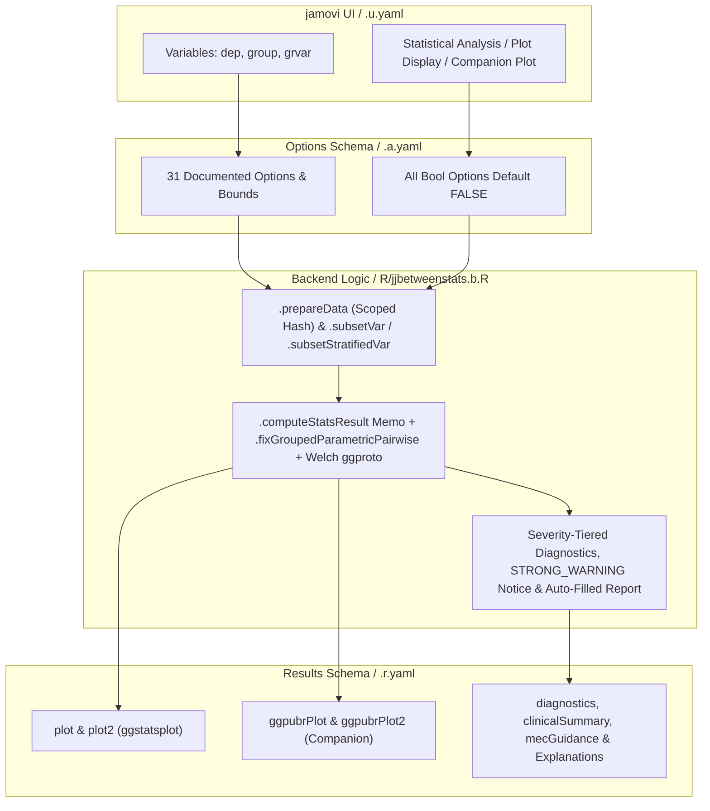
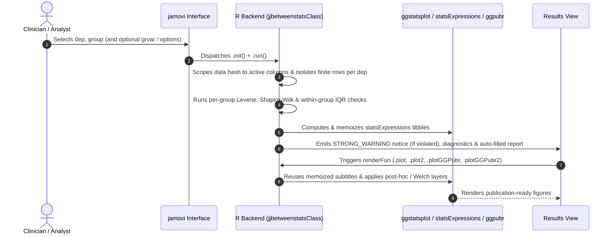

# Box-Violin Plots to Compare Between Groups - Developer Documentation

## 1. Overview

- **Function**: `jjbetweenstats`
- **Title**: Box-Violin Plots to Compare Between Groups
- **Module**: `JJStatsPlotT`
- **Files**:
  - `jamovi/jjbetweenstats.u.yaml` - User Interface Definition
  - `jamovi/jjbetweenstats.a.yaml` - Options & Schema Definition
  - `jamovi/jjbetweenstats.r.yaml` - Results Layout & Tables
  - `R/jjbetweenstats.b.R` - Backend Implementation
- **Summary**: Wrapper function for `ggstatsplot::ggbetweenstats` and `ggstatsplot::grouped_ggbetweenstats` (with optional `ggpubr` companion plots) to generate box-violin plots for comparing continuous variables between independent groups with statistical annotations, effect sizes, assumption diagnostics, and auto-filled clinical report templates.

## 1a. Changelog

- **Date**: 2026-11-14
- **Summary**: Release & code-review hardening: per-variable missing-data isolation, companion Welch one-way ANOVA layer (`varequal = FALSE`), pooled-SD Student's $t$ effect sizes, single-step Games-Howell post-hoc FWER preservation across both unstratified (`plot`) and stratified (`plot2`) panels, unified sparse-stratum guards across `plot2` and `ggpubrPlot2`, memoized `statsExpressions` computation + column-scoped data hashing, auto-filled numeric copy-ready report sentences, severity-tiered theme-safe diagnostics + `STRONG_WARNING` validity notices, `seed` bounds and `NA` fallback safety, full Roxygen/UI option tooltips (`31/31`), `jamovi` global palette support, and `i18n` catalog synchronization.

## 2. Options Reference (`.a.yaml`)

| Option | Type | Default | Description |
| :--- | :--- | :--- | :--- |
| `data` | `Data` | `NULL` | The data as a data frame |
| `dep` | `Variables` | `NULL` | Continuous dependent variable(s) (`numeric`, `suggested: continuous`) |
| `group` | `Variable` | `NULL` | Independent grouping variable (`suggested: ordinal, nominal`) |
| `grvar` | `Variable` | `NULL` | Optional Split-By stratification variable (`suggested: ordinal, nominal`) |
| `centralityplotting` | `Bool` | `FALSE` | Centrality points and labels |
| `centralitytype` | `List` | `parametric` | Centrality measure (`parametric`, `nonparametric`, `robust`, `bayes`) |
| `typestatistics` | `List` | `parametric` | Statistical test (`parametric`, `nonparametric`, `robust`, `bayes`) |
| `seed` | `Integer` | `20250101` | Random seed (`1`–`2147483647`) for jitter, bootstrap CIs, and MCMC |
| `pairwisecomparisons` | `Bool` | `FALSE` | Pairwise comparisons |
| `pairwisedisplay` | `List` | `significant` | Pairwise display (`significant`, `non-significant`, `everything`) |
| `padjustmethod` | `List` | `holm` | Adjustment method (`holm`, `hochberg`, `hommel`, `bonferroni`, `BH`, `BY`, `fdr`, `none`) |
| `effsizetype` | `List` | `biased` | Parametric effect size (`biased`, `unbiased`, `eta`, `omega`) |
| `mytitle` | `String` | `Between Group Comparison` | Plot title |
| `xtitle` | `String` | `""` | X-axis title |
| `ytitle` | `String` | `""` | Y-axis title |
| `originaltheme` | `Bool` | `FALSE` | `ggstatsplot` default theme |
| `resultssubtitle` | `Bool` | `FALSE` | Statistical results subtitle and auto-filled report numbers |
| `bfmessage` | `Bool` | `FALSE` | Bayes factor caption ($\log_e(\text{BF}_{01})$ on 2-group parametric plot) |
| `k` | `Integer` | `2` | Decimal places (`0`–`5`) |
| `conflevel` | `Number` | `0.95` | Confidence or credible level (`0.5`–`0.999`) |
| `varequal` | `Bool` | `FALSE` | Equal variances |
| `multiEndpointCorrection` | `List` | `none` | Multiple endpoint guidance (`none`, `bonferroni`, `holm`, `fdr`) |
| `plotwidth` | `Integer` | `650` | Plot width (`300`–`1200` px) |
| `plotheight` | `Integer` | `450` | Plot height (`300`–`800` px) |
| `colorblindSafe` | `Bool` | `FALSE` | Colorblind-safe palette (Viridis) |
| `showexplanations` | `Bool` | `FALSE` | Explanations and guides |
| `addGGPubrPlot` | `Bool` | `FALSE` | Publication-ready companion plot |
| `ggpubrPlotType` | `List` | `boxplot` | Companion plot type (`boxplot`, `violin`, `boxviolin`) |
| `ggpubrPalette` | `List` | `jco` | Companion color palette (`jamovi`, `jco`, `npg`, `aaas`, `lancet`, `jama`, `nejm`, `grey`, `default`) |
| `ggpubrAddStats` | `Bool` | `FALSE` | Companion statistical comparisons |
| `ggpubrAddPoints` | `Bool` | `FALSE` | Individual data points |

## 3. Results Definition (`.r.yaml`)

| Output ID | Type | Title | Visibility |
| :--- | :--- | :--- | :--- |
| `todo` | `Html` | `To Do` | Always visible (`jmv-welcome` empty state / partial-selection hint; cleared when active) |
| `mecGuidance` | `Html` | `""` | Always visible (populates when `length(dep) > 1`) |
| `diagnostics` | `Html` | `""` | Always visible (severity-tiered warnings and diagnostic notes) |
| `clinicalSummary` | `Html` | `""` | Always visible (concise overview when active) |
| `about` | `Html` | `About This Analysis` | `(showexplanations)` |
| `summary` | `Html` | `Analysis Summary` | `(showexplanations)` |
| `assumptions` | `Html` | `Statistical Assumptions` | `(showexplanations)` |
| `interpretation` | `Html` | `Interpretation Guide` | `(showexplanations)` |
| `report` | `Html` | `Copy-Ready Report Template` | `(showexplanations)` |
| `plot2` | `Image` | ``Violin Plot by ${grvar}`` | `(grvar)` |
| `plot` | `Image` | `Violin Plot` | Always visible (renders when `dep` and `group` selected) |
| `ggpubrPlot` | `Image` | `Publication-Ready Plot (ggpubr)` | `(addGGPubrPlot)` |
| `ggpubrPlot2` | `Image` | ``Publication-Ready Plot by ${grvar} (ggpubr)`` | `(length(grvar) > 0 && addGGPubrPlot)` |

**Declared References (`refs`):** `ClinicoPathJamoviModule`, `ggstatsplot`, `statsExpressions`, `ggpubr`, `car`, `WRS2`, `BayesFactor`, `effectsize`, `PMCMRplus`.

## 4. Architecture & Data Flow Diagram

## 5. Execution Sequence

## 6. Change Impact & Safety Guidelines

- **Per-Variable Missing Data**: `.subsetVar()` filters missing/non-finite values separately for each `dep` variable, while `.subsetStratifiedVar()` drops sparse `grvar` strata (`< 2` groups) cleanly across `plot2` and `ggpubrPlot2`.
- **Export-Safe Renderers**: Image `renderFun` callbacks compute data directly from `self$data` and `self$options`; `.statsCache` is self-populating on cache misses.
- **Safe Syntax Escaping**: `asSource()` formats all non-default options via `.R_literal()` (`deparse()`) so column names with spaces, punctuation, or non-ASCII characters produce valid R syntax.
