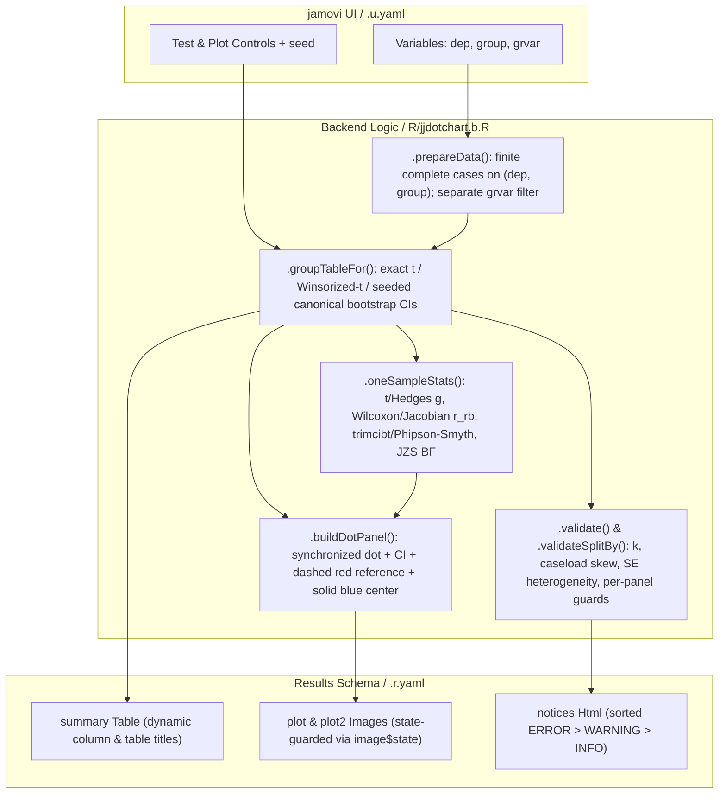

# Dot Chart (Summary vs Reference Value) - Developer Documentation

## 1. Overview

- **Function**: `jjdotchart`
- **Title**: Dot Chart (Summary vs Reference Value)
- **Module**: `JJStatsPlot`
- **Files**:
  - `jamovi/jjdotchart.u.yaml` - User Interface Definition
  - `jamovi/jjdotchart.a.yaml` - Options & Schema Definition
  - `jamovi/jjdotchart.r.yaml` - Results Layout & Tables
  - `R/jjdotchart.b.R` - Backend Implementation
- **Summary**: Cleveland dot chart for cross-sectional multi-unit benchmarking. Collapses finite complete observations within each level of `Groups` to a single within-group location summary, orders the $k$ groups ascending by summary value with within-group confidence intervals and a dashed red Reference Value line, and runs an unweighted one-sample test of those $k$ group summaries ($n = k$ groups with equal weight $1/k$, or $n = k_s$ per panel when `Split By` is active) against `Reference Value`. Parametric mode plots group arithmetic means (Student-$t$ CIs) and runs a one-sample $t$-test with Hedges' $g$; Nonparametric mode plots group medians ($B = 2000$ percentile bootstrap CIs) and runs a continuity-corrected Wilcoxon signed-rank test with delta-method Fisher-$z$ rank-biserial correlation; Robust mode plots 20% trimmed means (Yuen Winsorized-$t$ CIs) and runs Wilcox's bootstrapped trimmed-mean test ($B = 200$, Phipson-Smyth bounded $p$-values); Bayesian mode plots 1024-grid Sheather-Jones kernel MAP modes ($B = 500$ percentile bootstrap CIs) and runs a Gaussian Cauchy-JZS Bayes factor test ($r = 0.707$, where $\log_e(\text{BF}_{01}) > 0$ favors the null hypothesis).

## 1a. Changelog

- **Date**: 2026-11-15
- **Summary**: Synchronized table and plot group CIs across all four statistical modes, decoupled `Split By` missingness from unstratified outputs, added per-stratum validation, wired dynamic summary column headers, cleared stale rows across stateful filter transitions, and documented all 19 `.a.yaml` options including `seed`.

## 2. Options Reference (`.a.yaml`)

| Option | Type | Default | Description |
| :--- | :--- | :--- | :--- |
| `data` | `Data` | `NULL` | Input data frame |
| `dep` | `Variable` | `NULL` | Measurement (continuous numeric variable) |
| `group` | `Variable` | `NULL` | Groups (one point each; clustering unit) |
| `grvar` | `Variable` | `NULL` | Split By (Optional stratification variable) |
| `testvalue` | `Number` | `0` | Reference Value tested against the $k$ group summaries |
| `typestatistics` | `List` | `parametric` | Statistical Test (`parametric`, `nonparametric`, `robust`, `bayes`) |
| `conflevel` | `Number` | `0.95` | Confidence Level (`0.50` to `0.999`) |
| `k` | `Integer` | `2` | Decimal Places (plot annotation, `0` to `5`) |
| `resultssubtitle` | `Bool` | `TRUE` | Statistical results in plot |
| `showSummaryTable` | `Bool` | `TRUE` | Group summary table |
| `centralityplotting` | `Bool` | `FALSE` | Also mark the center of the plotted points (solid blue line) |
| `centralitytype` | `List` | `parametric` | Central Tendency Measure (`parametric`, `nonparametric`, `robust`, `bayes`) |
| `originaltheme` | `Bool` | `FALSE` | Original ggstatsplot theme |
| `mytitle` | `String` | `''` | Plot Title |
| `xtitle` | `String` | `''` | X-axis Label (Measurement) |
| `ytitle` | `String` | `''` | Y-axis Label (Groups) |
| `plotwidth` | `Integer` | `650` | Plot Width (pixels, `300` to `1200`) |
| `plotheight` | `Integer` | `450` | Plot Height (pixels, `300` to `800`) |
| `seed` | `Integer` | `20250101` | Random seed for bootstrap intervals and stochastic tests |

## 3. Results Definition (`.r.yaml`)

| Output ID | Type | Title | Description |
| :--- | :--- | :--- | :--- |
| `todo` | `Html` | `To Do` | Welcome guidance when `dep` or `group` is unselected |
| `notices` | `Html` | `Notices` | Theme-safe `ERROR` / `WARNING` / `INFO` clinical and statistical diagnostics |
| `summary` | `Table` | `Group Summaries (one row per plotted point)` (or unstratified title when `grvar` is set) | Per-group `N obs`, dynamically titled summary (`Mean`, `Median`, `Trimmed mean (20%)`, `MAP estimate`), raw `SD`, `Lower`, `Upper`, and `vs Reference` |
| `plot2` | `Image` | ``${dep} by {group}, split by {grvar}`` | Multi-panel stratified dot chart (`visible: (grvar)`) |
| `plot` | `Image` | ``${dep} by {group}`` | Unstratified Cleveland dot chart |

## 4. Architecture & Data Flow Diagram



## 5. Execution Sequence

```mermaid
sequenceDiagram
  autonumber
  actor User as Clinician / Analyst
  participant UI as jamovi Interface
  participant Backend as R Backend (jjdotchartClass)
  participant Results as Results View

  User->>UI: Selects Measurement, Groups, Reference Value, and Test Type
  UI->>Backend: Dispatches .run()
  Backend->>Backend: Clears stale notices & summary rows; syncs dynamic titles
  Backend->>Backend: Sanitizes data (.cleanFactor drops addNA '<NA>', filters +/-Inf)
  Backend->>Backend: Computes .groupTable() & validates assumptions + Split By strata
  Backend->>Results: Publishes image$state validity, fills summary table, renders notices
  Results->>Backend: Invokes .plot() / .plot2() inside tryCatch
  Backend-->>User: Displays synchronized Cleveland dot chart and audit table
```

## 6. Change Impact & Safety Guidelines

- **Generated Files**: Never hand-edit `R/jjdotchart.h.R`, `man/jjdotchart.Rd`, `jamovi/0000.yaml`, or `NAMESPACE`.
- **Decoupled Stratification**: Keep `(dep, group)` complete-case filtering independent of optional `grvar` so missing subgroup metadata never alters unstratified summaries.
- **State Persistence**: Always publish validity through `image$setState()` and check `private$.validHere(image)` so `.omv` reopen and image export work without re-running `.run()`.
