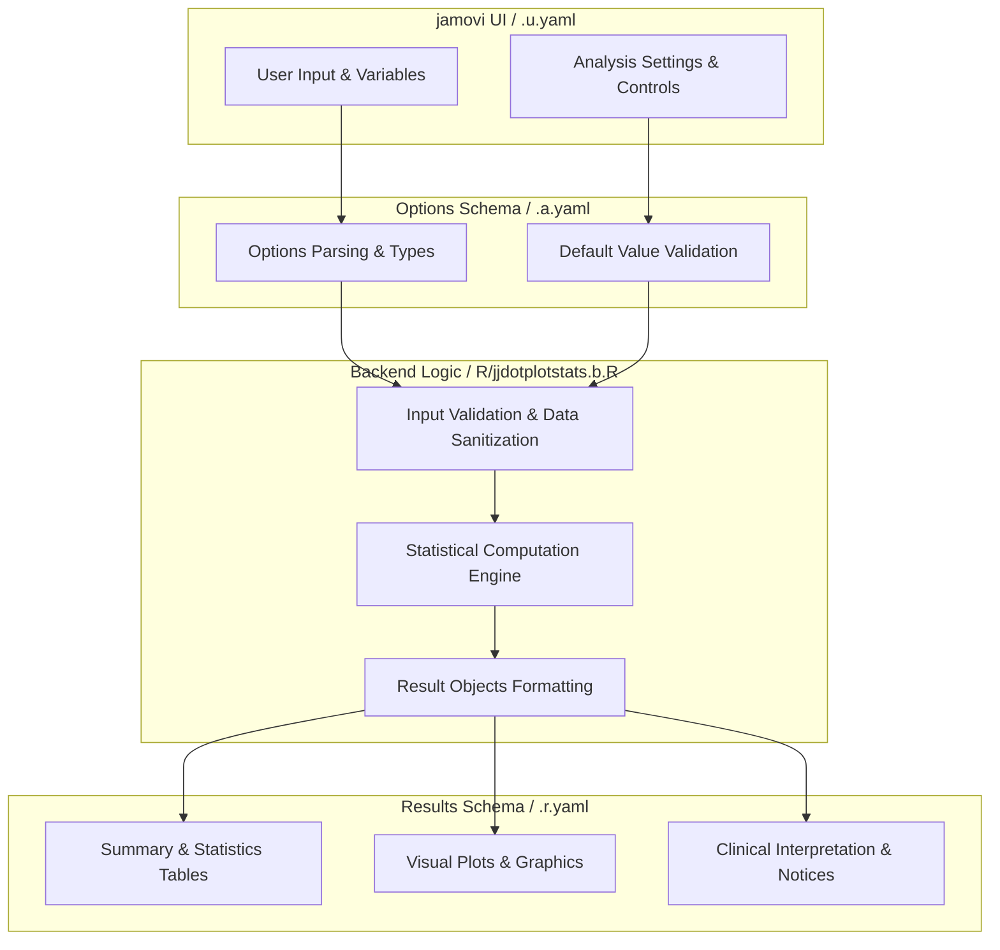
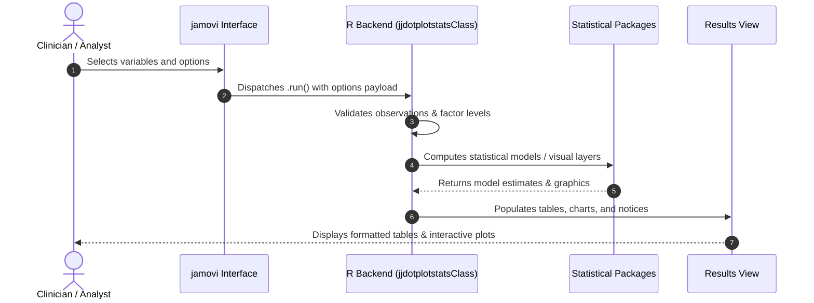

# Horizontal Box-Violin Comparison - Developer Documentation

## 1. Overview

- **Function**: `jjdotplotstats`
- **Title**: Horizontal Box-Violin Comparison
- **Module**: `JJStatsPlotT`
- **Files**:
  - `jamovi/jjdotplotstats.u.yaml` - User Interface Definition
  - `jamovi/jjdotplotstats.a.yaml` - Options & Schema Definition
  - `jamovi/jjdotplotstats.r.yaml` - Results Layout & Tables
  - `R/jjdotplotstats.b.R` - Backend Implementation
- **Summary**: Compares a continuous variable across groups and draws the comparison horizontally - values on the x axis, group labels down the y axis - with an optional vertical reference line. Wraps ggstatsplot::ggbetweenstats and ggstatsplot::grouped_ggbetweenstats, so the figure is a box-violin plot with the individual observations shown, and the test is a between-groups comparison using every observation.  This analysis was previously titled "Dot Chart", which described neither the figure nor the statistic: it draws violins and boxplots, not a dot chart, and it is a between-groups test rather than a one-sample one. For a genuine Cleveland dot chart - one summary point per label, tested against a reference value - use "Dot Chart (Summary vs Reference Value)", which wraps ggstatsplot::ggdotplotstats.  Prefer this over "Box-Violin Plots to Compare Between Groups" when the group labels are long or numerous, since the horizontal layout gives them room, or when a clinical threshold line is useful.

## 1a. Changelog

- **Date**: 2026-11-16
- **Summary**: Updated options/results reference and statistical architecture following exhaustive validation and post-hoc, Bayesian, data-hygiene, and Split-By fixes (`v1.0.82`).
- **Date**: 2026-08-29
- **Summary**: Comprehensive documentation suite created & verified against active schemas and backend implementation.

## 2. Options Reference (`.a.yaml`)

| Option | Type | Default | Description |
| :--- | :--- | :--- | :--- |
| `data` | `Data` | `NULL` | Input data frame |
| `dep` | `Variable` | `NULL` | Dependent Variable (continuous numeric) |
| `group` | `Variable` | `NULL` | Grouping Variable (categorical factor) |
| `grvar` | `Variable` | `NULL` | Split By (Optional stratification factor) |
| `typestatistics` | `List` | `parametric` | Statistical Test Type (`parametric`, `nonparametric`, `robust`, `bayes`) |
| `effsizetype` | `List` | `biased` | Effect Size Measure (`biased`, `unbiased`, `eta`, `omega`; parametric only) |
| `pairwisedisplay` | `List` | `significant` | Pairwise Comparisons (`significant`, `all`, `none`; 3+ groups) |
| `padjustmethod` | `List` | `holm` | Multiple Comparison Adjustment (`holm`, `fdr`, `bonferroni`, `none`) |
| `centralityplotting` | `Bool` | `FALSE` | Central tendency lines |
| `centralitytype` | `List` | `parametric` | Central Tendency Measure (`parametric`, `nonparametric`, `robust`, `bayes`) |
| `mytitle` | `String` | `''` | Plot Title |
| `xtitle` | `String` | `''` | X-axis Label (Values) |
| `ytitle` | `String` | `''` | Y-axis Label (Groups) |
| `originaltheme` | `Bool` | `FALSE` | Original ggstatsplot theme |
| `resultssubtitle` | `Bool` | `FALSE` | Statistical results in plot |
| `testvalue` | `Number` | `0` | Reference Line Value |
| `bfmessage` | `Bool` | `FALSE` | Bayes factor caption (2-group parametric only) |
| `conflevel` | `Number` | `0.95` | Confidence Level (`0.5` to `0.999`) |
| `k` | `Integer` | `2` | Statistical Precision (Decimal Places, `0` to `5`) |
| `testvalueline` | `Bool` | `FALSE` | Reference value line |
| `centralityparameter` | `List` | `mean` | Central Tendency Display (`mean`, `median`, `none`) |
| `centralityk` | `Integer` | `2` | Central Tendency Precision (deprecated; retained for backward compatibility) |
| `seed` | `Integer` | `42` | Random seed (`1` to `999999`) |
| `showexplanation` | `Bool` | `FALSE` | Assumptions and interpretation panel |
| `plotwidth` | `Integer` | `650` | Plot Width (pixels, `300` to `1200`) |
| `plotheight` | `Integer` | `450` | Plot Height (pixels, `300` to `800`) |

## 3. Results Definition (`.r.yaml`)

| Output ID | Type | Title | Description |
| :--- | :--- | :--- | :--- |
| `todo` | `Html` | `To Do` | Data processing log, group/row exclusions, within-group outlier screen, and sample summary |
| `notices` | `Html` | `Notices` | Severity-ranked (`ERROR`, `STRONG_WARNING`, `WARNING`, `INFO`) dark-theme-safe notices |
| `explanation` | `Html` | `Assumptions and Interpretation` | Test assumptions, visual reading guide, and copy-ready methods sentence (`visible: (showexplanation)`) |
| `plot2` | `Image` | ``${dep} - ${group} by ${grvar}`` | Stratified horizontal box-violin comparison (`visible: (grvar)`) |
| `plot` | `Image` | ``${dep} - ${group}`` | Main horizontal box-violin comparison |

## 4. Architecture & Data Flow Diagram

## 5. Execution Sequence

## 6. Change Impact & Safety Guidelines

- **Data Filtering**: Ensure observations with missing values are handled gracefully according to analysis options.
- **Formula Conflicts**: Use isolated environment calls or base formula methods when interacting with `ggstatsplot` or formula parsers.
- **Safe Deparsing**: Use `deparse(val)` in syntax generation (`asSource()`) to escape column names with spaces or special symbols.

