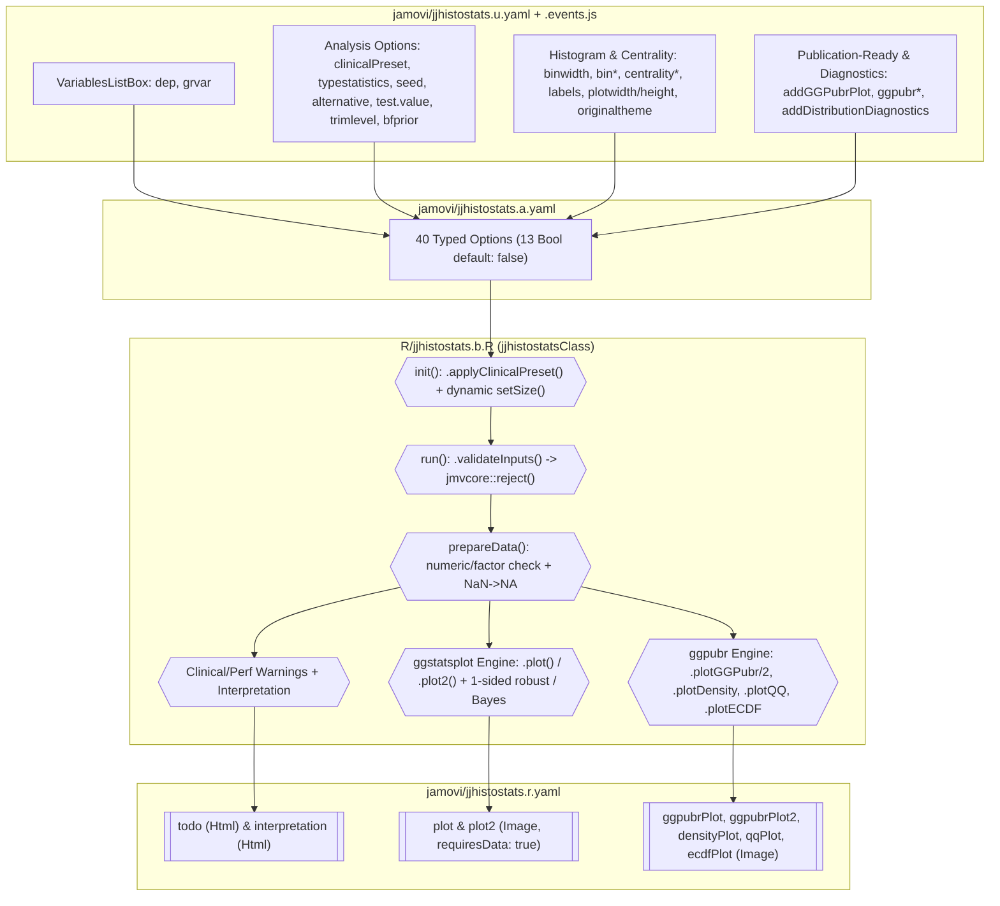
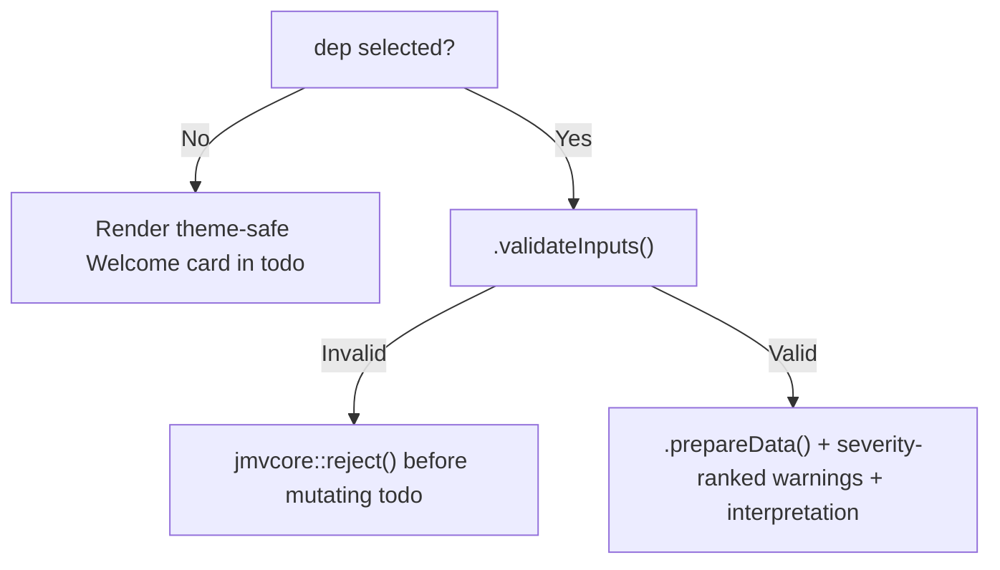
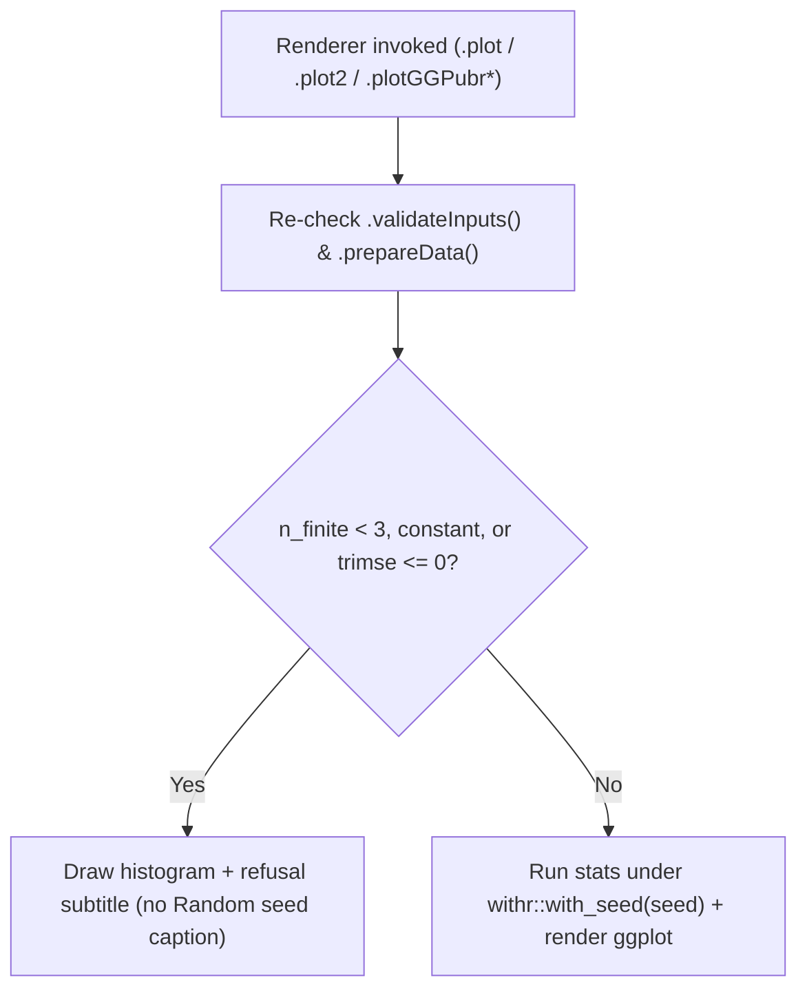

# Histogram (`jjhistostats`) - Developer Documentation

> Companion documents in this suite: [Feature Mapping](jjhistostats_documentation.md) | [Testing Checklist](testing_jjhistostats.md) | [Comprehensive Vignette](jjstatsplot-jjhistostats-comprehensive.Rmd)

## 1. Overview

- **Function**: `jjhistostats`
- **Title**: Histogram
- **Version**: `1.1.7` (`jas: 1.2`, `jrs: 1.1`, `jus: 3.0`)
- **Module / Menu Group**: `JJStatsPlotT` (test slot for `JJStatsPlot`; subgroup `Distribution`)
- **Files**:
  - `jamovi/jjhistostats.u.yaml` — User Interface definition
  - `jamovi/jjhistostats.a.yaml` — Analysis options & schema definition
  - `R/jjhistostats.b.R` — Backend R6 implementation (`jjhistostatsClass`)
  - `jamovi/jjhistostats.r.yaml` — Results layout & output schemas
  - `jamovi/js/jjhistostats.events.js` — Client-side UI event handlers (clinical presets, validation clamps, complementary colors)
- **Summary**: `jjhistostats` wraps `ggstatsplot::gghistostats()` and `ggpubr` (`gghistogram`, `ggdensity`, `ggqqplot`, `ggecdf`) to produce single-variable, multi-variable, and grouped histograms with optional one-sample location tests (parametric Student *t* + exact Hedges' *g*, nonparametric Wilcoxon signed-rank + rank-biserial *r*, robust bootstrap-*t* on trimmed means, and Bayesian one-sample *t*-test), clinical presets, severity-ranked clinical/statistical warnings, and plain-language clinical interpretation.

### 1a. Changelog

- **Date**: 2026-11-24
- **Summary**:
  - Refreshed and deduplicated the full documentation suite against active schemas (`version: '1.1.7'`) and verified backend behavior (515 passing automated tests).
  - Documented all 40 non-data options, including `seed`, `alternative`, `trimlevel`, `bfprior`, and `originaltheme` that were absent from the 2026-08-29 baseline.
  - Updated result titles, `clearWith` dependencies, density-scale alignment in `ggpubr`, clinical preset non-clobbering rules, and statistical edge-case guards (`n < 3`, zero Winsorized variance, directional Bayes log-scale overflow protection, exact-zero Wilcoxon ties, `addNA()` grouping levels).
- **Changes**:
  - **Options**: Added `seed`, `alternative`, `trimlevel`, `bfprior`, `originaltheme`; tightened `conf.level` bounds to `[0.5, 0.999]`; fixed `binwidth` documentation to `(max(x) - min(x)) / sqrt(N)`; uncommented `R: usage:` examples referencing `jjhistostats_test`; switched `description: main:` to folded `>` scalar.
  - **Backend**: Added `.cleanGgtheme()`, `.buildOneSidedRobustExpr()`, `.buildDirectionalBayesExpr()`, `.patchRobustZeroP()`, `.formatConfPct()`, `.formatPWithOp()`, `private$.statsComputed` seed-caption gating, non-clobbering `.applyClinicalPreset()`, `max_bins = 5000` preset-aware guard, `n < 3` and `WRS2::trimse() <= 0` guards, `y = "density"` in `.plotGGPubr`/`.plotGGPubr2`, and pre-`todo` validation before `jmvcore::reject()`.
  - **Results schema**: Fixed `plot2` title to `` `Histogram Split by ${grvar}` ``; added `addDistributionDiagnostics` to top-level `clearWith:`; added `plotwidth`/`plotheight` to `ggpubrPlot`/`ggpubrPlot2` `clearWith:`; verified `requiresData: true` on all 7 `Image` outputs and 8/8 `refs:` in `jamovi/00refs.yaml`.
  - **Diagrams**: Updated Mermaid flowchart and focused execution-flow diagrams to reflect `.init()`, `.validateInputs()`, `.prepareData()`, `.applyClinicalPreset()`, and multi-renderer flow.

---

## 2. UI Controls → Options Map

All 40 non-data `.a.yaml` options bind 1:1 to controls in `jamovi/jjhistostats.u.yaml`.

| CollapseBox / Section | UI Control (`type`, `name`) | Label / Title | Binds to Option | Defaults & Constraints | Enable / Event Rules |
|---|---|---|---|---|---|
| Top (`VariableSupplier`) | `VariablesListBox` `dep` | Variables | `dep` | `Variables`, `suggested: [continuous]`, `permitted: [numeric]` | Required target |
| Top (`VariableSupplier`) | `VariablesListBox` `grvar` | Split by (optional) | `grvar` | `Variable`, `default: NULL`, `maxItemCount: 1`, `permitted: [factor]` | Optional target |
| Analysis Options | `ComboBox` `clinicalPreset` | Clinical preset | `clinicalPreset` | `custom` \| `lab_values` \| `biomarkers` \| `patient_chars` \| `pathology_scores` | `change: onChange_clinicalPreset` |
| Analysis Options | `ComboBox` `typestatistics` | Type of statistic | `typestatistics` | `parametric` \| `nonparametric` \| `robust` \| `bayes` | `change: onChange_typestatistics` |
| Analysis Options | `TextBox` `seed` | Random seed | `seed` | `Integer`, `default: 20250101` | Always enabled |
| Analysis Options | `CheckBox` `resultssubtitle` | Statistical results | `resultssubtitle` | `Bool`, `default: false` | Gates stats options |
| Analysis Options | `CheckBox` `enableOneSampleTest` | Custom null value | `enableOneSampleTest` | `Bool`, `default: false` | Gates `test.value` |
| Analysis Options | `TextBox` `test.value` | Test value | `test.value` | `Number`, `default: 0` | `enable: (enableOneSampleTest)` |
| Analysis Options | `TextBox` `conf.level` | Confidence level | `conf.level` | `Number`, `default: 0.95`, `[0.5, 0.999]` | `enable: (resultssubtitle)` (no JS event — dotted name) |
| Analysis Options | `CheckBox` `bf.message` | Bayes factor | `bf.message` | `Bool`, `default: false` | `enable: (resultssubtitle)` |
| Analysis Options | `TextBox` `digits` | Decimal places | `digits` | `Integer`, `default: 2`, `[0, 5]` | `enable: (resultssubtitle)`, `change: onChange_digits` |
| Analysis Options | `CheckBox` `showInterpretation` | Clinical interpretation | `showInterpretation` | `Bool`, `default: false` | Always enabled |
| Analysis Options | `ComboBox` `alternative` | Test direction | `alternative` | `two.sided` \| `greater` \| `less` | `enable: (resultssubtitle)` |
| Analysis Options | `TextBox` `trimlevel` | Trim proportion | `trimlevel` | `Number`, `default: 0.2`, `[0, 0.4]` | `enable: (typestatistics:robust \|\| centralitytype:robust)` |
| Analysis Options | `TextBox` `bfprior` | Bayes prior scale | `bfprior` | `Number`, `default: 0.707`, `[0.1, 2]` | Always enabled (used by `bayes` and parametric `bf.message`) |
| Histogram | `CheckBox` `changebinwidth` | Manual bin width | `changebinwidth` | `Bool`, `default: false` | Gates `binwidth` |
| Histogram | `TextBox` `binwidth` | Bin width | `binwidth` | `Number`, `default: 1.1` (`> 0`) | `enable: (changebinwidth)`, `change: onChange_binwidth` |
| Histogram | `TextBox` `binfill` | Bin fill color | `binfill` | `String`, `default: 'skyblue'` | `change: onChange_binfill` |
| Histogram | `TextBox` `bincolor` | Bin border color | `bincolor` | `String`, `default: 'black'` | Always enabled |
| Histogram | `TextBox` `binalpha` | Bin transparency | `binalpha` | `Number`, `default: 0.7`, `[0, 1]` | `change: onChange_binalpha` |
| Centrality Line | `CheckBox` `centralityline` | Centrality line | `centralityline` | `Bool`, `default: false` | Gates centrality controls |
| Centrality Line | `ComboBox` `centralitytype` | Centrality measure | `centralitytype` | `default` \| `parametric` \| `nonparametric` \| `robust` \| `bayes` | `enable: (centralityline)` |
| Centrality Line | `TextBox` `centralitylinecolor` | Centrality line color | `centralitylinecolor` | `String`, `default: 'blue'` | `enable: (centralityline)` |
| Centrality Line | `TextBox` `centralitylinewidth` | Centrality line width | `centralitylinewidth` | `Number`, `default: 1`, `[0.1, 5]` | `enable: (centralityline)`, `change: onChange_centralitylinewidth` |
| Centrality Line | `ComboBox` `centralitylinetype` | Centrality line type | `centralitylinetype` | `solid` \| `dashed` \| `dotted` \| `dotdash` \| `longdash` \| `twodash` | `enable: (centralityline)` |
| Plot Labels | `TextBox` `title` | Plot title | `title` | `String`, `default: ''` | Always enabled |
| Plot Labels | `TextBox` `subtitle` | Plot subtitle | `subtitle` | `String`, `default: ''` | `enable: (!resultssubtitle)` |
| Plot Labels | `TextBox` `caption` | Plot caption | `caption` | `String`, `default: ''` | Always enabled |
| Plot Labels | `TextBox` `xlab` | X-axis label | `xlab` | `String`, `default: ''` | Always enabled |
| Plot Size and Theme | `TextBox` `plotwidth` | Plot width | `plotwidth` | `Integer`, `default: 600`, `[300, 1200]` | `change: onChange_plotwidth` |
| Plot Size and Theme | `TextBox` `plotheight` | Plot height | `plotheight` | `Integer`, `default: 450`, `[300, 800]` | `change: onChange_plotheight` |
| Plot Size and Theme | `CheckBox` `originaltheme` | Original ggstatsplot theme | `originaltheme` | `Bool`, `default: false` | Always enabled |
| Publication-Ready Plots (ggpubr) | `CheckBox` `addGGPubrPlot` | Publication-ready histogram | `addGGPubrPlot` | `Bool`, `default: false` | Gates ggpubr histogram options |
| Publication-Ready Plots (ggpubr) | `TextBox` `ggpubrPalette` | Fill color | `ggpubrPalette` | `String`, `default: '#0073C2FF'` | `enable: (addGGPubrPlot)` |
| Publication-Ready Plots (ggpubr) | `CheckBox` `ggpubrAddDensity` | Density curve | `ggpubrAddDensity` | `Bool`, `default: false` | `enable: (addGGPubrPlot)` |
| Publication-Ready Plots (ggpubr) | `CheckBox` `ggpubrAddMean` | Mean line | `ggpubrAddMean` | `Bool`, `default: false` | `enable: (addGGPubrPlot)` |
| Publication-Ready Plots (ggpubr) | `CheckBox` `addDistributionDiagnostics` | Distribution diagnostics | `addDistributionDiagnostics` | `Bool`, `default: false` | Gates density/QQ/ECDF controls |
| Publication-Ready Plots (ggpubr) | `TextBox` `ggpubrDensityColor` | Density plot fill color | `ggpubrDensityColor` | `String`, `default: '#0073C2FF'` | `enable: (addDistributionDiagnostics)` |
| Publication-Ready Plots (ggpubr) | `CheckBox` `ggpubrShowQQ` | QQ plot | `ggpubrShowQQ` | `Bool`, `default: false` | `enable: (addDistributionDiagnostics)` |
| Publication-Ready Plots (ggpubr) | `CheckBox` `ggpubrShowECDF` | ECDF plot | `ggpubrShowECDF` | `Bool`, `default: false` | `enable: (addDistributionDiagnostics)` |

---

## 3. Options Reference (`.a.yaml`)

- **Data & Variables**:
  - `data` (`Data`): Input data frame.
  - `dep` (`Variables`, numeric): One or more continuous numeric variables; multiple variables stack vertically into multi-panel plots.
  - `grvar` (`Variable`, factor, default `NULL`): Optional grouping factor for faceted histograms (`plot2`, `ggpubrPlot2`).
- **Clinical Presets**:
  - `clinicalPreset` (`List`, default `custom`): Pre-configures `typestatistics`, `centralityline`, `centralitytype`, `resultssubtitle`, `showInterpretation`, `bf.message`, and (for `pathology_scores`) `changebinwidth = TRUE` / `binwidth = 1.0`. In R, `.applyClinicalPreset()` only populates options still at their schema defaults so explicit user overrides are never silently clobbered.
- **Statistical Analysis & Test Parameters**:
  - `typestatistics` (`List`, default `parametric`): Selects the one-sample location test (`parametric` Student *t*, `nonparametric` Wilcoxon signed-rank, `robust` bootstrap-*t* on trimmed mean, `bayes` Bayesian one-sample *t*). Does not run a normality test (Shapiro–Wilk is reported separately in clinical warnings and `interpretation`).
  - `resultssubtitle` (`Bool`, default `false`): Enables the statistical subtitle on `plot`/`plot2`.
  - `enableOneSampleTest` (`Bool`, default `false`) & `test.value` (`Number`, default `0`): When `enableOneSampleTest` is `TRUE`, `test.value` supplies the null hypothesis value; when `FALSE`, `ggstatsplot` tests against `0` (flagged by a band-1 warning when `resultssubtitle = TRUE`).
  - `alternative` (`List`, default `two.sided`): Test direction (`two.sided`, `greater`, `less`). One-sided robust uses `.buildOneSidedRobustExpr()` (Phipson–Smyth `(b+1)/(B+1)`, `B = 2000`); directional Bayes uses `.buildDirectionalBayesExpr()` (log-scale `bf@bayesFactor$bf[1]` + unconstrained posterior median/ETI).
  - `trimlevel` (`Number`, default `0.2`, `[0, 0.4]`): Symmetric tail trimming proportion for `robust` tests and robust centrality lines.
  - `bfprior` (`Number`, default `0.707`, `[0.1, 2]`): Cauchy prior scale *r* for Bayesian one-sample tests and parametric `bf.message` captions.
  - `conf.level` (`Number`, default `0.95`, `[0.5, 0.999]`): Confidence / credible interval level formatted without rounding `99.9%` to `100%`.
  - `bf.message` (`Bool`, default `false`): Displays a Bayes factor caption beneath parametric histograms when `resultssubtitle = TRUE`.
  - `digits` (`Integer`, default `2`, `[0, 5]`): Decimal places for subtitle statistics.
  - `seed` (`Integer`, default `20250101`): Seed passed to `withr::with_seed()` for resampling/MCMC paths (`robust`, `bayes`, parametric `bf.message`); stamped in caption only when a statistical test actually ran (`private$.statsComputed`).
  - `showInterpretation` (`Bool`, default `false`): Displays the `interpretation` HTML panel (descriptives, population-moment skewness $g_1$, Shapiro–Wilk test for $3 \le n \le 5000$, and practical guidance).
- **Histogram, Centrality, Labels, Sizing & Theme**:
  - `changebinwidth` (`Bool`, default `false`) & `binwidth` (`Number`, default `1.1`): Manual bin width; automatic width is $(\max(x) - \min(x)) / \sqrt{N_{\text{finite}}}$. Guarded by `max_bins = 5000` (including preset-set binwidths).
  - `binfill`, `bincolor`, `binalpha` (`skyblue`, `black`, `0.7`): Histogram bar aesthetics.
  - `centralityline` (`Bool`, default `false`), `centralitytype` (`default`), `centralitylinecolor` (`blue`), `centralitylinewidth` (`1`), `centralitylinetype` (`dashed`): Vertical centrality line configuration.
  - `xlab`, `title`, `subtitle`, `caption`: Custom labels (`subtitle` is ignored when `resultssubtitle = TRUE` and `caption` when `bf.message` occupies the caption, both disclosed in `todo`).
  - `plotwidth` (`600`, `[300, 1200]`), `plotheight` (`450`, `[300, 800]`): Pixel dimensions per panel; stacked multi-variable heights scale by `1.15 * length(dep)`.
  - `originaltheme` (`Bool`, default `false`): Uses `ggstatsplot::theme_ggstatsplot()` instead of jamovi's theme (cleaned via `.cleanGgtheme()` to strip conflicting discrete fill scales).
- **Publication-Ready `ggpubr` & Diagnostics**:
  - `addGGPubrPlot` (`false`), `ggpubrPalette` (`#0073C2FF`), `ggpubrAddDensity` (`false`, switches bars to `y = "density"` / `ylab = "Density"`), `ggpubrAddMean` (`false`): Controls `ggpubrPlot` and `ggpubrPlot2`.
  - `addDistributionDiagnostics` (`false`), `ggpubrDensityColor` (`#0073C2FF`), `ggpubrShowQQ` (`false`), `ggpubrShowECDF` (`false`): Controls `densityPlot`, `qqPlot`, and `ecdfPlot`.

---

## 4. Backend Usage (`.b.R`)

Key R6 methods in `R/jjhistostats.b.R` (`jjhistostatsClass`):

| Method | Options Consumed | Responsibility & Result Population |
|---|---|---|
| `.applyClinicalPreset()` / `.option()` | `clinicalPreset`, plus all preset-controlled options | Populates `private$overrides` only for options at schema default; clears overrides on `custom`. |
| `.init()` | `dep`, `grvar`, `plotwidth`, `plotheight`, `addGGPubrPlot`, `addDistributionDiagnostics` | Computes dynamic panel dimensions for `plot`, `plot2` (guarded `num_levels >= 1`), `ggpubrPlot`, `ggpubrPlot2`, `densityPlot`, `qqPlot`, `ecdfPlot`. |
| `.validateInputs()` | `dep`, `grvar`, `changebinwidth`, `binwidth` (via `.option()`), `conf.level`, `trimlevel`, `bfprior`, `digits`, `binalpha`, `centralitylinewidth` | Validates numeric types, finite values, $n \ge 3$, positive binwidth, `max_bins <= 5000`, and parameter bounds; returns `list(valid, message)`. |
| `.prepareData()` | `dep` | Rejects factors via `jmvcore::reject()`, coerces with `jmvcore::toNumeric()`, sanitizes non-finite values to `NA_real_`. |
| `.prepareOptions()` / `.prepareAesthetics()` | All statistical, label, bin, and centrality options | Normalizes resolved options (honoring `clinicalPreset`) into clean argument lists. |
| `.buildOneSidedRobustExpr()` | `trimlevel`, `test.value`, `alternative`, `conf.level`, `digits`, `seed` | One-sided bootstrap-*t* on trimmed mean (`B = 2000`, Phipson–Smyth *p*-value, `.formatConfPct()`). |
| `.buildDirectionalBayesExpr()` | `bfprior`, `test.value`, `alternative`, `conf.level`, `digits`, `seed` | Reads `bf_dir@bayesFactor$bf[1]` directly on log scale; draws posterior from unconstrained `ttestBF()` with finite-draw filter. |
| `.patchRobustZeroP()` | `digits` | Replaces `WRS2::trimcibt` zero-exceedance floor (`<= 1e-300`) with `p < "0.005"` for all `digits` (`0..5`). |
| `.generateSingleHistogram()` / `.generateHistogram()` | All `ggstatsplot` options + `dep`, `grvar`, `originaltheme` | Builds single/multi/grouped histograms; enforces `n < 3`, constancy, and `WRS2::trimse() <= 0` guards; tracks `private$.statsComputed`. |
| `.generateClinicalWarnings()` / `.generatePerformanceWarnings()` | `dep`, `grvar`, `typestatistics`, `resultssubtitle`, `enableOneSampleTest`, `test.value`, `alternative`, `trimlevel`, `bfprior`, `bf.message`, `addDistributionDiagnostics`, `subtitle`, `caption` | Emits severity-ranked warnings (zero-null, Shapiro–Wilk non-normality, Wilcoxon normal approx/pseudomedian/zero ties, robust trim/zero-SE, Bayes prior, small *n*/groups, missing data, outliers, pooled diagnostics) into `results$todo`. |
| `.generateClinicalInterpretation()` | `dep`, `showInterpretation` (via `.option()`) | Populates `results$interpretation` HTML with significant-digit descriptives, $g_1$ skewness, Shapiro–Wilk test (`.formatPWithOp()`), and non-contradictory clinical guidance. |
| `.run()` | All options | Runs `.applyClinicalPreset()`, renders welcome card when `dep` empty, runs `.validateInputs()` + `jmvcore::reject()` *before* writing `todo`, composes severity-sorted warnings into `results$todo`, updates `results$interpretation`. |
| `.plot()` / `.plot2()` | All histogram options | Renders `plot` and `plot2` via `withr::with_seed()`, conditionally stamping `"Random seed:"` only when `private$.statsComputed` is `TRUE`. |
| `.plotGGPubr()` / `.plotGGPubr2()` | `addGGPubrPlot`, `ggpubrPalette`, `ggpubrAddDensity`, `ggpubrAddMean`, `dep`, `grvar` | Renders `ggpubrPlot` and `ggpubrPlot2` using safe `.x`/`.g` columns; enforces `y = "density"` when `ggpubrAddDensity = TRUE`. |
| `.plotDensity()` / `.plotQQ()` / `.plotECDF()` | `addDistributionDiagnostics`, `ggpubrDensityColor`, `ggpubrShowQQ`, `ggpubrShowECDF`, `dep` | Renders `densityPlot`, `qqPlot`, and `ecdfPlot` using safe `.x` column. |

---

## 5. Results Definition (`.r.yaml`)

| Output ID | Type | Title | Mode / `requiresData` | Visibility Rule | `clearWith` Scope | Population Entry Point |
|---|---|---|---|---|---|---|
| `todo` | `Html` | To Do | — | Always visible | Top-level (34 options incl. `addDistributionDiagnostics`) | `.run()` (`setContent()`) |
| `plot2` | `Image` | ``Histogram Split by ${grvar}`` | raster / `requiresData: true` | `(grvar)` | Top-level | `.plot2()` |
| `plot` | `Image` | Histogram | raster / `requiresData: true` | Always visible | Top-level | `.plot()` |
| `interpretation` | `Html` | Clinical Interpretation | — | `(showInterpretation)` | Top-level | `.run()` (`setVisible()` + `setContent()`) |
| `ggpubrPlot` | `Image` | Publication-Ready Histogram ggpubr | raster / `requiresData: true` | `(addGGPubrPlot)` | `dep`, `ggpubrPalette`, `ggpubrAddDensity`, `ggpubrAddMean`, `plotwidth`, `plotheight` | `.plotGGPubr()` |
| `ggpubrPlot2` | `Image` | ``Publication-Ready Histogram ggpubr by ${grvar}`` | raster / `requiresData: true` | `(addGGPubrPlot && !is.null(grvar))` | `dep`, `grvar`, `ggpubrPalette`, `ggpubrAddDensity`, `ggpubrAddMean`, `plotheight` | `.plotGGPubr2()` |
| `densityPlot` | `Image` | Density Plot ggpubr | raster / `requiresData: true` | `(addDistributionDiagnostics)` | `dep`, `ggpubrDensityColor` | `.plotDensity()` |
| `qqPlot` | `Image` | QQ Plot - Normality Assessment ggpubr | raster / `requiresData: true` | `(addDistributionDiagnostics && ggpubrShowQQ)` | `dep`, `ggpubrDensityColor` | `.plotQQ()` |
| `ecdfPlot` | `Image` | Empirical CDF ggpubr | raster / `requiresData: true` | `(addDistributionDiagnostics && ggpubrShowECDF)` | `dep`, `ggpubrDensityColor` | `.plotECDF()` |

Citations (`refs:` — all 8 verified in `jamovi/00refs.yaml`): `ClinicoPathJamoviModule`, `ggplot2`, `ggstatsplot`, `statsExpressions`, `ggpubr`, `WRS2`, `BayesFactor`, `effectsize`.

---

## 6. Data Flow Diagram (UI → Options → Backend → Results)



---

## 7. Execution Sequence (User Action → Results)

### User Input Flow


### Validation & Decision Logic



### Plot Rendering Flow



**Step-by-step execution flow:**
1. User selects `dep` (and optional `grvar`) and configures options; `jjhistostats.events.js` applies client presets and clamps numeric inputs.
2. `.init()` resolves preset overrides via `.applyClinicalPreset()` and sets panel dimensions on `plot`, `plot2`, `ggpubrPlot`, `ggpubrPlot2`, and diagnostic plots.
3. `.run()` renders the theme-safe welcome card if `dep` is empty; otherwise it validates inputs and calls `jmvcore::reject()` before altering any result panel.
4. On valid input, `.run()` sanitizes data, computes severity-ordered clinical/performance warnings into `results$todo`, and populates `results$interpretation` when enabled.
5. Each visible `Image` renderer runs independently (`requiresData: true`), guards degenerate subgroups (`n < 3`, constant, zero Winsorized SE), computes seeded statistics when applicable, and prints the composed `ggplot`/`patchwork`/`ggarrange` figure.

---

## 8. Change Impact Guide

- **`clinicalPreset`**: Populates default options only (preserves explicit non-default user settings in R; clears all overrides when switched back to `custom`). Switching to `pathology_scores` sets `binwidth = 1.0`, which is still enforced by the `max_bins = 5000` guard on wide-range data.
- **`typestatistics` / `alternative` / `resultssubtitle`**: Toggling `resultssubtitle` activates hypothesis testing and disables custom `subtitle`. Switching to `robust` (`B = 2000` when one-sided) or `bayes` increases compute time (~0.7 s parametric/nonparametric vs ~2.1 s robust at $n = 10{,}000$) and stamps `"Random seed:"` only when a test actually executes.
- **`changebinwidth` / `binwidth`**: Very small manual binwidths on wide ranges are rejected at `max_bins = 5000` with a suggested binwidth for ~30 bins.
- **`grvar`**: Drops `NA` grouping values (including `addNA()` explicit-NA levels), ignores unused 0-row factor levels, counts finite `dep` values per populated group for small-group warnings ($n < 10$), and skips tests on subgroups with $n < 3$.
- **`ggpubrAddDensity`**: Switches `ggpubrPlot` and `ggpubrPlot2` to `y = "density"` / `ylab = "Density"` so histogram bars and density curve share the same probability-density scale.

---

## 9. Example Usage

- **Dataset requirements**: A data frame containing at least one continuous numeric column with $\ge 3$ finite observations, and an optional factor column for grouping (see bundled `jjhistostats_test`, $n = 150$).
- **Example option payload (R)**:
```r
data(jjhistostats_test)

jjhistostats(
  data = jjhistostats_test,
  dep = "psa_level",
  grvar = "disease_stage",
  typestatistics = "nonparametric",
  resultssubtitle = TRUE,
  enableOneSampleTest = TRUE,
  test.value = 4.0,
  alternative = "greater",
  centralityline = TRUE,
  showInterpretation = TRUE,
  addGGPubrPlot = TRUE,
  ggpubrAddDensity = TRUE,
  seed = 20250101
)
```
- **Expected outputs**: `todo` (clinical advisories including one-sided test, Wilcoxon pseudomedian, and exact-zero-tie disclosures), `plot` (pooled histogram), `plot2` (stage-faceted histograms with one-sided Wilcoxon subtitles), `interpretation` (skewness + Shapiro–Wilk summary), and `ggpubrPlot`/`ggpubrPlot2` (density-scaled histograms with density overlay).

---

## 10. Appendix (Key Binding Snippets)

```r
# Non-clobbering preset reads in R/jjhistostats.b.R
.option = function(option) {
  if (option %in% names(private$overrides)) return(private$overrides[[option]])
  opt_obj <- self$options$option(option)
  if (!is.null(opt_obj)) return(opt_obj$value)
  NULL
}

# Safe non-syntactic variable handling in ggstatsplot & ggpubr
x_sym <- rlang::sym(depvar)          # ggstatsplot::gghistostats(data = df, x = !!x_sym, ...)
plot_df <- data.frame(.x = x_vec)    # ggpubr::gghistogram(data = plot_df, x = ".x", ...)
```
