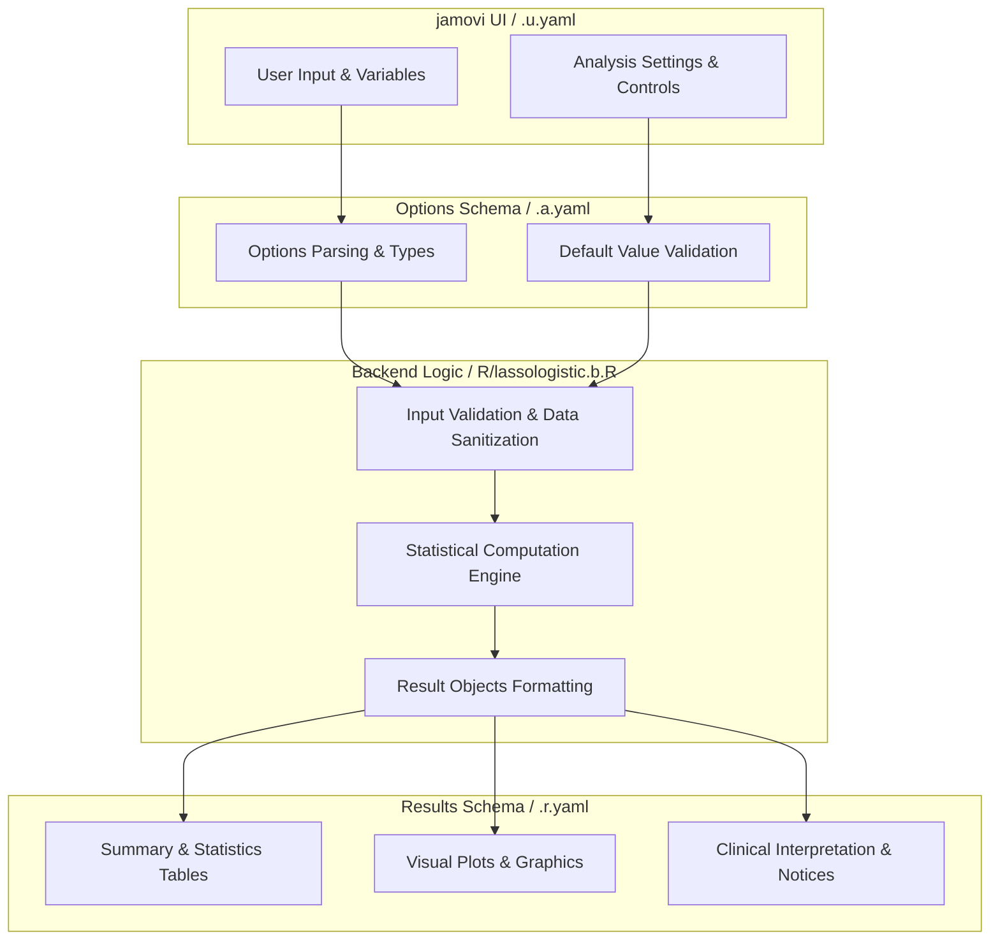
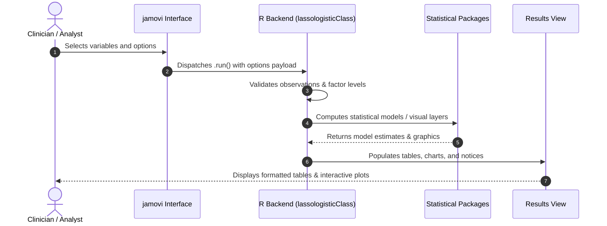

# LASSO Logistic Regression - Developer Documentation

## 1. Overview

- **Function**: `lassologistic`
- **Title**: LASSO Logistic Regression
- **Module**: `meddecide`
- **Files**:
  - `jamovi/lassologistic.u.yaml` - User Interface Definition
  - `jamovi/lassologistic.a.yaml` - Options & Schema Definition
  - `jamovi/lassologistic.r.yaml` - Results Layout & Tables
  - `R/lassologistic.b.R` - Backend Implementation
- **Summary**: Performs LASSO-penalized logistic regression for variable selection in binary classification problems. Ideal for diagnostic pathology studies that build classifiers (e.g., tumor type A vs B) with automatic feature selection.

## 1a. Changelog

- **2026-10-12, analysis 1.0.84:** independent re-audit repairs and release preparation.
  Standardization is now learned inside CV training folds and bootstrap fits using
  glmnet's population SD. The previous complete-dataset sample-SD preprocessing is
  superseded, so numerical results can change even when the options remain the same.
  Bootstrap copies of a source observation share one CV fold. Exact null optima use a
  disclosed finite lambda grid and analytic constant probabilities; numerical residues
  cannot generate scoring points. F1 is `2TP/(2TP+FP+FN)`; precision remains missing when
  no positives are predicted. Score rules retain 17 significant digits, predictor
  provenance survives name collisions, and output labels follow the chosen penalty.
  The generated wrapper and help are rebuilt from the YAML sources.

- **Date**: 2026-08-29
- **Summary**: Comprehensive documentation suite created & verified against active schemas and backend implementation.

## 2. Options Reference (`.a.yaml`)

| Option | Type | Default | Description |
| :--- | :--- | :--- | :--- |
| `data` | `Data` | Required in R | One independent observation per row |
| `outcome` | `Variable` | Required in R | Binary outcome |
| `outcomeLevel` | `Level` | Required in R | Explicit event; pass `NULL` for numeric 0/1 |
| `explanatory` | `Variables` | Required in R | At least two candidate predictors |
| `patientID` | `Variable` | `NULL` | Optional check for duplicate/missing patient IDs |
| `penalty` | `List` | `lasso` | Penalty Type |
| `alpha` | `Number` | `0.5` | Elastic Net Mixing (0=Ridge, 1=LASSO) |
| `lambda` | `List` | `lambda.1se` | Lambda Selection Method |
| `nfolds` | `Integer` | `10` | Number of CV Folds |
| `random_seed` | `Integer` | `123456` | Random Seed |
| `standardize` | `Bool` | `TRUE` | Training-fold/resample scaling; raw-unit coefficients |
| `suitabilityCheck` | `Bool` | `TRUE` | Data suitability assessment |
| `bootstrapValidation` | `Bool` | `FALSE` | Bootstrap internal validation |
| `bootstrapN` | `Integer` | `200` | Bootstrap Iterations |
| `cv_plot` | `Bool` | `TRUE` | Cross-validation plot |
| `coef_plot` | `Bool` | `TRUE` | Coefficient plot |
| `roc_plot` | `Bool` | `TRUE` | ROC curve |
| `scoringSystem` | `Bool` | `FALSE` | Scoring system |
| `scoringMethod` | `List` | `smallest` | Scoring Method |
| `scoringMaxPoints` | `Integer` | `10` | Maximum Points per Feature |
| `scoreCutMethod` | `List` | `median` | Cut Point for Continuous Predictors |
| `scoreCutPoints` | `String` | `` | Manual Cut Points |
| `scoreLookupTable` | `Bool` | `TRUE` | Score lookup table (observed event rates) |
| `predictions` | `Output` | `NULL` | Add Predicted Probabilities |
| `showSummary` | `Bool` | `FALSE` | Results summary |
| `showExplanations` | `Bool` | `FALSE` | Method explanations |
| `showMethodologyNotes` | `Bool` | `FALSE` | Detailed methodology notes |
| `includeClinicalGuidance` | `Bool` | `FALSE` | Clinical interpretation guidance |
| `showVariableImportance` | `Bool` | `FALSE` | Variable importance analysis |
| `showModelComparison` | `Bool` | `FALSE` | Model comparison analysis |

## 3. Results Definition (`.r.yaml`)

| Output ID | Type | Title | Description |
| :--- | :--- | :--- | :--- |
| `todo` | `Html` | `To Do` |  |
| `notices` | `Html` | `Important Information` |  |
| `suitabilityReport` | `Html` | `Data Suitability Assessment` |  |
| `modelSummary` | `Table` | `Model Summary` |  |
| `coefficients` | `Table` | `Selected Variables` |  |
| `performance` | `Table` | `Classification Performance` |  |
| `scoringTable` | `Table` | `Scoring System` |  |
| `scoringPerformance` | `Table` | `Scoring System Performance` |  |
| `methodComparison` | `Table` | `Scoring Method Comparison` |  |
| `lookupTable` | `Table` | `Score Lookup (Observed Event Rates)` |  |
| `validationTable` | `Table` | `Bootstrap Internal Validation` |  |
| `cv_plot` | `Image` | `Cross-validation Plot` |  |
| `coef_plot` | `Image` | `Coefficient Plot` |  |
| `roc_plot` | `Image` | `ROC Curve` |  |
| `predictions` | `Output` | `Add Predicted Probabilities` |  |
| `summaryText` | `Html` | `Results Summary` |  |
| `lassoExplanation` | `Html` | `Understanding Penalized Logistic Regression` |  |
| `methodologyNotes` | `Html` | `Methodology Notes` |  |
| `clinicalGuidance` | `Html` | `Clinical Interpretation Guidance` |  |
| `variableImportance` | `Table` | `Variable Importance Analysis` |  |
| `modelComparison` | `Table` | `Penalized vs Unpenalized Logistic` |  |

## 4. Architecture & Data Flow Diagram

## 5. Execution Sequence

## 6. Change Impact & Safety Guidelines

- **Analysis unit**: fitting, CV, and bootstrap resampling assume independent rows.
  Repeated lesions, visits, or readings must first be reduced to a justified independent
  unit or analyzed with a method that handles clustering. A supplied `patientID` is checked
  after complete-case filtering; duplicates and missing IDs stop the analysis. ID checks
  retain native numeric values, including large exactly representable identifiers.
- **Scoring contract**: score calculations and published criteria use the same raw-scale
  cutoff. Manual cuts refer to source variable names, even when model-matrix aliases need
  suffixes. Numeric two-valued predictors show the exact value that earns points. Manual
  cutoffs alone do not validate a score in another population.
- **Coefficient units**: glmnet returns coefficients per original measurement unit.
  Importance is per sample SD. When standardization is enabled, coefficient plot bars also
  show per-sample-SD effects; this display scale is distinct from glmnet's population-SD
  penalty scale.
- **Saved results**: ROC state schema 2 contains only specificity, sensitivity, AUC, and
  its interval. Legacy row-level ROC states can still be rendered. All plot data and
  dependent HTML are cleared before incomplete-input returns. Native protobuf restore,
  option-change parity, and image/PDF export require separate regression coverage.
- **Readiness**: software verification does not establish population-specific clinical
  validity. Performance tables are apparent unless explicitly labeled bootstrap corrected;
  score simplification and threshold selection still require external validation. The
  analysis remains in the `meddecideT` menu during release preparation.
- **Data Filtering**: Ensure observations with missing values are handled gracefully according to analysis options.
- **Formula Conflicts**: Use isolated environment calls or base formula methods when interacting with `ggstatsplot` or formula parsers.
- **Safe Deparsing**: Use `deparse(val)` in syntax generation (`asSource()`) to escape column names with spaces or special symbols.
