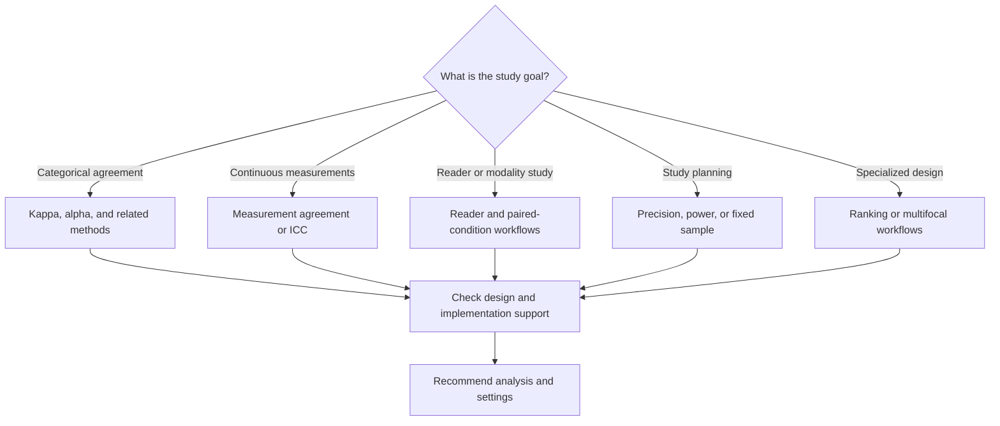
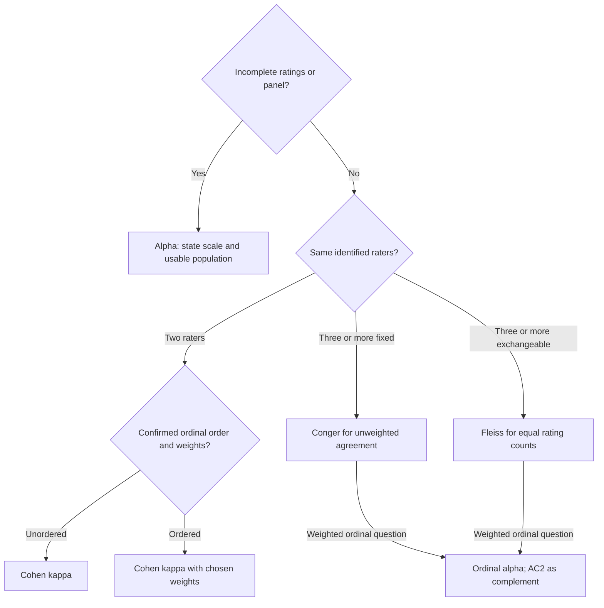
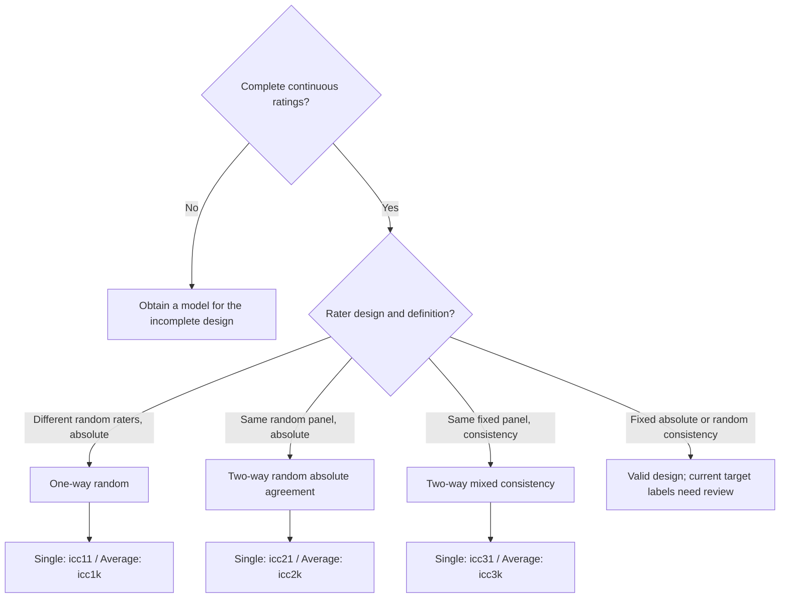
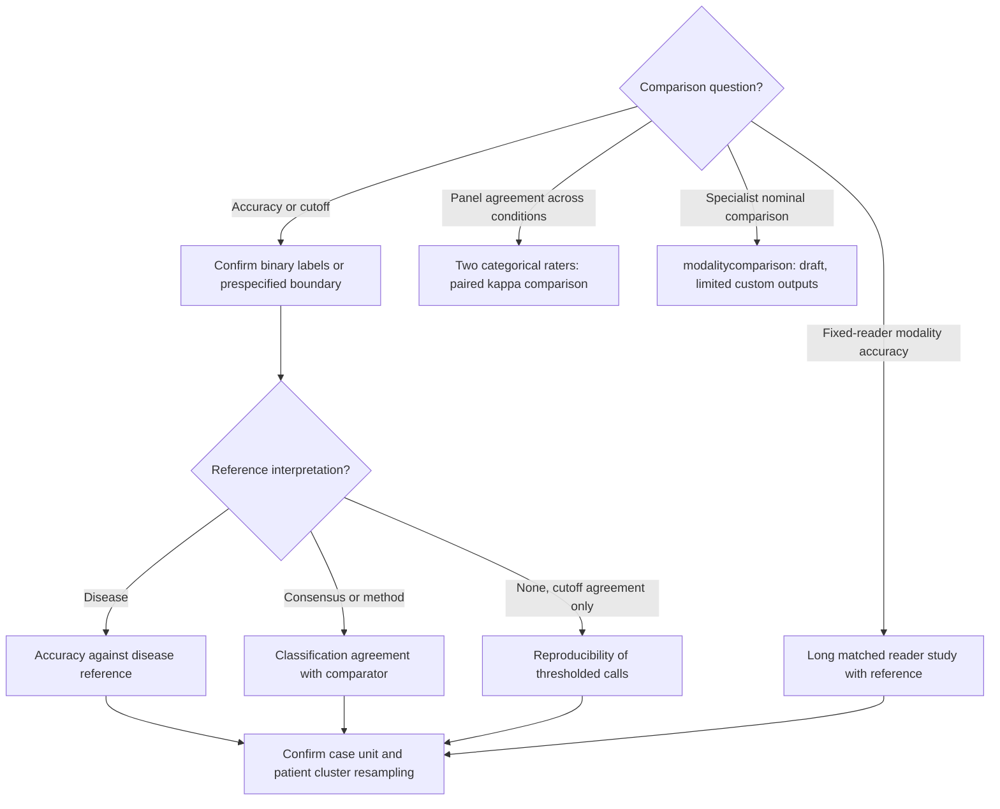
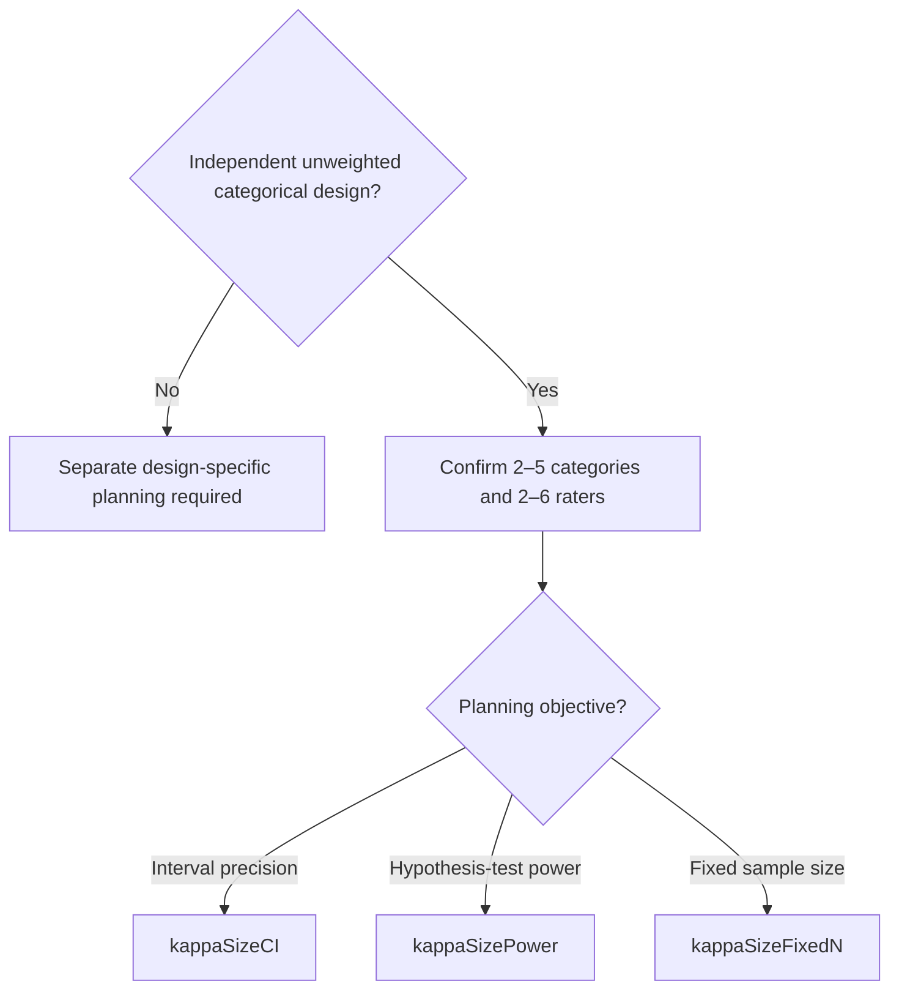

# Agreement method guide

`agreementintro` 0.0.1 · **meddecideT → Agreement → Method Guide** · testing route

The guide combines a short introduction with a study-design questionnaire and optional
data inspection. It recommends one primary analysis and at most two alternatives, with
copyable option values, preparation steps, and the target's development menu status.
It works without data. It does not calculate agreement statistics or launch analyses.

## Choosing a method



Complete **Study Question**, then its relevant **Design Details**. All design answers
start unspecified; zero raters/categories means unknown. The **Recommendation** section
shows either a method, specific information still needed, a conflict, or an unsupported
requirement. It never fills an unknown answer using a default assumption. Overview and
recommendations are visible initially; examples, glossary, pitfalls and the catalogue are opt-in.

The stable uppercase decision IDs below are also asserted in
[`test-agreementintro.R`](../tests/testthat/test-agreementintro.R).

### Categorical agreement



The diagram assumes independent cases without repeated readings, at least two raters,
and confirmed answers. Two exchangeable rating slots are routed to alpha: the current
`agreement` two-column interface calculates Cohen's kappa and cannot express that Fleiss design.

| Design | Primary settings in `agreement` | Population and interpretation |
|---|---|---|
| Two identified categorical raters | `wght = "unweighted"` | Cases observed by both raters; specialist alternative `cohenskappa` |
| Two ordinal raters | `wght = "equal"` or `"squared"` | Common full ordered scale; linear/quadratic disagreement costs must be chosen in advance |
| At least three fixed raters | `exct = TRUE`, `wght = "unweighted"` | Complete panel; Conger retains each rater's marginal distribution |
| Equal numbers of exchangeable ratings | `exct = FALSE`, `wght = "unweighted"` | Complete rating slots; Fleiss uses pooled category frequencies |
| Incomplete categorical panel | `kripp = TRUE`, `krippMethod = "nominal"` | Alpha uses available paired information; singleton-rated cases supply no pairs |
| Incomplete or multirater ordered agreement | `kripp = TRUE`, `krippMethod = "ordinal"` | Ordinal alpha uses its own distance definition; it is not linear/quadratic weighted kappa |

For an explicitly **unweighted** ordinal question, incomplete panels use nominal alpha.
Alpha tolerates missing ratings but does not make informative missingness harmless.[^alpha]
Report its population separately from the default table: two-rater kappa uses complete pairs;
multirater kappa uses all observed ratings and includes singleton-rated cases in its chance term,
while the displayed exact agreement percentage uses complete cases. Category-specific
agreement and Gwet's AC1/AC2 can complement kappa; they use different definitions and should
not be substituted solely because their values are higher.

### Continuous agreement and reliability

For two measurement methods, `MEASUREMENT_PAIR` recommends `blandAltmanPlot = TRUE`
and `linCCC = TRUE`. Specify acceptable differences in the original measurement units,
inspect difference distributions and changing variability, and report limits of agreement.
Correlation alone does not establish interchangeability.[^ba] `pathologyagreement` is a
contextual platform-comparison alternative, currently in a pending menu route.

ICC selection separates the **model**, **definition**, and **reporting unit**. A fixed-rater
consistency ICC allows systematic rater shifts; it must not be reported as absolute agreement.
Selection follows Koo and Li with the published erratum.[^icc][^erratum]



| Decision ID | Model / definition | `agreement` | `icccoeff` alternative |
|---|---|---|---|
| `ICC_1_1` / `ICC_1_K` | One-way random, absolute | `icc = TRUE`, `iccType = "icc11"` / `"icc1k"` | `icc_type = "icc1_1"` / `"icc1_k"`, `agreement_type = "consistency"` |
| `ICC_2_1` / `ICC_2_K` | Two-way random, absolute | `iccType = "icc21"` / `"icc2k"` | `icc_type = "icc2_1"` / `"icc2_k"`, `agreement_type = "agreement"` |
| `ICC_3_1` / `ICC_3_K` | Two-way mixed, consistency | `iccType = "icc31"` / `"icc3k"` | `icc_type = "icc3_1"` / `"icc3_k"`, `agreement_type = "consistency"` |

`icc = TRUE` applies to all primary configurations. In `irr::icc` the type argument does
not change the one-way calculation; report the one-way definition rather than copying the
API's consistency label. The erratum corrects the single-measure one-way denominator to
`MS_between + (k - 1) * MS_within`.[^erratum] The guide itself computes no ICC.

Fixed-rater absolute agreement and random-rater consistency are valid questions. Version one
withholds an exact recommendation because the current target labels do not unambiguously
express those combinations. It also withholds ordinary ICC, kappa and Bland–Altman settings
when patient clustering or repeated observations need an unsupported uncertainty model.

### Reader and paired-condition studies



`pathagreement` receives explicit `readerWorkflow`, `referenceType`, `readerPopulation = "shared"`,
class labels and cutoff direction. `READER_ORDINAL` uses a declared boundary category;
`READER_CONTINUOUS` uses a finite numeric cutoff and one of `ge`, `gt`, `le`, `lt`.
`READER_BINARY` preserves exact positive/negative labels. Expert consensus and another method
are comparator classifications; they are not silently declared disease truth.

For multiple specimens per patient, assign `readerCluster` and enable `readerBootstrap`.
This provides exploratory cluster-resampled intervals while retaining case/specimen estimates.
The modality workflow conditions on the selected readers, requires a reference, and does not
generalize to a random-reader population. Select `baselineModality` and `comparisonModality`
explicitly after preparing one record per case, reader and modality.

The existing paired agreement implementation compares categorical exact matches and kappa.
It cannot compare continuous ICC/CCC. For three or more raters it calculates unweighted Fleiss,
so the guide withholds a fixed-panel Conger or weighted paired recommendation (`PAIRED_MULTI_REVIEW`).
No existing statistical backend is changed by this guide.

`MODALITY_SPECIALIST` supplies a restricted `modalitycomparison` custom-category recipe for
two nominal or binary modalities: overall agreement and unweighted kappa on complete pairs.
Directional, weighted, discordance, contingency, plot and confidence-interval outputs are
disabled. The current draft alphabetically sorts custom categories and has no explicit order
setting, so ordinal custom designs receive `MODALITY_ORDER` instead of an unsafe configuration.

### Planning and specialized questions



The planning calculators additionally require defensible category proportions and anticipated
kappa. Power requires a null and alternative; fixed sample size evaluates a lower bound.
These are not interchangeable with weighted ordinal kappa or ICC planning.
The calculators use an intraclass, common-correlation kappa model with common category
probabilities. They do not automatically power unrestricted Cohen or fixed-panel Conger designs;
check the assumed margins and estimand in the selected calculator.

| Decision | Analysis and interpretation |
|---|---|
| `RANK_KENDALL` | `agreement(kendallW = TRUE)` for the same panel's complete comparable rankings; rank agreement does not mean equal values |
| `BIAS_MARGINAL` | `agreement(stuartMaxwell = TRUE)` for two paired categorical ratings; tests marginal homogeneity rather than absolute agreement |
| `FOCI_CONCORDANCE` | `multifocalconcordance`, draft; descriptive within-patient categorical concordance. `showCaseLevel`, `showKappa`, `showDiscordance` and `showSummary` are false. Sample identity alone does not establish consistent primary/comparison roles for kappa or gain/loss direction, and concordance does not establish clonality |

## Optional data inspection

Inspection starts **off**. Wide data use rater columns and optional condition-B columns.
Long data require case, reader and rating columns, with optional condition and occasion.
Patient/cluster and reference columns are optional. Selected data are never recoded or mutated.

The observed-data tables report types, full declared factor levels (display capped at 30),
distinct categories, missingness, constants, complete/overlapping rating groups, duplicate
reading keys and patient counts. Long coverage is checked within case–condition–occasion.
Exchangeable designs distinguish rater slots per case from the total number of reader identities.
Patient-specific focus labels do not imply missing ratings in other patients.
Blank ratings count as missing. Unused ordinal levels retain their order. Numeric category
codes are flagged for confirmation rather than automatically treated as measurements.

Counts and notes suggest questionnaire answers; the questionnaire remains unchanged.
Conflicts block a configuration until resolved. Selecting a reference column never answers
the reference-interpretation question. Duplicate keys are not averaged; multiple occasions
or conditions must be selected or explicitly modelled.

Identifiers are matched in their original type before building composite keys. The guide
can distinguish large numeric IDs that ordinary string formatting would merge. The current
`pathagreement` and `multifocalconcordance` importers do format IDs, so a detected collision yields
`READER_ID_REVIEW` or `FOCI_ID_REVIEW` instead of copyable unsafe settings. Prepare lossless text
IDs from the original source; ordinary numeric-to-text conversion is not sufficient.

### Empty-data example

```r
ClinicoPath::agreementintro(
  data = data.frame(), purpose = "categorical", scale = "nominal",
  nRaters = 2, panel = "same", missingRatings = "no",
  repeatedReadings = "no", analysisUnit = "independent"
)
```

This produces `CAT_TWO_NOMINAL` with Cohen's kappa as primary and `cohenskappa` as alternative.
For selected wide columns, the settings table also supplies explicit variable bindings.
Long input needing reshaping receives preparation instructions, not an invented wide dataset.

## Implementation and development status

The pure functions in [`agreementintro-rules.R`](../R/agreementintro-rules.R) keep observations,
confirmed answers and recommendations separate. The catalogue records source menu/version/status;
each decision adds supported design, exact settings, rationale, preparation and reference keys.
Schema tests detect drift in menu routes, versions, option names and enum values. Target fixtures
exercise the intended configurations; these checks do not certify every feature of a target analysis.

`agreementintro.b.R` computes decisions in `.run()`, uses native jamovi tables, and escapes
theme-neutral HTML explanations. Default full invalidation is retained. Rows, cached row names
and HTML contents are explicitly cleared on rerun, including when output is switched off.
Empty explanations send a nonempty blank HTML container; an empty string can leave the native
client's previous iframe content visible.
Long rationale, menu paths and category orders wrap in HTML paragraphs beside compact native
tables, so the output fits the results pane and PDF page. Empty recommendation tables are hidden
while the visible decision explains missing information or unsupported requirements.
No `File` or markdown `Text` elements are added; module `minApp` remains **2.7.27**.

| Target | Source menu | Status in this catalogue |
|---|---|---|
| `agreement` | meddecideT → Agreement | Testing |
| `cohenskappa` | meddecideExtraD → Diagnostic Statistics | Draft |
| `icccoeff` | meddecideExtraD → Agreement | Draft |
| `pathagreement` | OncoPathT → Agreement | Testing |
| `pathologyagreement` | OncoPathP → Agreement | Pending |
| `modalitycomparison` | meddecideExtraD → Agreement | Draft |
| `multifocalconcordance` | OncoPathD → ClinicoPath Biomarker Analysis | Draft |
| `kappaSizeCI`, `kappaSizeFixedN` | Power → Power Analysis by meddecide | Production menu route |
| `kappaSizePower` | PowerT → Power Analysis by meddecide | Testing |

These are **source routing labels**, not confirmation that the user's installed module contains
the analysis or that statistical/clinical release validation is complete. No production routing
is changed, and draft alternatives are not presented as release-ready.

Non-recommendation IDs include `START`, `DESIGN_INPUT`, `CAT_INPUT`, `CAT_ORDER`, `CAT_SCALE`,
`DATA_CHECK`, `DATA_CONFLICT`, `CLUSTER_REVIEW`, `REPEAT_REVIEW`, `MEASURE_UNSUPPORTED`,
`ICC_INPUT`, `ICC_SCALE`, `ICC_INCOMPLETE`, `ICC_ONEWAY_REVIEW`, `ICC_LABEL_REVIEW`,
`READER_INPUT`, `READER_SCALE`, `READER_REPEAT_REVIEW`, `READER_PANEL_REVIEW`, `READER_ID_REVIEW`,
`PAIRED_INPUT`, `PAIRED_SCALE`, `PAIRED_REVIEW`, `PAIRED_MULTI_REVIEW`, `MODALITY_SCALE`, `MODALITY_ORDER`,
`RANK_INPUT`, `RANK_REVIEW`, `BIAS_INPUT`, `BIAS_REVIEW`, `FOCI_SCALE`, `FOCI_ID_REVIEW`, `PLAN_INPUT`,
`PLAN_UNSUPPORTED`, and `UNSUPPORTED`. They retain no stale recommendation rows.

[^icc]: Koo TK, Li MY. A Guideline of Selecting and Reporting Intraclass Correlation Coefficients for Reliability Research. 2016. https://pmc.ncbi.nlm.nih.gov/articles/PMC4913118/
[^erratum]: Erratum to Koo and Li (2016). 2017. https://pmc.ncbi.nlm.nih.gov/articles/PMC5731844/
[^ba]: Bland JM, Altman DG. Statistical methods for assessing agreement between two methods of clinical measurement. 1986. Author-hosted corrected text: https://www-users.york.ac.uk/~mb55/meas/ba.htm
[^alpha]: Krippendorff K. Computing Krippendorff's Alpha-Reliability. https://www.asc.upenn.edu/sites/default/files/2021-03/Computing%20Krippendorff%27s%20Alpha-Reliability.pdf
