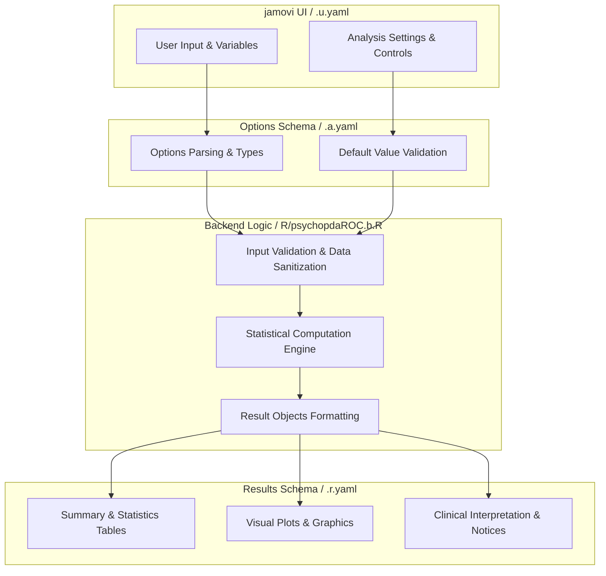
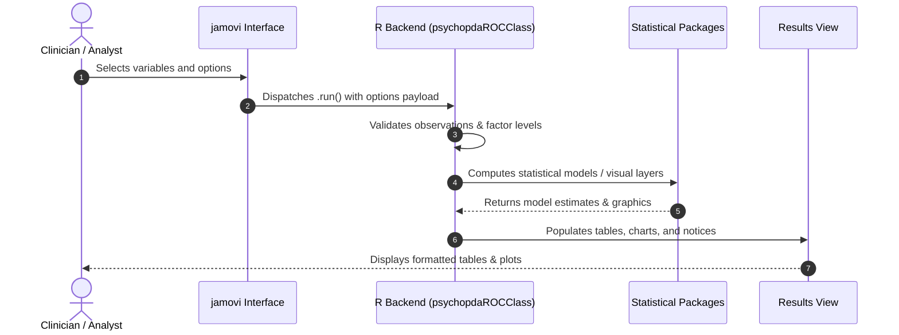

# Advanced ROC Analysis - Developer Documentation

## 1. Overview

- **Function**: `psychopdaROC`
- **Title**: Advanced ROC Analysis
- **Module**: `JamoviTest` (`meddecideT` testing route)
- **Files**:
  - `jamovi/psychopdaROC.u.yaml` - User Interface Definition
  - `jamovi/psychopdaROC.a.yaml` - Options & Schema Definition
  - `jamovi/psychopdaROC.r.yaml` - Results Layout & Tables
  - `R/psychopdaROC.b.R` - Backend Implementation
- **Summary**: Receiver Operating Characteristic (ROC) curve analysis with optimal cutpoint determination.

## 1a. Changelog

- **Date**: 2026-08-29
- **Summary**: Comprehensive documentation suite created & verified against active schemas and backend implementation.

- **Date**: 2026-10-09
- **Summary**: `positiveClass` now has `allowNone`: the box starts empty and the last level is no longer
  assumed. Nothing is computed until a level is chosen; the new **Outcome coding** table
  (`results$outcomeCoding`) lists every class level with its N and role, and the notes that used to
  suggest flipping Classification direction now say to check Positive class first.

- **Date**: 2026-10-10
- **Analysis 1.0.87**: Full-audit repairs synchronize optional outputs, saved images,
  table notes and native notices. The input helpers in `R/psychopdaROC-inputs.R`
  parse probability lists and bound decision-curve grids before allocation. Subgroup
  identity is stored separately from display labels, including literal ` ::: ` text.

- **Analysis 1.0.88**: Positive and Negative Class are explicit LevelSelectors, both
  initially empty. All calculations use only that pair; extra levels and missing
  outcomes are excluded and counted. Existing saved analyses need a Negative Class
  selection before recomputation. R calls must supply `negativeClass`, including
  `NULL` to request the waiting state. Marker pair IDs use column positions; quoted
  display names cannot redirect a comparison. Both DeLong paths preserve the chosen
  direction. The power target column is the absolute distance from AUC 0.5 actually
  used by the selected calculation, including the observed distance for post-hoc power.
  `showExplanations` starts off and controls routine procedure notes and interpretation;
  input, exclusion and inferential-scope notices remain visible. Effect-size plots
  put the quoted marker-pair names on the vertical axis. Missing DeLong inference
  serializes as missing cells, so the native display agrees with its explanatory note.

## 1b. Interpretation and input contracts

This function is for exploratory analysis of independent observations. Selected cutpoints
report apparent performance. AUC intervals and tests use asymptotic approximations;
nominal coverage is not guaranteed in small or imbalanced samples. The function does not
supply cluster-aware inference or general calibration guarantees for IDI/NRI. Prior
simulation failures remain failures; these repairs do not change their acceptance criteria.

- Positive and negative classes must be distinct, observed outcome levels. No class is inferred or pooled.
- Partial AUC requires `partialAUCfrom < partialAUCto`.
- NRI boundaries are sorted and deduplicated, with a notice when repeats are removed.
  Unusable tokens are disclosed; an empty accepted list uses explicitly labelled continuous NRI.
- ROC quantile bars use the accepted probabilities in plot state. Invalid tokens are disclosed;
  an entirely invalid list draws no bars and makes no claim that they were drawn.
- Decision curves use at most 100 thresholds. A denser request uses 100 equally spaced points
  spanning the requested range; a one-point range produces points in the plot. Invalid ranges
  use the documented default with a notice. Tables and plots share the exact grid.
- LOESS smoothing always uses LOESS. `displaySE` requests its pointwise 95% fitted-smooth
  confidence band; `showConfidenceBands` requests separate Wilson sensitivity intervals.
- `maxThresholds` is a maximum per marker, including the Youden optimum and endpoints.
- Power plots and table values use the same configuration. Degenerate correlation or target
  AUC leaves unavailable results blank with an explanation; another model is never substituted.
- Meta-analysis remains blocked without the explicit override. Disabling it or revoking that
  override clears the forest plot and hides dependent results. Correlated-marker pooling is
  exploratory and unsuitable for formal inference even when the override is enabled.

## 2. Options Reference (`.a.yaml`)

Analysis 1.0.88; all optional checkboxes default to false. `data` is supplied through the dataset, not a UI control. `positiveClass` and `negativeClass` are required arguments in R syntax; `refVar` is an optional numeric Variable.

| Option | Type | Default | Description |
|---|---|---|---|
| `manualRun` | `Bool` | `FALSE` | Run manually |
| `run` | `Action` | `NULL` | Run |
| `showExplanations` | `Bool` | `FALSE` | Show interpretation and procedure notes |
| `clinicalMode` | `List` | `basic` | Guidance Level |
| `data` | `Data` | `NULL` | Dataset |
| `dependentVars` | `Variables` | `NULL` | Test Variables |
| `classVar` | `Variable` | `NULL` | Class Variable (Gold Standard) |
| `positiveClass` | `Level` | `Required; allowNone` | Positive Class |
| `negativeClass` | `Level` | `Required; allowNone` | Negative Class |
| `subGroup` | `Variable` | `NULL` | Subgroup Variable (Optional) |
| `method` | `List` | `maximize_metric` | Cutpoint Method |
| `metric` | `List` | `youden` | Optimization Metric |
| `direction` | `List` | `>=` | Classification Direction |
| `specifyCutScore` | `String` | `` | Manual Cutpoint Value |
| `tol_metric` | `Number` | `1e-06` | Metric Tolerance |
| `break_ties` | `List` | `mean` | Tie Breaking Method |
| `allObserved` | `Bool` | `FALSE` | All observed cutpoints |
| `boot_runs` | `Integer` | `0` | Bootstrap Iterations |
| `seed` | `Integer` | `123` | Random Seed |
| `usePriorPrev` | `Bool` | `FALSE` | Prior prevalence |
| `priorPrev` | `Number` | `0.5` | Prior Prevalence Value |
| `costratioFP` | `Number` | `1.0` | Cost Ratio (FP:FN) |
| `sensSpecTable` | `Bool` | `FALSE` | Confusion matrices |
| `showThresholdTable` | `Bool` | `FALSE` | Threshold table |
| `maxThresholds` | `Integer` | `20` | Maximum Thresholds to Display |
| `delongTest` | `Bool` | `FALSE` | Compare test performance statistically |
| `plotROC` | `Bool` | `FALSE` | ROC curves |
| `combinePlots` | `Bool` | `FALSE` | Combine multiple ROC curves |
| `cleanPlot` | `Bool` | `FALSE` | Publication-ready plot |
| `showOptimalPoint` | `Bool` | `FALSE` | Mark selected cutpoint |
| `displaySE` | `Bool` | `FALSE` | Smoothed-curve confidence band |
| `smoothing` | `Bool` | `FALSE` | LOESS smoothing |
| `showConfidenceBands` | `Bool` | `FALSE` | Confidence bands |
| `legendPosition` | `List` | `right` | Legend Position |
| `directLabel` | `Bool` | `FALSE` | Direct curve labels |
| `interactiveROC` | `Bool` | `FALSE` | Additional static ROC plot |
| `showCriterionPlot` | `Bool` | `FALSE` | Sensitivity/Specificity vs threshold |
| `showPrevalencePlot` | `Bool` | `FALSE` | Predictive values vs prevalence |
| `showDotPlot` | `Bool` | `FALSE` | Test value distribution |
| `precisionRecallCurve` | `Bool` | `FALSE` | Precision-recall curve |
| `partialAUC` | `Bool` | `FALSE` | Partial AUC |
| `partialAUCfrom` | `Number` | `0.8` | Partial AUC From (Specificity) |
| `partialAUCto` | `Number` | `1.0` | Partial AUC To (Specificity) |
| `rocSmoothingMethod` | `List` | `none` | ROC Smoothing Method |
| `bootstrapCI` | `Bool` | `FALSE` | Bootstrap confidence intervals |
| `bootstrapReps` | `Integer` | `2000` | Bootstrap Replications |
| `quantileCIs` | `Bool` | `FALSE` | CIs at quantiles |
| `quantiles` | `String` | `0.1,0.25,0.5,0.75,0.9` | Quantile Positions |
| `compareClassifiers` | `Bool` | `FALSE` | Compare classifier performance |
| `calculateIDI` | `Bool` | `FALSE` | Discrimination improvement (IDI) |
| `calculateNRI` | `Bool` | `FALSE` | Reclassification improvement (NRI) |
| `refVar` | `Variable` | `NULL` | Reference Test for IDI/NRI |
| `nriThresholds` | `String` | `` | NRI Risk Categories |
| `idiNriBootRuns` | `Integer` | `1000` | IDI/NRI Bootstrap Iterations |
| `effectSizeAnalysis` | `Bool` | `FALSE` | Effect size analysis |
| `powerAnalysis` | `Bool` | `FALSE` | Statistical power analysis |
| `powerAnalysisType` | `List` | `post_hoc` | Power Analysis Type |
| `expectedAUCDifference` | `Number` | `0.1` | Expected AUC Difference |
| `targetPower` | `Number` | `0.8` | Target Statistical Power |
| `significanceLevel` | `Number` | `0.05` | Significance Level (Alpha) |
| `correlationROCs` | `Number` | `0.5` | ROC Correlation |
| `bayesianAnalysis` | `Bool` | `FALSE` | Bootstrap ROC analysis with prior weighting |
| `priorAUC` | `Number` | `0.7` | Prior AUC Belief |
| `priorPrecision` | `Number` | `10` | Prior Precision |
| `clinicalUtilityAnalysis` | `Bool` | `FALSE` | Clinical utility analysis |
| `treatmentThreshold` | `String` | `0.05,0.5,0.05` | Treatment Threshold Range |
| `harmBenefitRatio` | `Number` | `0.25` | Harm-to-Benefit Ratio |
| `interventionCost` | `Bool` | `FALSE` | Intervention cost analysis |
| `fixedSensSpecAnalysis` | `Bool` | `FALSE` | Fixed sensitivity/Specificity analysis |
| `fixedAnalysisType` | `List` | `sensitivity` | Fixed Analysis Type |
| `fixedSensitivityValue` | `Number` | `0.9` | Target Sensitivity |
| `fixedSpecificityValue` | `Number` | `0.9` | Target Specificity |
| `showFixedROC` | `Bool` | `FALSE` | Fixed point ROC curve |
| `fixedInterpolation` | `List` | `linear` | Interpolation Method |
| `showFixedExplanation` | `Bool` | `FALSE` | Analysis guide |
| `metaAnalysis` | `Bool` | `FALSE` | Meta-analysis of ROC curves |
| `metaAnalysisMethod` | `List` | `both` | Meta-Analysis Method |
| `heterogeneityTest` | `Bool` | `FALSE` | Test for heterogeneity |
| `forestPlot` | `Bool` | `FALSE` | Forest plot |
| `overrideMetaAnalysisWarning` | `Bool` | `FALSE` | Override independence warning (advanced users only) |

## 3. Results Definition (`.r.yaml`)

| Output | Type | Title | Visibility |
|---|---|---|---|
| `instructions` | `Html` | instructions | `True` |
| `procedureNotes` | `Html` | Procedure Notes | `(showExplanations)` |
| `runSummary` | `Html` | Analysis Status | `True` |
| `outcomeCoding` | `Table` | Outcome coding: which level is positive | `(classVar)` |
| `clinicalInterpretationTable` | `Table` | Clinical Interpretation | `(showExplanations)` |
| `resultsTable` | `Array` | Optimal Cutpoints and Performance | `True` |
| `sensSpecTable` | `Array` | Confusion Matrices | `(sensSpecTable)` |
| `thresholdTable` | `Table` | Detailed Threshold Performance | `(showThresholdTable)` |
| `fixedSensSpecTable` | `Table` | Fixed Sensitivity/Specificity Results | `(fixedSensSpecAnalysis)` |
| `fixedSensSpecExplanation` | `Html` | Fixed Sensitivity/Specificity Analysis Guide | `(fixedSensSpecAnalysis && showFixedExplanation)` |
| `aucSummaryTable` | `Table` | Area Under the ROC Curve | `True` |
| `delongComparisonTable` | `Table` | DeLong Test Pairwise Comparisons | `(delongTest)` |
| `delongTest` | `Preformatted` | DeLong Test Details | `(delongTest)` |
| `plotROC` | `Array` | ROC Curves | `(plotROC)` |
| `interactivePlot` | `Image` | Additional Static ROC Plot | `(plotROC && interactiveROC)` |
| `fixedSensSpecROC` | `Array` | Fixed Sensitivity/Specificity ROC Curves | `(fixedSensSpecAnalysis && showFixedROC)` |
| `criterionPlot` | `Array` | Sensitivity/Specificity vs. Threshold | `(showCriterionPlot)` |
| `prevalencePlot` | `Array` | Predictive Values vs. Prevalence | `(showPrevalencePlot)` |
| `dotPlot` | `Array` | Test Values Distribution | `(showDotPlot && !combinePlots)` |
| `dotPlotMessage` | `Html` | Dot Plot Note | `(showDotPlot && combinePlots)` |
| `precisionRecallPlot` | `Array` | Precision-Recall Curves | `(precisionRecallCurve)` |
| `idiTable` | `Table` | Integrated Discrimination Improvement (IDI) | `(calculateIDI)` |
| `nriTable` | `Table` | Net Reclassification Index (NRI) | `(calculateNRI)` |
| `effectSizeTable` | `Table` | Effect Size Analysis | `(effectSizeAnalysis)` |
| `powerAnalysisTable` | `Table` | Power Analysis Results | `(powerAnalysis)` |
| `bayesianROCTable` | `Table` | Bootstrap ROC Analysis with Prior Weighting | `(bayesianAnalysis)` |
| `clinicalUtilityTable` | `Table` | Clinical Utility Analysis | `(clinicalUtilityAnalysis)` |
| `metaAnalysisWarning` | `Html` | Meta-Analysis Warning | `(metaAnalysis)` |
| `metaAnalysisTable` | `Table` | Meta-Analysis Results | `(metaAnalysis)` |
| `decisionCurveTable` | `Table` | Decision Curve Analysis | `(clinicalUtilityAnalysis)` |
| `partialAUCTable` | `Table` | Partial AUC Results | `(partialAUC)` |
| `bootstrapCITable` | `Table` | Bootstrap Intervals (AUC and Youden Reference) | `(bootstrapCI)` |
| `rocComparisonTable` | `Table` | Classifier Performance Comparison | `(compareClassifiers)` |
| `effectSizePlot` | `Array` | Effect Size Visualization | `(effectSizeAnalysis)` |
| `powerCurvePlot` | `Array` | Power Analysis Curves | `(powerAnalysis)` |
| `bayesianTracePlot` | `Array` | Bootstrap AUC Traces | `(bayesianAnalysis)` |
| `decisionCurvePlot` | `Array` | Decision Curve Analysis | `(clinicalUtilityAnalysis)` |
| `metaAnalysisForestPlot` | `Array` | Meta-Analysis Forest Plot | `(metaAnalysis && forestPlot)` |

## 4. Architecture & Data Flow Diagram



## 5. Execution Sequence



## 6. Change Impact & Safety Guidelines

- **Data Filtering**: Ensure observations with missing values are handled gracefully according to analysis options.
- **Column lookup**: Keep the selected column names intact; use `data[[name]]` so punctuation and Unicode do not change the selected variable.
- **Safe Deparsing**: Use `deparse(val)` in syntax generation (`asSource()`) to escape column names with spaces or special symbols.


## 7. Current use and limitations

Every row must be an independent observation. Repeated lesions, blocks, slides or visits from a patient require a prespecified patient-level summary or a method that accounts for clustering. The analysis has no cluster identifier or cluster-resampling option.

The AUC estimates use the chosen direction and the explicitly selected positive and negative classes. Other outcome levels are excluded with counts. AUC intervals/tests are asymptotic: the independent 2026-10-10 audit found 90.3% coverage for nominal 95% intervals with 10 positive and 50 negative observations. A warning threshold of ten per class is not a validity guarantee. Zero-variance DeLong comparisons retain differences but leave inference unavailable.

NRI compares logistic-calibrated risks, treating differences at most `sqrt(.Machine$double.eps)` as numerical ties. This is a numerical rule, not a clinical risk-change threshold. IDI/NRI bootstrap uncertainty has not received general calibration validation. The option whose stable identifier is `bayesianAnalysis` computes a prior-weighted bootstrap summary, not a Bayesian posterior.

Selected cutpoints and their performance are estimated on the same data and require external validation. Predictive values based on an entered prevalence additionally require comparable case mix and conditional score distributions. Meta-analysis of correlated markers from the same patients is inappropriate; its independence override does not correct dependence.

Diagnostic plot controls work independently of the ROC curves checkbox. The stable option `interactiveROC` draws an additional static image and requires `plotROC`; it does not provide HTML interaction.

## 8. Reproducible example

From the repository root, run `Rscript --vanilla data-raw/psychopdaROC_release_data.R`. The generator writes matching `data/psychopdaROC_release.csv` and compressed `data/psychopdaROC_release.rda` files: 240 synthetic independent patients, two correlated markers, missing marker values, affine/inverse controls, two sites and special-character column names. No clinical data are used. Existing historical fixtures in `data-raw/non-rda/` are retained as source archives.

```r
d <- read.csv("data/psychopdaROC_release.csv", check.names = FALSE)
result <- ClinicoPath::psychopdaROC(
  data = d, dependentVars = c("marker_a", "marker_b"),
  classVar = "outcome", positiveClass = "Positive", negativeClass = "Negative", refVar = NULL,
  delongTest = TRUE, plotROC = TRUE, combinePlots = TRUE,
  showOptimalPoint = TRUE
)
```

Imported numeric value labels should be explicitly converted to a factor before selecting the two outcome levels (for example, `haven::as_factor`). Factor level labels, their order and missingness are preserved. Variable-label metadata is not an alternative lookup key: results retain the selected column names without destructive name normalization.

## 9. Reporting template and glossary

Replace the bracketed fields with the displayed results, keeping the chosen classes,
direction and complete-case counts explicit:

> Among [N positive] [positive label] and [N negative] [negative label] observations,
> [marker] had an AUC of [AUC] (95% CI [lower, upper]), with [higher/lower] values
> indicating the positive class. At the [method]-selected cutoff of [cutoff], apparent
> sensitivity was [sensitivity] and specificity was [specificity]. [N] observations
> outside the selected outcome pair or with missing required values were excluded.
> The cutoff and its performance were estimated on the same data and require validation.

Use marker-specific complete-case counts for a single-marker report and the shared
complete cases reported by DeLong for a paired comparison. State the interval method
if a fallback was used; omit unavailable intervals rather than filling them in.

| Term | Meaning in this analysis |
|---|---|
| Positive / negative class | The two explicitly selected observed outcome levels; every other level is excluded. |
| Classification direction | Whether values at or above (`>=`) or at or below (`<=`) the cutoff are called positive. |
| AUC | Probability that a randomly selected positive observation ranks ahead of a negative observation in the selected direction, counting ties as one half. |
| Sensitivity / specificity | Positive-class detection rate / negative-class exclusion rate at the displayed cutoff. |
| PPV / NPV | Probability of the selected outcome given the test classification; these depend on prevalence. |
| Apparent performance | Performance evaluated on the data that selected the cutoff, before validation. |
| Paired DeLong contrast | First marker AUC minus second marker AUC, using the same complete observations. |
| Effect-size difference | Second marker effect minus first marker effect; its descriptive size band is not a clinical decision threshold. |
| Target \|AUC - 0.5\| | Absolute AUC distance from chance actually used by the power calculation. |

See [feature mappings](psychopdaROC_documentation.md) and the [release checklist](testing_psychopdaROC.md) for verification scope. These checks do not establish clinical validation or authorize production promotion.
