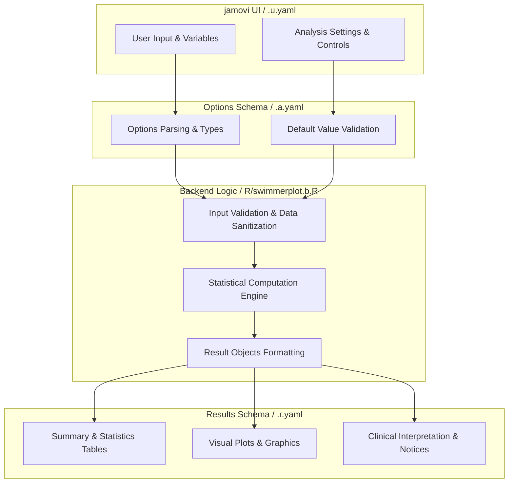
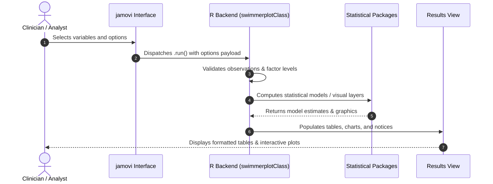

# Swimmer Plot - Developer Documentation

## 1. Overview

- **Function**: `swimmerplot`
- **Title**: Swimmer Plot
- **Module**: `OncoPath` (`menuGroup: OncoPath`, `menuSubgroup: Clinical Plots`, `version: 1.1.3`)
- **Files**:
  - `jamovi/swimmerplot.u.yaml` - User Interface Definition
  - `jamovi/swimmerplot.a.yaml` - Options & Schema Definition
  - `jamovi/swimmerplot.r.yaml` - Results Layout & Tables
  - `R/swimmerplot.b.R` & `R/swimmerplot-html.R` - Backend Implementation
- **Summary**: Creates swimmer plots using the `ggswim` package to visualize patient timelines, clinical events, milestones, censoring status arrows, and treatment responses. Computes Schemper & Smith (1996) reverse Kaplan-Meier median follow-up, Clopper-Pearson exact response rate CIs, person-time incidence metrics, and group comparison tests (log-rank or Wilcoxon rank-sum for duration; Fisher's exact or Pearson chi-square for response rates).

## 1a. Changelog

- **Date**: 2026-08-29
- **Summary**: Comprehensive documentation suite created & verified against active schemas and backend implementation.
- **Date**: 2026-11-07
- **Summary**: Updated for OncoPath 1.1.3 release: added `censorCoding` option, updated `milestone1Name`–`milestone5Name` defaults to `""` (defaulting to each selected variable's name), updated `notices` type to `Html`, removed obsolete `warningNotice` and `validationReport` result items, and documented per-patient vs per-episode response derivation and row-exclusion isolation.

## 2. Options Reference (`.a.yaml`)

| Option | Type | Default | Description |
| :--- | :--- | :--- | :--- |
| `data` | `Data` | `NULL` | The data as a data frame |
| `patientID` | `Variable` | `NULL` | Patient ID |
| `startTime` | `Variable` | `NULL` | Start Time |
| `endTime` | `Variable` | `NULL` | End Time |
| `responseVar` | `Variable` | `NULL` | Response or Status Variable |
| `censorVar` | `Variable` | `NULL` | Censoring / Event Status Variable |
| `censorCoding` | `List` | `auto` | Censoring coding (`auto`, `event_yes`, `censored_yes`, `1_2`, `2_1`) |
| `groupVar` | `Variable` | `NULL` | Grouping Variable |
| `timeType` | `List` | `raw` | Time Input Type (`raw`, `datetime`) |
| `dateFormat` | `List` | `ymd` | Date Format in Data (`ymd`, `dmy`, `mdy`, `ymdhms`, `dmyhms`, `mdyhms`) |
| `timeUnit` | `List` | `months` | Time Unit (`days`, `weeks`, `months`, `years`) |
| `timeDisplay` | `List` | `relative` | Time Display Mode (`relative`, `absolute`) |
| `maxMilestones` | `Integer` | `5` | Maximum milestones (`1` to `5`) |
| `milestone1Name` | `String` | `""` | Milestone 1 Name (defaults to variable name when empty) |
| `milestone1Date` | `Variable` | `NULL` | Milestone 1 Date |
| `milestone2Name` | `String` | `""` | Milestone 2 Name (defaults to variable name when empty) |
| `milestone2Date` | `Variable` | `NULL` | Milestone 2 Date |
| `milestone3Name` | `String` | `""` | Milestone 3 Name (defaults to variable name when empty) |
| `milestone3Date` | `Variable` | `NULL` | Milestone 3 Date |
| `milestone4Name` | `String` | `""` | Milestone 4 Name (defaults to variable name when empty) |
| `milestone4Date` | `Variable` | `NULL` | Milestone 4 Date |
| `milestone5Name` | `String` | `""` | Milestone 5 Name (defaults to variable name when empty) |
| `milestone5Date` | `Variable` | `NULL` | Milestone 5 Date |
| `showEventMarkers` | `Bool` | `FALSE` | Event markers |
| `eventVar` | `Variable` | `NULL` | Event Type Variable |
| `eventTimeVar` | `Variable` | `NULL` | Event Time Variable |
| `laneWidth` | `Number` | `3` | Lane Width (`0.5` to `10`) |
| `markerSize` | `Number` | `5` | Marker Size (`1` to `15`) |
| `plotTheme` | `List` | `ggswim` | Plot Theme (`ggswim`, `ggswim_dark`, `minimal`) |
| `colorPalette` | `List` | `default` | Color Palette (`default`, `colorblind`, `viridis`, `jamovi`, `high_contrast`) |
| `showLegend` | `Bool` | `TRUE` | Legend |
| `referenceLines` | `List` | `none` | Reference Lines (`none`, `median`, `protocol`, `custom`) |
| `customReferenceTime` | `Number` | `12` | Custom Reference Time |
| `customReferenceDate` | `String` | `""` | Custom Reference Date |
| `sortVariable` | `Variable` | `NULL` | Sort By Variable |
| `sortOrder` | `List` | `duration_desc` | Sort Order (`duration_desc`, `duration_asc`, `patient_id`, `response`) |
| `showInterpretation` | `Bool` | `TRUE` | Clinical interpretation |
| `personTimeAnalysis` | `Bool` | `TRUE` | Person-time analysis |
| `responseAnalysis` | `Bool` | `TRUE` | Response analysis |
| `showGlossary` | `Bool` | `FALSE` | Clinical glossary |
| `showCopyReady` | `Bool` | `FALSE` | Copy-ready manuscript text |
| `showAbout` | `Bool` | `FALSE` | About this analysis |
| `exportTimeline` | `Bool` | `FALSE` | Export timeline data |
| `exportSummary` | `Bool` | `FALSE` | Export summary statistics |

## 3. Results Definition (`.r.yaml`)

| Output ID | Type | Title | Description |
| :--- | :--- | :--- | :--- |
| `notices` | `Html` | `Important Information` | Structured warning, strong-warning, and info notices |
| `instructions` | `Html` | `Instructions` | Onboarding instructions shown before required variables are assigned |
| `plot` | `Image` | `Patient Timeline Visualization` | Swimmer plot (`renderFun: .plot`, 900x600) |
| `summary` | `Table` | `Timeline Summary Statistics` | Cohort counts, follow-up summaries, and response category rates |
| `interpretation` | `Html` | `Clinical Interpretation` | Clinical summary and interpretation |
| `personTimeTable` | `Table` | `Person-Time Analysis` | Follow-up person-time and incidence rates overall and by response |
| `milestoneTable` | `Table` | `Milestone Event Summary` | Summary statistics for configured milestones |
| `eventMarkerTable` | `Table` | `Event Marker Summary` | Counts, percentages, and timing for discrete event markers |
| `timelineData` | `Table` | `Export Timeline Data` | Processed timeline table (up to 500 patients) |
| `summaryData` | `Table` | `Export Summary Statistics` | Key-value summary statistics table |
| `exportInfo` | `Html` | `Export Information` | Export guidance and row-limit notes |
| `advancedMetrics` | `Table` | `Advanced Clinical Metrics` | Incident density, ORR, DCR, and median follow-up metrics |
| `groupComparisonTest` | `Table` | `Group Comparison Statistical Tests` | Duration (log-rank / Wilcoxon) and response (Fisher / Chi-square) comparisons |
| `clinicalGlossary` | `Html` | `Clinical Glossary` | Definitions of clinical and statistical terms |
| `copyReadyReport` | `Html` | `Copy-Ready Manuscript Text` | Pre-formatted manuscript methods and results paragraph |
| `aboutAnalysis` | `Html` | `About This Analysis` | Methodology and missing-data rules |

## 4. Architecture & Data Flow Diagram

## 5. Execution Sequence

## 6. Change Impact & Safety Guidelines

- **Data Filtering**: Ensure observations with missing values are handled gracefully according to analysis options.
- **Formula Conflicts**: Use isolated environment calls or base formula methods when interacting with `ggstatsplot` or formula parsers.
- **Safe Deparsing**: Use `deparse(val)` in syntax generation (`asSource()`) to escape column names with spaces or special symbols.

