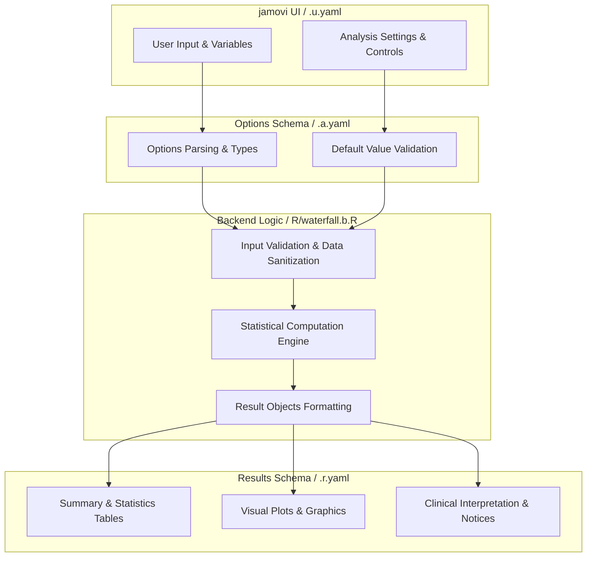
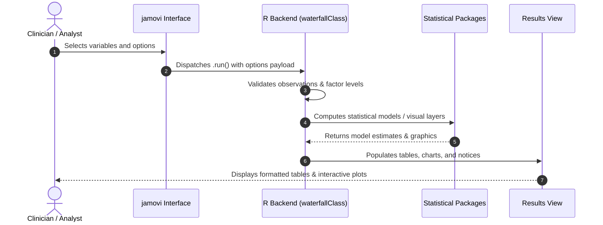

# Treatment Response: Waterfall & Spider - Developer Documentation

## 1. Overview

- **Function**: `waterfall`
- **Title**: Treatment Response: Waterfall & Spider
- **Module**: `OncoPath` (`menuGroup: OncoPath`, `menuSubgroup: Clinical Plots`, `version: 1.1.3`)
- **Files**:
  - `jamovi/waterfall.u.yaml` - User Interface Definition
  - `jamovi/waterfall.a.yaml` - Options & Schema Definition
  - `jamovi/waterfall.r.yaml` - Results Layout & Tables
  - `R/waterfall.b.R` - Backend Implementation
  - `jamovi/js/waterfall.events.js` - Client-side UI Events
- **Summary**: Use this when you have one tumour burden number per patient: either a percent change from baseline you have already calculated (one row per patient), or a single measurement recorded at each visit (one row per patient per visit). It draws waterfall and spider plots, assigns each patient a best response from their largest shrinkage from baseline (up to the first progression), and reports ORR and DCR with exact Clopper-Pearson binomial confidence intervals, group comparison, time to first response (TTR), and censoring-aware Kaplan-Meier duration of response (DoR). When a time variable is supplied, progression is measured against the patient's smallest recorded burden (nadir), not against baseline. Categories are named CR, PR, SD and PD and the thresholds are adapted from RECIST v1.1, but this is NOT a RECIST v1.1 implementation: because it never sees individual lesions it cannot sum target lesions, detect a new lesion, or judge non-target progression, and it cannot apply the 4-week confirmation rule itself (you may supply your own confirmation or response-category override column).

## 1a. Changelog

- **Date**: 2026-08-29
- **Summary**: Comprehensive documentation suite created & verified against active schemas and backend implementation.
- **Date**: 2026-11-07
- **Summary**: Updated for OncoPath 1.1.3 release: added `measurementUnit`, `showClinicalSummary`, and `showAboutAnalysis` options, removed obsolete `naturalLanguageSummary` and `explanations` result items, removed forward references to unreleased analyses, and documented per-visit `responseCategoryVar` handling (best response up to first PD, post-PD shrinkage cutoff, and TTR/DoR propagation) and the percent-of-baseline scale guard.

## 2. Options Reference (`.a.yaml`)

| Option | Type | Default | Description |
| :--- | :--- | :--- | :--- |
| `data` | `Data` | `NULL` | The data as a data frame |
| `patientID` | `Variable` | `NULL` | Patient ID Variable |
| `responseVar` | `Variable` | `NULL` | Response Value (Raw or Percentage) |
| `timeVar` | `Variable` | `NULL` | Time Variable (Required for Spider Plot and Raw Input) |
| `groupVar` | `Variable` | `NULL` | Group Variable |
| `inputType` | `List` | `percentage` | Data Input Type (`percentage`, `raw`) |
| `measurementUnit` | `List` | `unspecified` | Unit of raw measurements (`unspecified`, `mm`, `cm`; enables the RECIST v1.1 >= 5 mm absolute increase rule for PD) |
| `sortBy` | `List` | `response` | Sort By (`response`, `id`) |
| `sortDirection` | `List` | `conventional` | Sort Direction (`conventional`, `reverse`) |
| `showBaseline` | `Bool` | `TRUE` | Baseline (Y = 0) line |
| `confirmationVar` | `Variable` | `NULL` | Confirmation Status (optional) |
| `ongoingVar` | `Variable` | `NULL` | On-Treatment / Ongoing (optional) |
| `responseCategoryVar` | `Variable` | `NULL` | Response Category Override (optional; supports patient-level or per-visit CR/PR/SD/PD/NE responses) |
| `showCategoryLabels` | `Bool` | `FALSE` | Response category above each bar |
| `showSpiderLabels` | `Bool` | `FALSE` | Patient ID labels on spider lines |
| `annotationVars` | `Variables` | `NULL` | Annotation Tracks (below the bars) |
| `showThresholds` | `Bool` | `TRUE` | Response thresholds (-30% / +20%) |
| `labelOutliers` | `Bool` | `FALSE` | Label large changes |
| `showMedian` | `Bool` | `FALSE` | Median response |
| `showCI` | `Bool` | `FALSE` | Bootstrap 95% confidence interval for the median response |
| `minResponseForLabel` | `Number` | `50` | Minimum Response for Labels (percent, `0` to `100`) |
| `colorBy` | `List` | `recist` | Color By (`recist`, `group`) |
| `colorScheme` | `List` | `jamovi` | Color Scheme (`jamovi`, `recist`, `simple`, `colorful`, `colorblind`) |
| `barAlpha` | `Number` | `1` | Bar Transparency (`0` to `1`) |
| `barWidth` | `Number` | `0.7` | Bar Width (`0.1` to `1`) |
| `showWaterfallPlot` | `Bool` | `TRUE` | Waterfall plot |
| `showSpiderPlot` | `Bool` | `FALSE` | Spider plot |
| `spiderColorBy` | `List` | `response` | Spider Plot Color By (`response`, `group`) |
| `spiderColorScheme` | `List` | `classic` | Spider Plot Color Scheme (`classic`, `jamovi`, `colorful`, `colorblind`) |
| `timeUnitLabel` | `List` | `generic` | Time unit (`generic`, `days`, `weeks`, `months`, `years`) |
| `generateCopyReadyReport` | `Bool` | `FALSE` | Copy-ready report |
| `showClinicalSignificance` | `Bool` | `FALSE` | Clinical significance assessment & glossary |
| `showConfidenceIntervals` | `Bool` | `FALSE` | Confidence intervals for clinical metrics |
| `enableGuidedMode` | `Bool` | `FALSE` | Analysis checklist |
| `showExplanations` | `Bool` | `FALSE` | Analysis explanations (displays Clinical Summary and About This Analysis) |
| `showClinicalSummary` | `Bool` | `FALSE` | Clinical summary |
| `showAboutAnalysis` | `Bool` | `FALSE` | About this analysis |
| `showResponseDuration` | `Bool` | `FALSE` | Time-to-response & duration of response (KM) |
| `addResponseCategory` | `Output` | `NULL` | Add Response Category to Data |
| `seed` | `Integer` | `123` | Random seed (used for the bootstrap CI of the median response) |

## 3. Results Definition (`.r.yaml`)

| Output ID | Type | Title | Description |
| :--- | :--- | :--- | :--- |
| `guidedAnalysis` | `Html` | `Analysis Checklist` | Step-by-step analysis checklist when `enableGuidedMode` is active |
| `todo` | `Html` | `Treatment Response Analysis Guide` | Onboarding guide shown before required variables are assigned |
| `todo2` | `Html` | `Validation Messages` | Fatal validation messages when data checks fail |
| `notices` | `Html` | `Important Information` | Structured warning, strong-warning, and info notices |
| `clinicalSummary` | `Html` | `Clinical Summary` | Cohort response distribution and clinical summary |
| `aboutAnalysis` | `Html` | `About This Analysis` | Methodology, RECIST v1.1 threshold adaptations, and limitations |
| `summaryTable` | `Table` | `Response Categories (threshold-based, not full RECIST v1.1)` | Counts and percentages for CR, PR, SD, PD, and Unknown / not evaluable |
| `personTimeTable` | `Table` | `Person-Time Analysis` | Follow-up person-time, time to response, and KM DoR by category |
| `clinicalMetrics` | `Table` | `Clinical Response Metrics` | Evaluable N, ORR, DCR (evaluable and all-patients), median TTR, and KM median DoR |
| `waterfallplot` | `Image` | `Waterfall Plot` | Waterfall plot (`renderFun: .waterfallplot`) |
| `copyReadyReport` | `Html` | `Copy-Ready Report Sentences` | Pre-formatted manuscript methods and results text |
| `clinicalSignificance` | `Html` | `Clinical Significance Assessment` | Context-aware response rate interpretation |
| `clinicalGlossary` | `Html` | `Clinical Terms & Definitions` | Glossary of response and time-to-event terms |
| `enhancedClinicalMetrics` | `Table` | `Confidence Intervals for Response Rates` | Exact Clopper-Pearson 95% CIs for CR, PR, SD, PD, ORR, and DCR |
| `groupComparisonTable` | `Table` | `Group Comparison Analysis` | Per-group N, ORR, DCR, and median change |
| `groupComparisonTest` | `Table` | `Group Comparison Statistical Test` | Fisher's exact or Chi-square test (and OR for 2 groups) + Mann-Whitney / Kruskal-Wallis test |
| `spiderplot` | `Image` | `Spider Plot - Response Over Time` | Longitudinal spider plot (`renderFun: .spiderplot`) |
| `responseDurationTable` | `Table` | `Time-to-Response & Duration of Response` | Median TTR, naive median DoR, and censoring-aware Kaplan-Meier median DoR |
| `addResponseCategory` | `Output` | `Add Response Category to Data` | Writes each patient's final response category back to the dataset |

## 4. Architecture & Data Flow Diagram

## 5. Execution Sequence

## 6. Change Impact & Safety Guidelines

- **Data Filtering**: Ensure observations with missing values are handled gracefully according to analysis options.
- **Formula Conflicts**: Use isolated environment calls or base formula methods when interacting with `ggstatsplot` or formula parsers.
- **Safe Deparsing**: Use `deparse(val)` in syntax generation (`asSource()`) to escape column names with spaces or special symbols.

